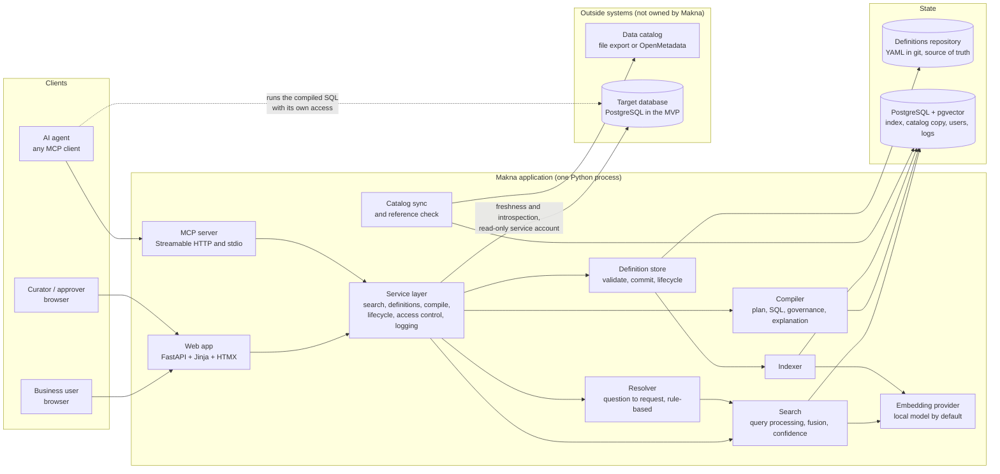

# Architecture

Status: design output (2026-11-11). Written in the design session for the build team. Decisions and their reasons are in `docs/DECISIONS.md` (records DR-1 to DR-13); this document describes the result. Work packages are in `docs/PLAN.md`.

If you find that this document contradicts another source of truth, say so in your report (see `CLAUDE.md`).

## 1. The design in one page

Makna is **one Python application and one PostgreSQL database**, placed between a data catalog and a query engine on one side and people and agents on the other.

- **Meaning lives in YAML files in a git repository** (the "definitions repository"). One file holds one object: a domain, an entity, a metric, or a glossary term. PostgreSQL holds an index built from those files. The index can always be rebuilt from the files.
- **Physical metadata comes from the catalog** through a connector and is copied into PostgreSQL at each sync. Makna never edits it.
- **Search** is one SQL statement that fuses full-text search and vector search over the index.
- **The compiler** turns a structured request (metric, dimensions, filters, time range, grain) into SQL for the target engine (PostgreSQL in the MVP, DuckDB in tests; D-22) by building a syntax tree with sqlglot. It joins only along relationships declared in approved entity files, aggregates each input of a metric separately, and enforces masking.
- **Makna compiles; it never runs a caller's query** (D-21). Agents and people run the compiled SQL with their own tools and their own access to the engine.
- **No language model runs inside Makna in the MVP.** The calling agent is the language model. Makna gives it search results, definitions, and a compiler, and tells it honestly when nothing matches.
- **Three ways in, one service layer.** The web app (server-rendered HTML), the MCP server, and the command line all call the same Python functions in `makna.services`. Rules such as "agents see approved definitions only" live in that layer, not in the interfaces.

Terms used in this document:

- **Official file**: `<name>.yaml`, the approved (or deprecated) version of an object.
- **Proposal file**: `<name>.draft.yaml`, a draft or in-review change to an object, next to its official file if one exists.
- **Simple metric**: a metric built from exactly one measure. Ratio and derived metrics are built from other metrics. The simple metrics that a metric finally depends on are its **inputs**.
- **Balance measure**: a measure taken at snapshot dates that must not be added up over time, such as outstanding principal (`semi_additive: last` in the schema).
- **Pin**: an entry in a metric's `join_paths` that says which join path to use when there is more than one.

## 2. Components



| Component | Python package | What it does | Does not do |
|---|---|---|---|
| Models | `makna.model` | Pydantic models for definitions, catalog metadata, requests, and responses. The shared vocabulary of all other packages. | No I/O. |
| Definition store | `makna.definitions` | Loads YAML, validates it (JSON Schema, then cross-file rules), writes files, commits to git, runs lifecycle transitions. | Does not query PostgreSQL except through the indexer hook. |
| Catalog connectors | `makna.catalog` | The connector interface, the file connector, the OpenMetadata connector, the sync job, and the reference check. | Never writes to a catalog. |
| Engine connectors | `makna.engine` | The engine interface and the PostgreSQL connector: list tables and columns, and the freshness query, with a read-only service account. | Never runs a caller's query or SQL (D-21). |
| Index | `makna.index` | Database tables (SQLAlchemy Core), migrations (Alembic), and the indexer that turns definitions and catalog metadata into index rows and search documents. | |
| Search | `makna.search` | Embedding providers, query processing, the hybrid search statement, and the confidence band. | |
| Compiler | `makna.compiler` | Join graph, request planning, SQL generation with sqlglot, governance checks, explanation. Pure functions over models: no database, no network. | Does not execute SQL. |
| Resolver | `makna.resolve` | Turns a question in words into a request, using search results and rules. Used by the test bench and by one eval. | No language model in the MVP. |
| Services | `makna.services` | The use cases: `search`, `get_definition`, `list_related`, `compile_query`, proposal and approval actions, user and token management, audit and tool-call logging. Applies access rules. | |
| MCP server | `makna.mcp` | Four read-only tools over `makna.services`. | No logic of its own. |
| Web app | `makna.web` | Routes, templates, static files. | No logic of its own beyond form handling. |
| Application | `makna.app` | The composition root: `create_app()` builds the one FastAPI application that `makna serve` runs, and mounts the web routes and the MCP server. | No logic of its own. |
| CLI | `makna.cli` | `makna` command: validate, sync, index, serve, user and token management, freshness. | |

**Dependency rule.** `model` depends on nothing. `compiler`, `definitions`, `catalog`, `engine`, `search`, and `index` depend on `model` (and `index`/`search` on the database); `index` and `search` import nothing else from Makna, so neither imports the other: the `EmbeddingProvider` protocol and the search settings are in `makna.model.search`, the indexer receives definitions as `makna.model.objects.DefinitionObject` values (built from files by `makna.definitions.loader.definition_objects`), and `search` reads the index tables with SQL text; `catalog` also uses `index` for the catalog tables it writes (`makna.index.tables`, `makna.index.db`), and imports neither `definitions`, `compiler`, nor `services`. `resolve` depends on `search` (the hits and the shared vocabulary), on `compiler` (the dimensions a metric offers, and the snapshot type), and on `model`. `services` depends on all of them. `mcp` and `web` depend on `services` only (plus `model` and `config`). `app` is the composition root and the only module that imports `web` and `mcp` (and `services`, `model`, `config`), except that `cli` imports the one module `makna.mcp.bridge`, which imports nothing from Makna. `cli` may also import `definitions`, `catalog`, `index`, `search`, `engine`, and `app` (so that `serve` starts the application without importing `web` or `mcp`), because operator commands (`validate`, `catalog sync`, `index build`, `search`, `catalog compare`) are built before the service layer exists; commands that act for a user or an agent (user and token management, `resolve`) go through `services`; `makna validate` also runs V19 through `makna.services.examples`, a module of the service layer because it needs both `definitions` and `compiler`, which may not import each; and `makna mcp` is only an HTTP bridge (section 12). A test in WP-01 enforces this with an import check.

## 3. Repository layout

```
pyproject.toml              one project, distribution name makna-sl, import package makna (D-9, P-8)
src/makna/                  the packages in the table above
semantic/schema/            makna.schema.json and small validated examples
semantic/definitions/       the sample definitions (lending/...), seed for the dev stack
data/generator/             the seeded synthetic data generator
data/catalog/               lending.catalog.yaml, the file-based catalog export
data/generated/             generator output (not committed)
evals/                      golden set, reference SQL, runners
deploy/                     docker-compose.yml, container files, the init runner (deploy/init.py), PostgreSQL role setup
alembic.ini                 points Alembic at the migrations in src/makna/index/migrations
tests/                      unit/ (DuckDB in-process), integration/ (needs PostgreSQL), engine/ (needs the sample data in PostgreSQL)
spikes/                     design-session experiments, not product code
docs/                       this pack, plus docs/notes/
```

## 4. Data flows

### 4.1 A search (web or MCP)

1. The caller sends a query string, optional `kinds`, and optional `domain`. The service layer adds what the caller may see: agents (tokens) and viewers get approved objects only; curators, approvers, and admins also get drafts.
2. **Query processing** (`makna.search.query`): lower-case, split into words, drop English and Indonesian stop words. Build a full-text query that ORs the remaining words (prefix match for words of four or more letters). Compute the query embedding with the configured provider.
3. **One SQL statement** (section 8.2) ranks documents by full-text score and by vector distance, fuses the two rankings, applies the status and kind weights, and returns the top results with both raw scores.
4. **Confidence** (section 8.3): the service computes how much of the query's informative vocabulary appears in the names and synonyms of the top results, and labels the result set `high`, `medium`, or `low`.
5. The service loads the brief form of each hit from `semantic_object` and returns hits plus the confidence band and guidance text.
6. The call is written to `tool_call_log` (section 14).

### 4.2 A compiled query (web test bench or MCP)

1. The caller sends a request: `metric`, `dimensions`, `filters`, `grain`, `time_start`, `time_end`, `limit`.
2. The service loads the approved model snapshot (the official content of approved and deprecated entities and metrics, from `semantic_object`, with the open reference issues and the levels the catalog derives for columns; cached in memory and refreshed when `index_state.definitions_version`, the latest successful catalog sync, or the open reference issues change). It never holds drafts or proposals, for any role. It also carries its own catalog state (whether a catalog is synced, and the tables the catalog covers), read in the same transaction. Every service that reads the snapshot (`get_definition` and `compile_query`; `search` and `list_related` read the index directly) waits for a rebuild when the stored state is newer than its snapshot (one thread builds, the others wait; about 10 ms on the sample model) and takes all its facts from that one snapshot. If the rebuild fails, the callers that waited for it share that failure (`INTERNAL`) instead of each trying again. If no catalog has been synced, or the catalog does not cover a table the plan reads, the service refuses (`CATALOG_NOT_SYNCED`, D-30).
3. **Plan** (`makna.compiler.plan`): check the metric is approved and has no open reference issue; expand it to its inputs; for every input resolve the join path to every entity named in a dimension or filter; check grain and filter values; apply sensitivity rules. Any failure is a structured error with a code (section 7.7), and nothing is generated.
4. **Generate** (`makna.compiler.sqlgen`): build one aggregate subquery per input, combine the inputs, compute the metric, order, and limit (section 7.5).
5. **Verify** (`makna.compiler.governance`): walk the finished syntax tree and fail if a personal column appears outside a mask or an aggregate, except where the governance policy allows it (section 7.6, D-29).
6. Return the SQL text, the result columns, the explanation steps, and warnings.
7. The call is written to `tool_call_log`.

Makna stops there (D-21). The caller runs the SQL with its own tool and its own access to the engine, for example an agent's database tool. Makna never sees the rows.

Details settled in WP-12 (each is explained where it belongs; this is the list):

- **Caller.** `makna.services.Caller` is a frozen dataclass: `user_id`, `role` (`viewer`, `curator`, `approver`, `admin`), `channel` (`mcp`, `web`, `cli`), `teams`, and `token_id`. A caller with a `token_id` acts as a `viewer` at most (`effective_role`) and uses the "agent token" column of the permission matrix (section 11). An unknown role or channel is a `ValueError`.
- **Services.** `makna.services.Services` offers `search`, `get_definition`, `list_related`, and `compile_query`, each taking a `Caller` first. No service executes SQL on the engine or accepts SQL text (D-21). `makna.app.create_app` builds one `Services` from the settings (database engine, embedding provider, snapshot cache, governance policy) and keeps it on `app.state.services`; it opens no database connection, so `/healthz` answers while the database is down, and a missing variable, an embedding provider or a dialect that cannot be built is a `ConfigError` at start.
- **Service errors** `NOT_FOUND`, `PERMISSION_DENIED`, `INVALID_INPUT`, `CATALOG_NOT_SYNCED`, `INTERNAL` (section 12); compiler errors pass through. A `GovernanceError` about a personal column is `BROKEN_REFERENCE` with the reference issue `R05` (section 5.3).
- **Input bounds** (section 12): query 1 to 500 characters, `limit` 1 to 10, `kinds` from the five kinds of `makna_search`, `id` at most 200 characters of the form `kind:name`, `relation` from the list of section 12, and the compile request through `QueryRequest`.
- **Governance policy.** The configured `GovernancePolicy` is passed to every compile and to every `available_dimensions` call; no input can change it. The indexer stores the available dimensions it computed under it and the policy's fingerprint (section 5.4); a service that runs under another policy computes them from the snapshot and logs one warning.
- **Catalog (D-30), globally and per table.** A synced catalog is a successful `sync_run` and at least one `catalog_dataset` not marked removed; without one, `compile_query` is `CATALOG_NOT_SYNCED` and the other services still work. The check is also **per table**: after planning, `compile_query` refuses with `CATALOG_NOT_SYNCED` (`details.tables` names them) when any table the plan reads, joins included, has no live `catalog_dataset`, because the column checks (R02) and the derived levels come from the catalog table by table. A partial export, or a sync of another source, therefore cannot make a query compile without the levels of its tables.
- **No answer of any kind without a log row.** If the `tool_call_log` row of a call cannot be written, the call is `INTERNAL` with no details, whether it would have answered or refused; only `INTERNAL` itself, when even it cannot be logged, is returned without a row. Building the request of the row never fails a call: a field that cannot be redacted or stored becomes `[unloggable]` and the other fields are kept; `{"unloggable": true}` for the whole request is a last resort. Text with a NUL or another control character (tab, newline and carriage return are fine) or an unpaired surrogate is `INVALID_INPUT` naming the field, in every text input including the compile request.
- **Compile request bounds** (`INVALID_INPUT` naming the field): at most 20 dimensions, 20 filters, 100 values in a list, and no string over 200 characters. Stored text is clipped to its limit after normalisation, so a row stays small.
- **Redaction** first normalises (NFKC, invisible characters dropped, `%xx` and HTML references decoded until the text stops changing (at most 5 passes; text still changing after that is stored as `[REDACTED]`); invisible, format and combining characters (Unicode Cf, Mn, Me) and noncharacters removed; control characters, unpaired surrogates and private-use characters replaced, again after the last decoding) and stores the redacted normalised text; ISO dates and times are spared only when no digit leads into or follows them through the separators the digit rule joins (a separator is one to three characters that are neither letters nor digits); a run of 9 or more digits is caught across up to three spaces, `.`, `-`, `/`, `_`, `,` or dashes; emails also in the forms `name at domain dot com`, `(at)`, `[at]`, `%40`.
- **Known limits (documented, not fixed in WP-12).** (1) Stale search documents: after a catalog tag makes a dimension personal, its search document keeps the values until the next `makna index build`; a search for a value word can still return the dimension as a hit (no value is returned). (2) R05 messages and the catalog issues name a personal column by table and column; names are not values, and the column's name is not treated as secret. (3) The foreign keys of `tool_call_log` lose the row when the user or token no longer exists, which now makes the call `INTERNAL`: WP-12B must keep log rows when users or tokens are deleted (revoke or soft-delete them, or `ON DELETE SET NULL` with a label), and must not delete a token that has a call in flight.
- **Tool-call log.** One row per call, written after it in its own transaction; `status` is `ok`, `refused`, or `error` (`INTERNAL`); the request is redacted (section 14); a filter value is stored only for a dimension known to be non-personal.


## 5. The semantic model

The schema is `semantic/schema/makna.schema.json` (JSON Schema 2020-12). Validated examples are in `semantic/schema/examples/`. Decision record DR-1 explains why this is Makna's own format and how it relates to Apache Ossie and MetricFlow.

### 5.1 Objects

| Kind | What it is | Key fields |
|---|---|---|
| `domain` | A business area used for browsing. | name, label, description |
| `entity` | A business object backed by one physical table. | `source.table`, `primary_key`, `dimensions`, `measures` (each with its `rules`), `relationships`, `rules` |
| `metric` | A number people ask for. | `type` (`simple`, `ratio`, `derived`), `measure` or `numerator`/`denominator` or `expr`/`inputs`, `filters`, `join_paths`, `format`, `time_grains`, `example_questions`, `example_requests`, `caveats` |
| `glossary_term` | A business word and its meaning. | `related` (objects it explains), `catalog_term` |

Every object carries `name`, `label`, `description`, `owner`, `status`, `sensitivity`, and `synonyms` by language (SEM-2). Metrics, entities, and glossary terms must have at least one English (`en`) and one Indonesian (`id`) synonym (D-19); for domains, dimensions, and rules synonyms are optional. **Dimensions, measures, and relationships are parts of an entity**, not separate files: each has its own description and (for dimensions) synonyms, sensitivity, and masking, and inherits owner and status from its entity.

Inside an entity:

- A **dimension** is a scalar SQL expression over the entity's own columns, with a type (`categorical`, `time`, `boolean`, `numeric`). Categorical dimensions may list their `values` so that people and agents can write filters without querying.
- A **measure** is an aggregation (`sum`, `count`, `count_distinct`, `avg`, `min`, `max`) of an expression over the entity's own columns, with an optional row filter, an optional list of rules, and exactly one `time_dimension`: the official date for that measure. `semi_additive: last` marks a balance measure.
- A **rule** is a named boolean condition over the entity's own columns, written once and reused (D-17), for example `non_performing: days_past_due > 90`. A measure uses rules with `rules: [non_performing, in_book]` (names of rules of its own entity): **every** rule must hold, and the measure is then the business number by itself, so a metric does not repeat them. The older `rule: name` key still reads as `rules: [name]`; giving both is an error, and new files write `rules`. A metric uses a rule in `filters` as `{rule: entity.rule}`, on its measure's entity or an entity reachable from it. When a rule changes, review lists every measure and metric that uses it.
- A **relationship** is an approved join from this entity (the "many" side) to another entity (the "one" side), by key columns, and its `to` columns are exactly the target's `primary_key` (V21, and R06 against the catalog), so a join finds one row. These are the only joins the compiler will ever write. **A relationship's name is its role**: `contract` on a payment and on an installment both mean "the contract of this row", and `booking_branch` and `servicing_branch` are two meanings of "branch". Approval reviews the name, because the ratio rule of section 7.4 compares it.

A **metric** is one of:

- `simple`: one measure (`entity.measure`), optional `filters` that are part of the definition (structured filters or rule references; they may use dimensions and rules of joined entities), and optional `join_paths` pins.
- `ratio`: `numerator` and `denominator`, each the name of another metric. A zero denominator gives NULL.
- `derived`: an arithmetic `expr` over the metrics listed in `inputs`.

Every approved metric also has at least one **example request** (D-18): a business question and the structured request (section 7.1, without `metric`) that answers it. It is a verified example an agent can copy, and it must compile (V19), so it cannot drift from the definition.

Expressions (`expr` and `filter` on dimensions, measures, and rules) are plain SQL that sqlglot parses and prints for the target dialect (D-22). **They are written in sqlglot's neutral SQL, not in PostgreSQL** (D-32 ruling 2): Makna reads them with sqlglot's default parser, which differs from PostgreSQL in a few spellings, so V05 refuses what the two readings disagree on, with a message that says what to write instead: `^` (a power in PostgreSQL, an exclusive or in neutral SQL; write `POWER(x, y)`), the type names `int2` and `int4` (write `SMALLINT`, `INTEGER`; `int8` is read as `TINYINT` and refused with the other casts to it), and any expression whose PostgreSQL text differs between the neutral parse and a PostgreSQL parse (`CONCAT(a, b)`, which neutral SQL writes as `a || b` and PostgreSQL does not read the same on NULL, is one). Two differences that mean the same are not counted: division (the neutral reading adds a floating-point cast, deliberately, see section 7.5) and `IS NOT NULL`. Some common functions are refused for the same reason, because the two readings print them differently or the engines give different answers: `CONCAT(a, b)` (write `a || b`, or `COALESCE` each part), `DATE_PART('year', d)` (write `EXTRACT(YEAR FROM d)`), `BTRIM(x)` (write `TRIM(x)`), `DATE_ADD`, `DATE_SUB`, and `TS_OR_DS_ADD` with no unit (PostgreSQL adds seconds, DuckDB days; write `d + INTERVAL '1 day'`), `DATEDIFF` (write `d1 - d2`), `GREATEST` and `LEAST` (PostgreSQL skips NULL arguments, DuckDB returns NULL; write a `CASE` expression), `ROUND` (PostgreSQL rounds a double half to even, DuckDB half away from zero; for a decimal, `FLOOR(x * 100 + 0.5) / 100` is explicit), `SUBSTRING` unless its start is a positive and its length a non-negative literal whole number (a start below 1 counts from the other end on DuckDB), `EXTRACT` of `SECOND`, `EPOCH`, `MILLISECOND`, or `TIMEZONE` (fractions and availability differ; the parts that agree are year, month, day, hour, minute, quarter, week, dow, doy, microsecond, decade, century, millennium, isodow, and isoyear), `SPLIT_PART` unless its delimiter is a non-empty text literal and its field a non-zero whole number literal (an empty delimiter splits into characters on DuckDB and returns the whole text on PostgreSQL, and field 0 is an error on PostgreSQL), `TRY_CAST` and a JSON cast, and casts to `CHAR`, `TINYINT`, `TIMESTAMPTZ`, or a text type with a length (`VARCHAR(2)`), and `DAYOFWEEK`, `DAYOFMONTH`, `DAYOFYEAR`, `QUARTER`, and `WEEK` (PostgreSQL has no such functions; write `EXTRACT(DOW FROM d)` and so on). **Known limits, not refused:** (1) case mapping of non-ASCII text differs (`UPPER('ß')` is `ß` on PostgreSQL and `ẞ` on DuckDB); (2) the text form of a float differs (`CAST(1e20 AS TEXT)` is `100000000000000000000` on PostgreSQL and `1e+20` on DuckDB). Both are expected failures in the parity test. The engine-tier test `tests/engine/test_function_parity.py` runs every allow-listed function, every cast type, every name, and every `EXTRACT` part on PostgreSQL and DuckDB and finds the next one. Field selection on a value, as in `(segment).email`, and subscripting one, as in `segment['email']` (which takes a key of a JSON column, as `->` does), are refused too: the name after the dot is not a column of the table, so no check on columns could compare it with the personal columns. They may not contain subqueries, aggregates, or window functions. Metric `filters` and request filters are structured (`dimension`, `op`, `value`), never SQL text.

### 5.2 File layout and lifecycle states

```
<domain>/domain.yaml
<domain>/entities/<name>.yaml
<domain>/metrics/<name>.yaml
<domain>/glossary/<name>.yaml
<domain>/<kinds>/<name>.draft.yaml      a proposal: a new object, or a change to <name>.yaml
```

| State | Where it lives | Meaning |
|---|---|---|
| `draft` | proposal file | Being written. Visible to curators. Never served to agents by default; never compiled. |
| `in_review` | proposal file | Submitted. Waiting for an approver. |
| `approved` | official file | The official version. `version` counts approvals. |
| `deprecated` | official file | Hidden from search by default. A deprecated **metric** is refused by the compiler (`DEPRECATED`). A deprecated **entity** stays usable (D-32 ruling 4): its dimensions are offered, and a request that reaches it, by a join or as the entity of a measure, compiles and carries a warning with the entity, the reason, and the replacement. Carries a reason and an optional replacement. |

An approved object with a pending change has both files: the official file keeps being served while the proposal is edited and reviewed. Approval replaces the official file with the proposal's content and deletes the proposal file, in one commit (section 10).

### 5.3 Validation rules

Validation has two levels. **Definition errors** block saving a proposal as `in_review` and block approval, and until WP-18 they also block `makna index build` and the stack's `init`: both run all of V01 to V23 **including V19** (the example requests, which need the compiler) before they index anything, print each problem (file, rule, message), and index nothing when there is one (C-1). **Reference issues** (SEM-4) are found by comparing definitions with the synced catalog; they are reported after every sync and every index run, they block approval, and they make the compiler refuse the affected objects.

Definition errors (`makna.definitions.validate`; each rule has a code used in tests and error messages):

| Code | Rule |
|---|---|
| V01 | The file validates against `makna.schema.json`. |
| V02 | The path matches the content: domain folder, kind folder, file name equals `name`. A proposal file has status `draft` or `in_review`; an official file has `approved` or `deprecated`. |
| V03 | Names are unique per kind across the repository. Inside an entity, dimension, measure, and relationship names are unique. Entity and dimension names contain no double underscore, because `__` separates entity and dimension in result column names (section 7.2). |
| V04 | `domain` names an existing domain. |
| V05 | Every `expr` and `filter` parses with sqlglot and prints for both the `postgres` and `duckdb` dialects (a printer that fails is a V05 issue, never a crash), is written in neutral SQL (section 5.1: no `^`, no `int2`/`int4`/`int8`, and a PostgreSQL parse prints the same PostgreSQL text, division and `IS NOT NULL` excepted), selects no field of a value, and contains no subquery, aggregate, or window function, and calls only functions on the allow-list of `makna.model.functions` (WP-10B): conditionals and casts, arithmetic and rounding, text, and date functions. A cast may target only integer, numeric, floating, text, date, timestamp, or boolean types (no `regclass` or other `reg*` or user-defined types), and a schema-qualified function name such as `public.btrim(x)` is refused. Any other function, `set_config`, `current_setting`, `pg_*`, `nextval`, `random` included, is an error that names it. |
| V06 | A measure's `time_dimension` names a dimension of type `time` on the same entity. |
| V07 | A relationship's `to` names an existing entity. |
| V08 | A simple metric's `measure` resolves. Ratio and derived metrics resolve to existing metrics, with no cycle. A derived `expr` uses only names in `inputs` and only `+ - * /`, parentheses, numbers, `NULLIF`, and `COALESCE`. |
| V09 | Each `join_paths` entry is a connected chain of relationships that starts at the measure's entity and ends at the keyed entity. |
| V10 | Metric `filters` use dimensions reachable from the measure's entity, never a personal dimension; the value type fits the dimension type; for a categorical dimension with `values`, the value is one of them. |
| V11 | A masking method fits the dimension type: `truncate_date` for `time`; `bucket` for `numeric`; `redact` for `categorical`. |
| V12 | A measure that reads a column of a personal dimension uses `count` or `count_distinct` only, and only on the column itself (`COUNT(col)` or `COUNT(DISTINCT col)`), not on an expression over it. No measure's `filter` reads a personal column. |
| V13 | An approved or in-review metric depends only on approved entities and approved metrics. |
| V14 | A deprecated object has a `deprecation.reason`; `replaced_by`, if present, resolves. |
| V15 | `default_grain` is one of `time_grains`. A metric with a balance measure among its inputs does not offer `day` or `week`. |
| V16 | A measure's `time_dimension` is not a personal dimension (a time range would filter on raw personal dates, and freshness would show one). |
| V17 | A personal dimension has no `values` (they would be returned by `get_definition` and indexed for search). |
| V18 | Each name in a measure's `rules` (or its older `rule`) names a rule on the same entity; a metric's `{rule: entity.rule}` names a rule on an entity reachable from its measure; a rule's `expr` reads no column of a personal dimension. |
| V19 | Every example request plans and compiles with no error (checked with the compiler by `makna.services.examples`, which `makna validate` runs, and at submit and approve). "Compiles" means: it plans, SQL is generated for the `postgres` dialect, and that SQL re-parses with sqlglot's `postgres` dialect. Nothing is executed, so the check needs no database. It does not need the metric to be approved yet. |
| V20 | A dimension that is not personal reads no column of a personal dimension on the same entity (a copy would bypass masking and refusals). |
| V21 | The `to` columns of a relationship are exactly the `primary_key` of its target entity, so that a join finds one row of the target and cannot multiply the rows of a measure (section 7.3). |
| V22 | The expression of a personal dimension casts only to a text type (`TEXT`, `VARCHAR`), judged on the text PostgreSQL will run (a cast its printer adds counts), and does not use `TS_OR_DS_TO_DATE`. A cast to a number or a date fails on a value that does not fit, and PostgreSQL prints the value in its error (section 7.6). |
| V23 | A personal dimension with a `bucket` or `truncate_date` mask is a bare column (no `expr`, or an `expr` that is the column), so that R07 can judge the catalog type of the column the mask casts (section 7.6). |

Reference issues (`makna.catalog.references`):

| Code | Issue |
|---|---|
| R01 | `source.table` is not in the synced catalog. |
| R02 | A column used in a `primary_key`, relationship key, `expr`, or `filter` is not in the table. Columns are extracted from expressions with sqlglot. |
| R03 | A dimension reads a column whose catalog tags map to a stricter sensitivity than the dimension declares (section 7.6). The dimension is treated at the stricter level until a curator fixes the file. |
| R04 | `catalog_term` on a glossary term does not exist in the catalog. |
| R05 | A metric reads a column that is personal (the catalog marks it, or a definition declares it) where personal data is not allowed: in a metric filter, a rule, a measure filter, or a join key. Found by the indexer, not by the catalog check, because it needs the compiler (WP-12, below). |
| R06 | The `primary_key` of an entity is not the primary key the catalog reports for its table: a declared column the catalog does not mark as a key, or a key column the entity leaves out. Raised only when the catalog marks a key for the table, and it makes the compiler refuse the entity (V21 trusts the declared key, so a wrong one would let a join multiply rows). |
| R07 | A personal dimension has a `bucket` mask over a column the catalog types as other than `integer`, `decimal`, or `float`, or a `truncate_date` mask over a column that is not a `date` or `timestamp` (a type `other` is not judged). The compiler refuses the entity until a curator fixes it (section 7.6). |

**R05 (WP-12).** The compiler's final check refuses SQL that reads a personal column outside a mask or a count (section 7.6). A definition can still make it do so when the catalog tags a column personal that the definition reads in a filter, a rule, or as a join key: `verify` then raises `GovernanceError`, an internal error that fails closed and gives an agent nothing to act on. Two places turn it into a structured refusal:

- **Index time, where it is cheap.** `makna index build` compiles each approved metric with no dimensions under the configured governance policy. If that raises `GovernanceError` about a personal column, the indexer opens `R05` on `metric:<name>` (part `column:<table>.<column>`, a message that names the table and column and never a value). It closes the row when the compile works again. The catalog sync leaves `R05` rows alone (`makna.catalog.references.plan_changes` closes only R01 to R04, R06, and R07), and `makna catalog issues` lists them. A request with no dimension never reads a join key, so a personal join key is found at request time.
- **Request time.** `compile_query` refuses a metric (or an input of it) with an open `R05` before it plans, and turns a `GovernanceError` that names a table and column into the same refusal: `BROKEN_REFERENCE` with `details.issues` holding one issue with code `R05`, and a message that says a curator must change the definition or the catalog tags. The compiler's internal reason goes to the application log at warning level, as table and column names only. A `GovernanceError` that names no column (a function that is not allowed, a clash of result column names) is an internal error of the generator, not a catalog problem, and is `INTERNAL`.

When the reference check has also opened R03 for a dimension the catalog tags (the definitions were given to the sync), the planner's `BROKEN_REFERENCE` for R03 comes first.

### 5.4 Derived facts computed at index time

The indexer computes and stores, for each metric: its inputs; the set of **available dimensions** (section 7.4), each with its entity, description, type, effective sensitivity, and the join path that reaches it; the rules it uses (through its measures and filters); the allowed grains; and a plain-language formula line (for example "NPF Outstanding Principal divided by Outstanding Principal"). Search results, metric pages, `get_definition`, and the compiler's error messages all read these stored facts, so they always agree.

The service layer computes the available dimensions (WP-12). The indexer may not import the compiler, so `makna.index.indexer.build` takes a `derive` hook and `makna.services.derive.make_derive` is that hook; `makna index build` and the stack's `init` pass it. For each approved or deprecated metric it stores in `semantic_object.derived` the keys `dimensions` (for each dimension: `ref`, `entity`, `name`, `label`, `description`, `type`, the effective `sensitivity` with the catalog-derived level counted, the `masking` rule, `available`, the `reason` when it is not, and `via`, the path label taken from the last relationship of the join path, for example "servicing branch") and `excluded` (entities left out, with `kind` and the reason). It computes them with the governance policy of the server configuration and the configured dialect (the index-time compile that looks for R05). Each metric row also holds `derived.basis`: `governance_fingerprint` (`GovernancePolicy.fingerprint()`), `definitions_version`, and `catalog_marker` (the id of the latest successful `sync_run`, read before the catalog levels, so a sync that commits during the build is not claimed as covered). The facts and their basis are one value of one row, so a reader cannot combine facts of one build with the basis of another. `index_state` repeats the three (`governance_fingerprint`, `derived_definitions_version`, `derived_catalog_marker`). For an entity, `derived.dimension_sensitivity` holds the effective level of each dimension, and the allowed values of a dimension whose level is `personal` are left out of its search document, whether the definition or the catalog's tags make it personal. The rules a metric uses are not stored in `derived`: they are the `uses_rule` edges of the metric and of its inputs, read through `input_of`.

**Which answer is used.** The service uses the stored dimensions only when the row's `basis` has the running policy's fingerprint and the `definitions_version` and catalog marker of the snapshot the call uses. Otherwise it computes them from the snapshot with `available_dimensions` under the running policy, the function `compile_query` plans with, so `get_definition` and `compile_query` never disagree about what is available. A policy that differs from the stored fingerprint also logs one warning that the index should be rebuilt. `index_object` keeps the stored dimensions of its object and moves `definitions_version` on, which marks every stored fact stale until the next build.

## 6. Internal metadata model

### 6.1 The common catalog model (CON-1)

Every catalog connector returns these models (`makna.model.catalog`). They are the smallest set that OpenMetadata, DataHub, and a hand-written export can all fill (DR-2).

| Model | Fields |
|---|---|
| `CatalogDataset` | `engine_fqn` (the name the query engine uses, `catalog.schema.table`; the key Makna joins on), `catalog_id` (the catalog's own identifier), `name`, `description`, `owners: list[CatalogOwner]`, `tags: list[str]`, `columns: list[CatalogColumn]`, `updated_at` |
| `CatalogColumn` | `name`, `data_type` (normalized: `string`, `integer`, `decimal`, `float`, `boolean`, `date`, `timestamp`, `other`), `native_type`, `description`, `tags: list[str]`, `nullable`, `is_primary_key`, `ordinal` |
| `CatalogOwner` | `name`, `type` (`user` or `team`), `email` |
| `CatalogGlossaryTerm` | `catalog_id`, `name`, `definition`, `synonyms: list[str]`, `related_terms: list[str]`, `tags: list[str]` |

The connector interface (`makna.catalog.base.CatalogConnector`, a `typing.Protocol`):

```python
class CatalogConnector(Protocol):
    name: str
    def list_datasets(self) -> Iterator[CatalogDataset]: ...
    def list_glossary_terms(self) -> Iterator[CatalogGlossaryTerm]: ...
    def check(self) -> None: ...        # raises ConnectorError with a clear message if misconfigured
```

Each connector maps its catalog's table identifiers to `engine_fqn` through its own configuration (for OpenMetadata: a mapping from service name to the engine's database name). Lineage (CON-6) will add an optional method in phase 3; do not add it now.

Details settled in WP-21 (the OpenMetadata connector, `makna.catalog.openmetadata`):

- **Calls.** `GET /api/v1/tables?fields=columns,tableConstraints,tags,owners` (the server returns `tableConstraints`, which carries a composite primary key, only when asked) and `GET /api/v1/glossaryTerms?fields=relatedTerms,tags`, with `limit` set to `page_size` and the `after` cursor of `paging.after`, with `Authorization: Bearer <token>`; `check()` makes one `GET /api/v1/tables?limit=1`. Written from the JSON schemas of OpenMetadata 2.0.7, not yet run against a server (manual criterion 4).
- **Name rule.** The four-part `service.database.schema.table` becomes `<engine catalog>.<schema>.<table>`, where the engine catalog is `[catalog.openmetadata.services]` of `config/makna.toml` applied to the service name. The OpenMetadata database name is dropped, because the engine reads one database; two tables of one service that give the same `engine_fqn` (same schema and table in two databases) are a `ConnectorError`. A table whose service is not listed is skipped, never guessed; the connector counts them per service (`skipped_services`) and the CLI prints one line per service. A table the common model cannot hold (a dot or a space in the schema or table name, an empty or repeated column name; the engine FQN pattern allows no dot or space, so OpenMetadata's quoting is not mapped) is skipped too and reported by `service.schema.table` (`skipped_tables`); it does not stop the sync.
- **Fields.** `catalog_id` is the entity id (tables and glossary terms). Column `ordinal` is the list position. `data_type` follows `dataType` (INT family `integer`, DECIMAL/NUMERIC/NUMBER `decimal`, FLOAT/DOUBLE `float`, VARCHAR/CHAR/TEXT/STRING/UUID `string`, DATE, TIMESTAMP/TIMESTAMPZ/DATETIME `timestamp`, BOOLEAN, anything else `other`); `native_type` is `dataTypeDisplay` (else the lower-cased `dataType`). A primary key is a column constraint `PRIMARY_KEY` or a `PRIMARY_KEY` table constraint; `NOT_NULL` and keys are not nullable. Only tag labels in state `Confirmed` count; tags are listed once. Owners of type user and team map to `CatalogOwner`; the owner reference carries no e-mail, so `email` stays empty. A glossary term keeps `synonyms`, the names of `relatedTerms` and its tags; every entity status is read.
- **Sources.** The source is stored as `catalog_source` `openmetadata` (`[catalog.openmetadata] source_name`) with connector `openmetadata`. A database synced from the file (source `lending-sample`) refuses an OpenMetadata sync, because the tables already belong to another source (the refusal of section 6.2, now worded for every connector); the other way round is refused the same way. A source is never taken over.
- **Safety.** The token is a `SecretStr`, read in the CLI (`makna.catalog` does not import `makna.config`), put into the header of each request only, and in no message, `repr` or log. `base_url` must be `https://`, or `http://` for `localhost`, `127.0.0.1` and `[::1]` (no whitespace or control character in it); redirects are not followed. A request may take at most 4 times `timeout_seconds` in all (the library's timeout is per operation), and an answer is read up to 64 MiB, or the listing fails. Every failure, including a malformed body (too deeply nested, a date out of range, a term without a name), is a `ConnectorError` of a fixed text per kind (unauthorized, timeout, unreachable, HTTP status, unreadable shape, too large, repeated cursor, too many pages) naming the endpoint path and the status at most, never a response body. A listing stops with an error on a repeated cursor and after `max_pages` pages.

### 6.2 The file-based catalog format (CON-3)

One YAML or JSON file, validated by a Pydantic model. Any in-house catalog can integrate by exporting this file.

```yaml
format: makna-catalog/v1
source: {name: lending-sample, exported_at: "2026-06-30T00:00:00Z"}
datasets:
  - engine_fqn: lending.core.customers
    catalog_id: lending.core.customers
    name: customers
    description: One row per customer.
    owners: [{name: data-governance, type: team}]
    tags: [Tier.Gold]
    columns:
      - {name: customer_id, native_type: integer, data_type: integer, nullable: false, is_primary_key: true, description: Primary key.}
      - {name: national_id, native_type: varchar, data_type: string, description: National identity number., tags: [PII.Sensitive]}
glossary_terms:
  - {catalog_id: glossary.npf, name: NPF, definition: Financing more than 90 days past due., synonyms: [non-performing financing]}
```

**Rules of the format (WP-06).** The file is read as a whole and rejected, with an error that names the field (for example `datasets[3].columns[2].data_type: ...`), if: `format` is not `makna-catalog/v1`; a key is unknown at any level; a required key (`source.name`, `datasets[].engine_fqn` and `name`, `columns[].name` and `data_type`, `glossary_terms[].catalog_id` and `name`) is missing; `engine_fqn` is not `catalog.schema.table`; `data_type` is not one of the normalized types of section 6.1; a type is wrong (a string where a boolean belongs); or an `engine_fqn`, a column name within a dataset, or a glossary `catalog_id` appears twice. Optional keys default to: `description` empty, `owners` and `tags` empty, `nullable` true, `is_primary_key` false. `ordinal` is the column position from 0; when left out, the position in the list is used (an export should write it, so that removing a column does not renumber the others). A glossary term may also carry `related_terms` and `tags`; the sync does not store them yet.

The sync (`makna.catalog.sync`) writes only differences into the catalog tables and records them in `sync_run.summary` (`datasets`, `columns`, `glossary_terms`: `added`, `changed`, `removed`; `reference_issues`: `opened`, `closed`). A table missing from the file is marked `removed_at`, counts as absent for reference issue R01, and its `catalog_column` rows are deleted (counted as removed columns), so no reader of `catalog_column` needs to look at `removed_at`; a column missing from the file is deleted. A table that returns is counted as `added`, and its columns are added again. The summary also counts `reference_issues.reworded` (an open issue whose message changed). Open issues of an object whose definition file fails the schema are left as they are (a warning names the file), so they are not closed and reopened as new rows. A `source.name` that differs from the stored source while the same tables exist is refused with an error naming both sources (the same refusal applies between connectors, section 6.1). `derived_sensitivity` is recomputed at every sync from the current tag map. For R04, `catalog_term` is matched against the `catalog_id` or the `name` of a catalog glossary term.

### 6.3 The engine interface (CON-4)

Makna never runs a caller's query (D-21). It talks to the target engine only for its own needs: listing tables and columns (`makna catalog compare`) and the freshness check (section 13), both with one read-only service account from `MAKNA_ENGINE_URL`.

```python
class EngineConnector(Protocol):
    dialect: str                    # sqlglot dialect name: "postgres" (MVP) or "duckdb" (tests)
    def list_tables(self, schema: str) -> list[EngineTable]: ...                    # name, columns(name, native_type)
    def latest_value(self, table: str, expr: exp.Expr) -> date | None: ...          # SELECT MAX(expr): the freshness check
```

The PostgreSQL connector uses `psycopg`. The freshness query is built as a sqlglot tree like every other query. Engine introspection is used by `makna catalog compare`, which reports tables and columns that the catalog and the engine disagree on; it is not a second source of metadata. A Trino connector can be added behind the same interface later (CON-7, D-22).

Details settled in WP-11:

- The expression type is `sqlglot.exp.Expr`, as in the compiler (not `exp.Expression`). `dialect` is a read-only property. `EngineTable` is `(schema, name, columns)` and `EngineColumn` is `(name, native_type)`, where `native_type` is the engine's own text from `format_type` (for example `character varying(20)`, `numeric(18,2)`); `list_tables` returns base and partitioned tables, with columns in table order. Errors are `EngineError` (`makna.engine.base`); no message or log record holds the password (`redact_url` and `scrub`, used everywhere the URL is shown).
- `table` is `schema.table` or `catalog.schema.table`, as an `engine_fqn` is. The catalog part is dropped: a connection reads one database, and PostgreSQL accepts the qualifier only when it equals the database's name. `latest_value` returns the date of a timestamp result, and None when the table is empty or the expression is NULL everywhere.
- Every connection is opened read-only and with the statement timeout of `[engine] statement_timeout_seconds` in `config/makna.toml` (30 seconds by default: ample for the one aggregate of the freshness check on an indexed or partitioned fact table, short enough that a refresh over every measure cannot hang on a table that is being rebuilt). A query that runs over it fails with an `EngineError` that names the timeout. The connector has no other statement than the introspection query and the `MAX` tree.
- `makna catalog compare` reads the synced catalog copy in the `makna` database (the active tables of `catalog_dataset`, as `makna catalog issues` reads its issues) and the engine's tables in the schemas the catalog has tables in. It compares table and column names without regard to case, not types (a catalog says `varchar` where PostgreSQL says `character varying`), and ignores the catalog part of `engine_fqn`. It prints which engine it read (the URL without the password) and one line per difference: `missing_table`, `missing_column` (the catalog has it, the engine does not), `extra_table`, `extra_column` (the other way round). Exit status 0: no differences; 1: differences; 2: a setting is missing or a database cannot be read. The comparison itself is a pure function (`makna.engine.compare.compare`).
- D-21 is enforced by `tests/unit/test_engine_not_called_by_interfaces.py`: no module of `makna.services`, `makna.mcp` or `makna.web` imports `makna.engine` or calls a connector, except the modules in its allowlist, which holds `makna.services.freshness` (WP-17) and nothing else. `makna.engine` may import `makna.model` only (the dependency rule), and a scan keeps SQL text from being built by string formatting in it.

### 6.4 Database tables

All tables are in the `makna` database. Everything in the first two groups can be dropped and rebuilt from the catalog and the definitions repository.

**Catalog copy** (written only by the sync job)

| Table | Columns |
|---|---|
| `catalog_source` | `id`, `name` unique, `connector`, `last_sync_at` |
| `catalog_dataset` | `id`, `source_id`, `engine_fqn` unique, `catalog_id`, `name`, `description`, `owners` jsonb, `tags` jsonb, `content_hash`, `synced_at`, `removed_at` |
| `catalog_column` | `id`, `dataset_id`, `name`, `data_type`, `native_type`, `description`, `tags` jsonb, `nullable`, `is_primary_key`, `ordinal`, `derived_sensitivity` |
| `catalog_glossary_term` | `id`, `source_id`, `catalog_id`, `name`, `definition`, `synonyms` jsonb |
| `sync_run` | `id`, `source_id`, `started_at`, `finished_at`, `status`, `summary` jsonb (datasets and columns added, changed, removed; reference issues opened and closed) |

**Semantic index** (written only by the indexer)

| Table | Columns |
|---|---|
| `semantic_object` | `id` (`kind:name`), `kind`, `name`, `domain`, `label`, `status` (state of the version being served: `approved`, `deprecated`, or, for an object with no official file, `draft`/`in_review`), `has_proposal`, `proposal_status`, `official` jsonb (the official file's content), `proposal` jsonb, `official_path`, `official_commit`, `proposal_commit`, `version`, `owner_team`, `sensitivity`, `derived` jsonb (section 5.4), `updated_at` |
| `object_edge` | `src_id`, `dst_id`, `type` (`input_of`, `measured_on`, `joins_to`, `uses_rule`, `explains`, `replaced_by`; `same_entity` is read from `measured_on`, not stored) |
| `reference_issue` | `id`, `object_id`, `part` (for example `dimension:phone_number`), `code` (R01 to R07), `message`, `opened_at`, `closed_at` |
| `search_document` | `id`, `object_id`, `kind` (`metric`, `entity`, `dimension`, `rule`, `glossary_term`, `domain`, `column`), `status`, `domain`, `names` text, `description` text, `extra` text, `tsv` tsvector (generated), `embedding` vector, `text_hash` |
| `index_state` | `key`, `value` (`last_indexed_commit`, `definitions_version`, `embedding_model`, and since WP-12 `governance_fingerprint`, `derived_definitions_version`, `derived_catalog_marker`) |
| `data_freshness` | `object_id`, `latest_value` (the newest value of the measure's time dimension), `checked_at` |

**Operational** (not rebuildable; back these up)

| Table | Columns |
|---|---|
| `app_user` | `id`, `email` unique, `display_name`, `password_hash`, `role`, `teams` text[], `is_active`, `created_at` |
| `api_token` | `id`, `user_id`, `name`, `token_hash`, `created_at`, `last_used_at`, `revoked_at` |
| `audit_event` | `id`, `at`, `actor_user_id`, `actor_label`, `action`, `object_id`, `from_status`, `to_status`, `reason`, `commit_sha`; unique on (`commit_sha`, `object_id`, `action`) |
| `tool_call_log` | `id`, `at`, `channel` (`mcp`, `web`, `cli`), `user_id`, `token_id`, `tool`, `request` jsonb (redacted), `result` jsonb (object ids returned, confidence, row count; never row values), `status` (`ok`, `error`, `refused`), `error_code`, `duration_ms` |

**Implementation choices (WP-05).** The semantic index tables have no foreign keys: `object_id` in `search_document` also names catalog columns and glossary terms, which are not `semantic_object` rows, and the sync job writes `reference_issue` before the indexer writes objects. The catalog copy and the operational tables have foreign keys. `data_freshness.latest_value` is a `date`, matching `latest_value` in section 6.3.

**Settled in WP-12 (edges).** `object_edge` is written by the indexer and holds only what a definition states, so that `index_object` can replace exactly the edges of its object. A ratio or derived metric states `input_of` edges from each input metric to itself (the edge is owned by the metric that lists its inputs, so it is replaced with that metric); a simple metric states `measured_on` (to its measure's entity) and `uses_rule` (to `rule:<entity>.<rule>`, through its measure's `rule` and its `{rule: ...}` filters); a glossary term states `explains` for each entry of `related`; an entity states `joins_to` for each relationship; a deprecated object states `replaced_by`. A ratio or derived metric uses the rules of its inputs and is measured on their entities, which the reader finds through `input_of` (`makna.services.related`). Two metrics are on the same entity when their entities meet; that is read from `measured_on`, not stored. `index_object` also moves `definitions_version` to a new digest of the old value and the object's content whenever it changed anything.

**What becomes a search document.** One per approved or deprecated object; one per object that exists only as a proposal (with its proposal status); one per dimension and one per rule of each indexed entity (`dimension:<entity>.<name>`, `rule:<entity>.<name>`); one per catalog column (`column:<engine_fqn>.<name>`, status `approved`; a column whose derived sensitivity is `personal` is returned only to curators and above, never to agents or viewers, so search is not a map of where raw personal data lives); one per catalog glossary term that no Makna glossary term claims through `catalog_term`. `names` holds the name with underscores as spaces, the label, and all synonyms. `extra` holds example questions (including those of example requests), the formula line, value descriptions, and caveats.

**Settled in WP-07.** The status of a document is the state of the version served: an official file keeps its `status`; an object with only a proposal is `draft` or `in_review`, never `approved`, whatever the file says. Dimension and rule documents take the status and domain of their entity. A catalog column document has no domain, its `extra` holds the table name and the data type, and its `object_id` is `column:<engine_fqn>.<name>`; a catalog glossary term has the id `catalog_term:<catalog_id>`. A dataset with `removed_at` set, and its columns, are not indexed. Whether a column is `personal` is read from `catalog_column.derived_sensitivity` at search time (not copied into the document), so a change of the tag map takes effect at the next sync without a new index build; a column document whose catalog row is gone is hidden from viewers and agents until the next build (fail closed). `text_hash` is the SHA-256 of kind, status, domain, names, description, and extra; the indexer writes only documents whose hash changed, and a run with no difference writes nothing (a second `init` proves it). `semantic_object.derived` holds `inputs` (object ids: `measure:<entity>.<measure>` or `metric:<name>`) and `formula` for each metric; WP-12 adds the available dimensions and the entity dimension levels (section 5.4). `last_indexed_commit` and the commit columns are not written yet: they belong to WP-18. `index_state.definitions_version` is a digest of all definition content.

## 7. The query compiler

The design was proven in `spikes/compiler/` (see its README for what was and was not proven). The product compiler is written fresh; the spike is a reference for the approach, not code to copy.

### 7.1 The request

```json
{
  "metric": "collection_rate",
  "dimensions": ["branch.region_name", "product.financing_scheme"],
  "filters": [{"dimension": "product.product_category", "op": "in", "value": ["car_backed"]}],
  "grain": "month",
  "time_start": "2026-01-01",
  "time_end": "2026-07-01",
  "limit": 1000
}
```

- One metric per request.
- `dimensions` and filter dimensions are `entity.dimension`.
- `time_start` is inclusive and `time_end` is exclusive; both are ISO dates and both are optional. **Requests never contain relative time** ("last month"). The caller resolves relative time to dates (section 8.4 does this for the test bench, with an explicit "today").
- `grain` is optional. With a grain, the result has a `metric_time` column holding the first day of each period.
- `limit` defaults to 1000 and may not exceed 10000.

### 7.2 Result columns

In this order: `metric_time` (if a grain was requested); one column per dimension named `<entity>__<dimension>`; for ratio and derived metrics, one column per input, named after the input metric; the metric, named after the metric. Rows are ordered by the key columns.

A request that selects a personal dimension (section 7.6) while the policy has a minimum group size has one more column, last: `__groups_left_out`, with role `governance`. It holds, on every row, the number of groups the minimum group size left out. Its name starts with two underscores, which no entity, dimension, or metric name can (names start with a letter), so it cannot clash with another column. Compilation fails with an internal error if any two result columns would get the same name (a metric called like `customer__city`, for example).

Details settled in WP-10:

- **Why a column and not a number in the warning.** The compiler only produces SQL (D-21), so when it compiles it cannot know how many groups the data will have left out. The generated SQL computes the number and returns it in `__groups_left_out` (a scalar subquery over the same rows, so a `LIMIT` does not change it). The warning of section 7.8 names the column. When every group is left out the result has no rows and the column cannot be read; the warning says that an empty result can mean this.
- The record counts behind the rule (section 7.6) are columns of the input subqueries named `__records_<entity>`. They are never selected into the result.

### 7.3 Join paths (QRY-1 "only approved join paths")

Relationships form a directed graph from "many" to "one". To reach entity B from a measure's entity A, the compiler may only walk relationships forward. Walking forward can never multiply rows of A, so no join can inflate a measure. That holds because each relationship's target columns are the target's primary key, which validation checks (V21) and the catalog check confirms (R06); without those checks it would be an unchecked declaration. R06 says nothing when the catalog marks no primary key for a table (a view, or a catalog that does not report keys), and V21 then trusts the declared `primary_key`, so a wrong declaration still multiplies rows unnoticed; for a join target, prefer a catalog that reports its keys.

Rule for choosing the path from A to B:

1. If the metric pins a path for B in `join_paths`, use it.
2. Otherwise find all paths from A to B of up to 4 steps that visit no entity twice. If there is none: error `NO_JOIN_PATH`.
3. If exactly one path is shortest, use it.
4. If several are equally short: error `AMBIGUOUS_JOIN_PATH` at compile time, and at index time the dimensions of B are left out of the metric's available dimensions and a warning is recorded for curators.

In the sample domain, `contract` reaches `branch` by `contract.booking_branch` and by `contract.servicing_branch` (both one step), so every metric that offers branch dimensions pins one. `contract` reaches `customer` directly (one step) and through `application` (two steps); the direct path wins without a pin.

### 7.4 Available dimensions

- For a **simple metric**: every dimension of the measure's entity and of every entity reachable by rule 7.3.
- For a **ratio or derived metric**: a dimension `E.d` is available only if every input can reach `E` **and every input's path enters `E` through the same final relationship**. This prevents dividing a number by booking branch by a number by servicing branch.
- A personal dimension without a masking rule is listed as unavailable with the reason, so agents do not try it.
- "The same final relationship" compares a relationship's own name and its target, not the name with its entity in front (D-32 ruling 3). A relationship's name is its role (section 5.1). `payment.contract` and `installment.contract` are both the relationship `contract` to `contract`: the contract the row belongs to, one meaning in two tables, so a ratio of payments and installments offers `contract` dimensions. `contract.booking_branch` and `contract.servicing_branch` are two meanings of "branch" (a ratio of one by the other would divide unlike numbers), and so are a billing and a shipping link to one region: they differ, and the entity's dimensions are left out until the inputs pin chains that end in relationships of the same name. No rule on the shape of the graph can tell the two cases apart, so the naming is a rule that approval reviews. An entity that one input reads itself (`installment` for `collection_rate`, whose denominator is measured on installments) has no relationship to compare and cannot be aligned by a pin, so it is left out: a known limit, and the owner's choice (D-34). A narrower rule ("an input measured on an entity agrees with a relationship named after that entity") was considered and left for later; the broader one (an input measured on the entity agrees with any relationship) is unsound for a relationship from an entity to itself with a different role. **The rule trusts relationship names as roles.** Two entities that name different meanings the same (`order.region` for the shipping region and `customer.region` for the home region) make a ratio of them offer `region` dimensions and divide unlike numbers, so approval must review the names of relationships (WP-19B). Entities left out because of an ambiguous path or inconsistent inputs are recorded with the reason, and the reason is the warning for curators.

### 7.5 SQL generation

For each input (simple metric), one subquery:

```
SELECT [date_trunc(grain, <time dimension>) AS metric_time,] <dimension exprs>, <agg>(<measure expr>) AS <input name>
FROM <measure entity table> AS t0
LEFT JOIN <next entity on the path> AS t1 ON <relationship keys> ...
WHERE (<measure filter>) AND (<each rule of the measure>) AND <metric filters> AND <request filters>
  AND <time dimension> >= DATE time_start AND <time dimension> < DATE time_end
  [AND <time dimension> IN (<last snapshot date per period>)]      -- balance measures only
GROUP BY <the same key expressions>
```

- The time range and grain apply to **each input's own time dimension**. For `collection_rate`, payments are placed by posting date and installments by due date.
- **Balance measures.** The extra condition keeps only rows whose snapshot date is the latest snapshot date in each requested period within the time range (one subquery: `SELECT MAX(date) FROM table WHERE <range> GROUP BY date_trunc(grain, date)`; without a grain, a single `MAX`). So outstanding principal for a quarter is the balance at the quarter's last month end, and without a grain it is the latest balance in the range.
- Joins are `LEFT JOIN`, so rows with a missing dimension key are kept under a NULL dimension value instead of silently dropped.

Then:

- **Simple metric**: the input subquery is the query.
- **Ratio or derived metric**: put each input in a CTE; `UNION ALL` the CTEs, each selecting the key columns, its own value, and NULL for the other inputs; `GROUP BY` the key columns taking `MAX` of each input (wrapped in `COALESCE(..., 0)` for `sum`, `count`, and `count_distinct` inputs); then compute the metric in the outer query. A ratio is `CAST(numerator AS DOUBLE) / NULLIF(denominator, 0)`.

This "aggregate separately, then combine" shape is the core correctness rule. Inputs are never joined row to row. The spike shows the naive join giving a collection rate of 1.0006 where the correct value is 0.9411. `UNION ALL` plus `GROUP BY` is used instead of `FULL OUTER JOIN` because grouping treats NULL keys as equal, needs no null-safe join syntax, and extends to any number of inputs.

Details settled in WP-09:

- **Aliases.** Tables are aliased `t0` (the measure's table), `t1`, `t2`, ... in the order the joins are needed. An alias belongs to a join *path prefix*, not to a relationship name, so two dimensions that reach the same entity through different routes get separate joins.
- **Combining.** As above, the `COALESCE(..., 0)` wrapper applies to `sum`, `count`, and `count_distinct` inputs; `avg`, `min`, and `max` inputs stay NULL when a group has no rows for them. Inputs of a ratio or derived metric that are themselves ratio or derived metrics are computed from the combined leaf columns, so nesting works.
- **Missing keys.** Every join is a `LEFT JOIN`, as stated above; a row whose join key is NULL is kept under a NULL dimension value, for simple and for ratio metrics (tested on a hand-built table with one NULL key).
- **Time filters** on a time-typed dimension are written as `CAST('<value>' AS DATE)` (a date-only value) or `CAST(... AS TIMESTAMP)`. Rows are ordered by the key columns with NULL keys last.
- **Division.** The ratio casts its numerator to `DOUBLE PRECISION`; a derived metric's `a / b` is printed by sqlglot with a floating-point numerator for `postgres`, so integer inputs do not truncate (a test pins this).
- **`metric.id`** in the response is `metric:<name>`.

All SQL is built as a sqlglot syntax tree and printed for the configured dialect (`postgres` in the MVP; D-22). Expressions from YAML are parsed and their columns bound to a table alias. Filter values become literal nodes. **No SQL text is ever built by string concatenation or formatting.** Because the tree is dialect-neutral, unit tests print the same tree for DuckDB and run it in-process, and the engine tier runs it on PostgreSQL (section 15). `spikes/compiler/run_on_postgres.py` showed both on the spike cases.

### 7.6 Sensitivity and masking (QRY-2, Q-5, DR-5)

Levels, from least to most strict: `public`, `internal`, `confidential`, `personal`.

- **Effective sensitivity of a dimension** = the stricter of (a) the level in the YAML (or the entity's level if the dimension has none) and (b) the level derived from catalog tags on the columns its expression reads. The tag mapping is configuration (`[sensitivity.tag_map]` in `config/makna.toml`; default: `PII.Sensitive` and `PersonalData.Personal` map to `personal`; `PII.NonSensitive` maps to `confidential`). If the catalog starts tagging a column as personal, Makna tightens at the next sync without any YAML change, and opens reference issue R03.
- **Rules for a `personal` dimension:**
  - It can be selected as a dimension only if it has a `masking` rule, and the masked expression is what goes into the SQL: `redact` gives the constant `'***'`; `truncate_date` gives the date truncated to the grain; `bucket` gives the lower bound of a fixed-width band. There is no partial masking such as "last four digits": used as a grouping key, a partly masked identifier still returns one row per person (review R-4).
  - **Minimum group size.** When a request selects a personal dimension, every input's aggregate also counts the distinct primary keys of the entity that holds that dimension. A result group is dropped if any input has rows for it from fewer than `min_group_size` such records (`[governance]` in `config/makna.toml`, default 10, at least 2). The counts are not returned. The warning says that groups smaller than the minimum were left out, and names the result column that says how many (see Details settled in WP-10). Within one result, this leaves out the small groups a combination of masked and ordinary dimensions (for example birth year, city, and segment) would form; it does not stop comparing two results. Requests without a personal dimension are not affected.
  - Without a masking rule it cannot be selected: error `PERSONAL_DATA_REFUSED`.
  - Under `strict`, it can never be used in a filter, masked or not (filtering on an identity number singles out a person): error `PERSONAL_DATA_REFUSED`. `allow_personal_filters` (below) changes this.
  - A measure may count rows or distinct values of a personal column (V12), because the result is an aggregate. It counts the column itself, not an expression over it: `COUNT(CASE WHEN birth_date < ... THEN 1 END)` would reveal one person's value in every one-person group. A personal dimension cannot be a measure's official date (V16) and cannot list `values` (V17).
- **No role can unmask through Makna in the MVP.** There is no role that sees raw personal data. Row-level policies (QRY-5) and privileged unmasking are phase 2. **Revised by D-29:** the adopter can relax the rules for the whole deployment, not per role (next paragraph).
- **Makna accepts no SQL text and runs no caller queries** (D-21). Its join rules and masking hold for the SQL it produces. A caller that also has direct access to the engine can run other SQL; engine access control is the protection there (below).
- **Final check.** After generation, the governance pass walks the tree: every reference to a column read by any personal dimension (whether or not the request selected it), or tagged personal by the catalog, must sit inside a masking expression that the compiler itself built for a selected dimension, or be the bare argument of `COUNT` or `COUNT(DISTINCT ...)`, or compilation fails. A mask-shaped expression that comes from a definition gets no exemption. `MIN`, `MAX`, and other aggregates do not count, because they return one person's value. This catches mistakes in the generator itself.
- **Governance modes (D-29).** The rules above are the `strict` mode, the default. `[governance] mode` in `config/makna.toml` chooses one of three modes for the whole deployment; only the server configuration sets it, and no request field, user, role, or token can change it.
  - `strict`: every rule applies. `min_group_size` may be set (at least 2); the three rules below cannot.
  - `custom`: the adopter relaxes the rules named in the file; each rule not named keeps its strict value. The rules are `min_group_size` (0 turns the minimum group size off; otherwise at least 2), `allow_personal_filters` (default false), `apply_masks` (default true) and `allow_unmasked_personal` (default false).
  - `off`: every rule is relaxed. `min_group_size` is ignored (the rule is off).
  - **What each rule relaxes.** The effective sensitivity of a dimension, catalog-derived levels included, is computed in every mode exactly as above. `allow_unmasked_personal`: a personal dimension with no masking rule may be selected, and it returns the raw column. `apply_masks = false`: a personal dimension with a masking rule returns the raw column instead of the mask. `allow_personal_filters`: filters on personal dimensions plan; a time range on a personal official date counts as a filter, and so does the month-end selection of a balance metric on a personal snapshot date. A grain on a personal official date counts as selecting the raw date, so it needs `allow_unmasked_personal` (or `apply_masks = false` when the date dimension has a masking rule), and it is guarded like a selected dimension: the minimum group size counts the records of the entity that holds the date (`__records_<entity>`, `__groups_left_out`). When that entity's primary key holds the personal date itself (the snapshot date of a balance table), the records cannot be counted without reading it, so the request is refused while the minimum is on. `min_group_size = 0`: no record counts, no left-out groups, no `__groups_left_out` column. **With `allow_personal_filters` the minimum group size does not apply to filters** (it applies to selected personal dimensions only, as in `strict`), so a filter on an identifier can select one person's records; the warning and the explanation say so. The refusal messages of a policy that is not `strict` name the rule that would allow the request. Definition validation (V12, V16, V17, the counts-only rule for measures) does not change with the mode, so definitions stay portable between deployments.
  - **Warnings.** When the policy relaxes at least one rule, every compile response carries one warning that names the mode and each relaxed rule with its value, and the explanation holds one sentence that says the same (section 7.8). `strict`, and `custom` with nothing relaxed, add neither and leave the SQL and the explanation unchanged.
  - **The final check follows the policy.** `verify` still runs on every compile and accepts exactly what the mode allows. Under `strict` it is as described above. Under `custom` it also accepts a raw personal column where an enabled rule allows it and the plan put it, as it does for masks: as a whole select-list item, or the equal `GROUP BY` item, under the alias of a dimension the plan selected raw (or `metric_time` for a released grain) where `allow_unmasked_personal` (for columns of dimensions with no masking rule) or `apply_masks = false` (for those with a rule) allows it, and inside the `WHERE` of a query of its own (a filter, a time range, the month-end subquery) where `allow_personal_filters` allows it. `MIN`, `MAX`, `SUM`, `AVG`, a `COUNT` of an expression, a column in a subquery, lateral, or select-list expression, `HAVING`, `ORDER BY`, join conditions, and `SELECT *` still fail. **`off` is `custom` with every rule relaxed and is checked the same way**: it skips nothing, so the counts-only rule for measures holds in every mode (a column only the catalog tags personal can still only be counted). In every mode the tree may call only functions the compiler builds or that are on the allow-list of `makna.model.functions` (V05 uses the same list for definitions), because a function such as `set_config` can carry a value past a check on columns.
  - **`makna validate` (V19) always uses `strict`**, whatever the server is configured to use.
- `confidential` and below are not masked in the MVP; the level is shown to people and agents and recorded in logs.

Details settled in WP-10:

- **Derived level is data, keyed by column.** `Model` (and `Model.build`) take an optional mapping `derived_sensitivity` from a physical column to the level the catalog derives from its tags. The key is `(engine_fqn, column)`, the catalog's own identification, with `engine_fqn` written as an entity's `source.table` (`catalog.schema.table`); keys are lower case, as the catalog stores them (`Model.build` lower-cases them, and the lookup lower-cases the entity's table and the column a dimension reads, as `verify` does), so they must come from the catalog (the sync stores `derived_sensitivity` per column; WP-12 passes it). The compiler never reads a catalog. A dimension's effective level is the stricter of its declared level (else its entity's) and the derived levels of the columns its expression reads, and the explanation, the available dimensions, and planning all use it. A derived level can only tighten. A dimension that is personal this way and has no masking rule is refused; one that has a mask is masked. A column the catalog tags personal that no dimension reads is still a personal column for `verify` (below): a measure may count it, and nothing else may read it.
- **Masks apply to personal dimensions only.** A masking rule on a dimension that is not personal is not applied. `redact` is `CAST('***' AS TEXT)`: PostgreSQL rejects a bare string constant in `GROUP BY`. `truncate_date` is `CAST(DATE_TRUNC(grain, value) AS DATE)`. `bucket` is `FLOOR(CAST(value AS DOUBLE PRECISION) / width) * width`: the cast keeps integer division from truncating on PostgreSQL (docs/notes/integer-division-differs-between-postgres-and-duckdb.md), `FLOOR` gives the lower bound of the band for negative values too, and a whole width is written without a decimal point. The result of `bucket` is a floating-point number.
- **The governance policy is a compile parameter (revised in WP-10B, D-29).** `plan_request` and `compile_request` take a keyword-only `governance: GovernancePolicy`, default `strict` with a minimum group size of 10 (the `[governance]` default of `config/makna.toml`); they no longer take `min_group_size`. `GovernancePolicy` is a frozen type in `makna.model.governance`, built only by `GovernancePolicy.strict(min_group_size)`, `.custom(...)`, and `.off()` (any other construction is checked, so an inconsistent policy cannot exist), and the plan carries it (`plan.governance`, with `plan.min_group_size` as a shortcut). The compiler reads no configuration; `makna.config` builds the policy from `[governance]` (`Settings.governance.policy()`) and the caller passes it. `makna validate` (V19) always passes `strict`. `available_dimensions` takes the same keyword (default `strict`): a personal dimension with no masking rule is listed as available only when the policy allows unmasked personal data.
- **Which records are counted.** For each entity that holds a selected personal dimension, every input adds `COUNT(DISTINCT <primary key>) AS __records_<entity>`, over the rows that pass the input's own filters, on the same join path as the dimension (a composite key is counted as a tuple). A simple metric keeps the groups in which every counted entity has at least `min_group_size` records. For a ratio or derived metric, each input's count goes through the `UNION ALL`, and the combined row takes the `MIN` of them. An input with no rows for a group adds no count, so it cannot drop the group; an input with rows for it and too few records does drop it. Requests without a personal dimension compile to the same SQL as before (a golden file pins nine of them), and `tests/unit/golden/compiler_governance_golden.json` pins 780 seeded requests, personal ones included, to the text and errors they compile to under the default policy and `strict` (made before WP-10B, which showed that the governance modes changed nothing). It is a change detector: a package that changes compiler output regenerates it in the same pull request, lists the changed cases by category with the reason, and the task reviewer and the owner's merge approve the diff (D-32 (1); the procedure is in `tests/unit/golden/make_governance_golden.py`).
- **The count left out.** See section 7.2: `__groups_left_out`. Section 7.8 gives the warning.
- **The final check.** `makna.compiler.governance.verify(tree, plan)` checks every reference to a column read by any dimension whose effective sensitivity is personal anywhere in the model, selected or not, catalog-derived ones included. The plan carries those columns as `(table, column)` pairs (`plan.personal_columns`), the catalog-personal columns included, so `verify` does not plan again. A reference is allowed only inside a mask the plan built (a whole select-list item under the alias of a selected masked dimension, or the matching `GROUP BY` item; a mask-shaped expression anywhere else, such as inside `MAX`, `SUM`, or `COUNT`, or in a measure or a dimension that is not masked, is not exempt), or as the whole, bare argument of `COUNT(col)` or `COUNT(DISTINCT col)` (an expression inside the `COUNT`, such as a `CASE`, fails), and only in the select list or the `GROUP BY` of its own query: in a `WHERE`, `HAVING`, `ORDER BY`, or join condition it fails even inside a mask, because a filter on a personal column is never allowed. `SELECT *` over a table that holds one fails. A mask must also be the masking rule of the dimension selected under that alias (same method, grain or width), and have its exact shape (a cast to date of a truncation to month, quarter, or year; or the floor-and-multiply of a bucket), so a truncation to the day does not pass. A failure raises `GovernanceError`, an internal error and not a `QueryError`: it means the generator or the model is wrong, never the request. `compile_plan` calls `verify` on every compile. A rule, measure filter, or metric filter that reads a column the catalog tags personal, though the YAML does not, also ends here, because V10, V12, and V18 only see the YAML level. V19 reports such a case as an issue and `makna validate` does not crash.
- **A personal official date.** Under `strict`: when the official date of a measure is effectively personal (the catalog tagged its column; V16 stops the YAML case), a request with a grain or a time range raises `PERSONAL_DATA_REFUSED` (`use: time`), and so does any request for a balance metric, which always reads its snapshot date. The request fails closed; a catalog that starts tagging the date also opens R03.
- **The minimum is 0 or at least 2.** A minimum of 1 keeps every group and would switch the rule off without any sign, so `GovernancePolicy` refuses it (`ValueError`) and so does the configuration. 0 is the rule switched off on purpose: allowed in `custom` only (`off` sets it).
- **What the rule does not do (D-32 (6)).** The minimum group size prevents small cells within one result. It is not a privacy guarantee, and it does not protect a person from an agent that tries. Two requests that differ by one person (a time range or a non-personal filter), or a request grouped by non-personal dimensions alone (no personal dimension, so no rule applies: review C-4 found 5,797 one-customer groups by city, occupation, gender, income band, registration date and segment), can still reveal a person's masked value or the metric for one person. Access control in the engine is the protection for personal data; Makna's rules hold for the SQL it produces. It counts the entity that holds the personal dimension, not the person (DR-5, "What this does not do"). The warning (section 7.8) says the same: small groups are left out of this result, and that is not a privacy guarantee.
- **R02 is part of the protection.** PostgreSQL reads `t.name` as a function of the whole row, `name(t)`, when the table has no column `name`. A dimension called `to_jsonb` would then return every column of the row, personal ones included, and `verify` sees only a column with an innocent name. What stops it is the reference check: an open R02 (a column that is not in the catalog table) on any entity the request touches refuses the request (`BROKEN_REFERENCE`). A deployment with no synced catalog does not have this protection.

**Limits that remain after the checks above.** (1) The guarantees assume that approved definitions are not hostile. A definition author can still encode a personal value in a condition inside a mask, or in the error message of the engine for a value that does not cast (`docs/notes/engine-error-text-can-carry-a-personal-value.md`); the allow-lists narrow this and cannot close it. Review and approval (D-5, D-11, D-20) are the control. The *accidental* case is narrowed by three checks (WP-15C, open question 5), and this is exactly what they cover. V22 lets the expression of a personal dimension cast only to `TEXT` or `VARCHAR`, judged on the text PostgreSQL will run (so a cast the printer adds, such as the one in `x / 1` or in `TS_OR_DS_ADD`, counts), and refuses `TS_OR_DS_TO_DATE`. V23 requires a personal dimension with a `bucket` or `truncate_date` mask to be a bare column, because those masks cast it. R07 then opens a reference issue when the catalog types that column as something other than a number (`bucket`, which casts to `double precision`) or a date or timestamp (`truncate_date`), and when the catalog (not the definition) tags the column of a masked dimension personal and the dimension is not a bare column. What stays open: a type the catalog calls `other`, a catalog with no column types, a value that does not cast inside a condition of a hostile definition, and a numeric or date column whose own values break the cast (a text column typed `integer` in the catalog). (2) Whatever runs Makna's compiled SQL must not pass engine error text on to agents or other callers: an error message can contain a value of a personal column. The eval harness (WP-22B) and any adopter tool must follow this.

Makna's masking is a property of the SQL it generates. It does not replace access control in the engine: the engine still decides what each user's credentials may read. Because agents run SQL with their own engine access (D-21), an adopter that exposes personal data must also restrict or mask it in the engine.

### 7.7 Errors

Compilation fails with one structured error. Each error has a code, a message that says what to do, and details an agent can act on.

| Code | When | Details returned |
|---|---|---|
| `UNKNOWN_METRIC` | No such metric. | up to 3 close names |
| `NOT_APPROVED` | The metric (or an input) is a draft or in review. | status |
| `DEPRECATED` | The metric is deprecated. | reason, `replaced_by` (as stored, for example `metric:npf_ratio`) |
| `BROKEN_REFERENCE` | An open reference issue affects the metric. | the issues |
| `UNKNOWN_DIMENSION` | The dimension does not exist. | available dimensions |
| `DIMENSION_NOT_AVAILABLE` | It exists but this metric cannot be grouped or filtered by it. | reason, available dimensions |
| `NO_JOIN_PATH`, `AMBIGUOUS_JOIN_PATH` | Section 7.3. Normally caught earlier as `DIMENSION_NOT_AVAILABLE`. | candidate paths |
| `INVALID_GRAIN` | Grain not offered by the metric. | allowed grains |
| `INVALID_FILTER` | Operator or value does not fit the dimension: a time value that is not `YYYY-MM-DD` or `YYYY-MM-DD HH:MM[:SS]`, and (from the service, which has the catalog) a value that cannot be compared with the column of a dimension that reads one column. | expected type, allowed values, and the catalog type when the catalog decided |
| `INVALID_TIME_RANGE` | Not ISO dates, or start is not before end. | |
| `PERSONAL_DATA_REFUSED` | Section 7.6. The governance policy (D-29) decides which uses are refused: under `strict` all of them. | the dimension, and whether a masked form exists |
| `LIMIT_EXCEEDED` | Limit above 10000 (or below 1). A boolean limit is not a number, and the service refuses it as an invalid input (section 12) before planning. | the limit and the maximum |

The service layer adds five codes of its own, which are not in this table (section 12, "Service errors"). A compiler error passes through the services with its own code. `BROKEN_REFERENCE` can also carry an `R05` issue (section 5.3). A curator, approver, or admin who asks for a draft metric gets `NOT_APPROVED`; a viewer or token gets `UNKNOWN_METRIC`, as for an id that does not exist, because the compiler plans against the approved snapshot only.

**Order of checks for dimensions (settled in WP-10).** For each dimension in `dimensions`, then each filter, in the order the request lists them, the first failure is the error: (1) `UNKNOWN_DIMENSION`; (2) `PERSONAL_DATA_REFUSED` (a personal dimension in a filter, masked or not, or one without a masking rule in `dimensions`); (3) `DIMENSION_NOT_AVAILABLE`; for a filter, then `INVALID_FILTER`. Personal data comes before availability because the refusal does not depend on the metric: the answer is the same whichever metric is asked, and it never depends on which joins exist. A filter on a personal dimension is refused before its operator and value are judged. Dimensions are judged before filters. `PERSONAL_DATA_REFUSED` details: `dimension`, `use` (`group`, `filter`, or `time` for a personal official date), `masked_form_available`, and `available_dimensions` (those that are not personal).


### 7.8 Explanation (QRY-3)

The compiler returns an ordered list of plain sentences, built while planning, for example:

1. "Collection Rate = Amount Collected divided by Amount Due. Each side is calculated separately and then combined by month and region."
2. "Amount Collected: payments placed by posting date, from 2026-01-01 up to but not including 2026-07-01; reversed payments are excluded (part of the definition)."
3. "Region comes from the servicing branch of the contract (payment, then contract, then servicing branch)."

The sentences come in a fixed order: the formula and how the inputs are combined; for each input, its time dimension and time range; for each input, the filters and rules that are part of its definition; the filters the request added; then the join path behind each dimension or filter that lives on another entity. Warnings come after.

After the join sentences, a request with a dimension or a grain gets one sentence that says the result is cut at the request's limit: the rows are sorted ascending by the grain's period and then the dimensions, only the first N are returned, and a result of exactly N rows may be incomplete (QRY-3, C-8; for example "The result is cut at 1000 rows: the rows are sorted ascending by region name, and only the first 1000 are returned, so a result of exactly 1000 rows may be incomplete."). Then each selected personal dimension that is masked gets a sentence that says it is masked and how (`redact`, `truncate_date` with its grain, or `bucket` with its width). When the governance policy relaxes at least one rule (D-29), one last sentence names the mode and each relaxed rule, for example "This server runs in governance mode custom, which relaxes allow_personal_filters = true (filters on personal dimensions are allowed), so the personal-data protection that applies by default is reduced for this result." Under `strict`, and under `custom` with nothing relaxed, there is no such sentence.

It also returns `warnings`, for example "Outstanding Principal is a balance: the value for each quarter is the balance at its last month end.", or, for each deprecated entity the request reaches (by a join or as the entity of a measure; D-32 ruling 4), "The entity Region (region), which this result reads, is deprecated: Regions were merged into areas. Its replacement is entity:area. It still works, and a curator should move the definitions that use it to its replacement." (each entity once, in the order of their names, after the balance warnings), or, for a request with a personal dimension, "Groups built from fewer than 10 Customer records are left out of this result, so that a small group does not show in it. This is not a privacy guarantee for personal data: someone who compares two requests that differ by one person can still read that person's value, and access control in the query engine is the protection. The number of groups left out is in the result column `__groups_left_out`, the same on every row. A result with no rows can mean that every group was left out." The warning names the column and does not state the number, because the number is only known when the SQL runs (section 7.2). When the policy relaxes a rule, `warnings` ends with one more warning that names the mode and each relaxed rule with its value: "Governance mode off relaxes min_group_size = 0 (no group is left out for being small), allow_personal_filters = true (filters on personal dimensions are allowed), apply_masks = false (masked personal dimensions are returned unmasked) and allow_unmasked_personal = true (personal dimensions without a masking rule are returned unmasked). The server configuration sets this, not the request. Personal-data protection is reduced: check that the people and agents who can read this result may see the data it can contain." A rule is listed only if the policy relaxes it, in this order: `min_group_size`, `allow_personal_filters`, `apply_masks`, `allow_unmasked_personal`. With `min_group_size = 0` there is no minimum-group-size warning.

## 8. Search and question resolution

The mechanics were proven in `spikes/search/`. Read its README: two of its findings shaped this section.

### 8.1 Embeddings (SRC-4)

```python
class EmbeddingProvider(Protocol):
    model_id: str
    dimension: int
    def embed_documents(self, texts: list[str]) -> list[list[float]]: ...
    def embed_query(self, text: str) -> list[float]: ...
```

| Provider | Use |
|---|---|
| `fastembed` (default) | Runs `sentence-transformers/paraphrase-multilingual-MiniLM-L12-v2` (384 dimensions, Apache-2.0) inside the Makna process with ONNX on CPU. No data leaves the deployment and no extra service runs (DR-9). At run time it reads only the files in `[embedding.fastembed] cache_dir` (`local_files_only`) and never tries the network; the Docker image downloads the model into `/opt/makna/models` when it is built. |
| `ollama` | Calls a local Ollama server (`POST /api/embed`). |
| `openai_compatible` | Calls a hosted or self-hosted endpoint with the OpenAI embeddings API shape (`POST {url}/embeddings`); the API key comes only from `MAKNA_EMBEDDING_API_KEY`. |
| `hash` | A deterministic stand-in (hashed character trigrams) for unit tests and CI. Not for real use. |

The text embedded for a document is its names (twice, so synonyms weigh more) followed by its description. The `embedding` column is `vector` without a fixed size, and the MVP uses exact search with no vector index: at thousands of documents an exact scan takes a few milliseconds and avoids approximate-search recall loss. `index_state.embedding_model` records the model; if the configured model differs, `makna index build` re-embeds everything.

### 8.2 The search statement (SRC-1, SRC-2, SRC-3)

One statement with two ranked lists and a fusion step:

- **Keyword list**: `tsv @@ query`, ordered by `ts_rank_cd`. `tsv` uses the `simple` text search configuration (no stemming, which suits mixed Indonesian and English) with weight A for `names`, B for `description`, C for `extra`. Top 30.
- **Vector list**: ordered by cosine distance to the query embedding. Top 30.
- **Fusion**: `score = (w_keyword / (60 + keyword_rank) + w_vector / (60 + vector_rank)) * status_weight * kind_weight`.

Weights, all in `config/makna.toml` under `[search]` (with `[search.status_weights]` and `[search.kind_weights]`; each list keeps `candidates = 30` documents). The two list weights were tuned in WP-15 on the golden set (`w_keyword = 4.0`, `w_vector = 0.25`; the starting values were 1.0 and 1.0) and again in WP-14C on the tuned split only, by the rule of `evals/tune.py`: `w_keyword = 1.0`, `w_vector = 0.125`. Only their ratio matters; the keyword list is the stronger one with the default embedding model (`docs/EVALS.md` section 7.2), and a held-out split that the tuning cannot read (section 3.2) measures how far the choice carries to questions that do not repeat a synonym.

The status and kind weights are tie-breakers, not tiers (WP-15D, review finding C-3): status approved 1.0, deprecated 1.0, draft and in review 0.95; kind metric 1.0, glossary term, entity, dimension, and rule 0.96, domain 0.94, column 0.92. The reason is the shape of the score. Rank 1 and rank 30 of one list differ only by the factor (60+1) / (60+30) = 0.68, and the ranks next to each other by 1 to 2 percent, so a weight below 0.68 puts the best match of a kind below every candidate of a heavier kind, and a weight of 0.8 below about the first ten to fifteen candidates. The former weights (deprecated, draft and in review 0.5, column 0.6, entity, dimension and rule 0.8) did that: a search for "region" listed six metrics that only mention a region in an example question before `dimension:branch.region_name`, which is first in both lists, and a deprecated metric that the caller asked for fell out of the first ten. With every weight between 0.9 and 1.0 a weight moves a hit by a few ranks and cannot decide the order alone; metrics keep 1.0 because most questions ask for one. A deprecated hit weighs the same as an approved one: it appears only when the caller asks for deprecated objects (below), and the hit carries its status, so the caller sees what it is.

Status rules (SRC-3): deprecated documents are excluded unless `include_deprecated` is set (for any role). A document whose fused score is zero (for example one found only by a leg whose weight is 0) is not returned. Agents (MCP) and viewers search approved documents only. Curators, approvers, and admins also see drafts, at a small penalty (weight 0.95). Synonyms in both languages are in `names`, the highest-weight field (SRC-2).

The spike found that fusing a weak list with a strong one can lower the first result's accuracy. That is why the weights are configuration and why WP-15 reports keyword-only, vector-only, and fused scores side by side.

### 8.3 Confidence and "nothing matches"

Search always returns its best guesses; rank scores cannot say "none of these is right". The spike showed that raw scores do not separate a valid weak match from no match. So search returns evidence, and three parties share the judgement:

- **Makna computes a confidence band** for the result set. First the query's non-stop words are split into **qualifier words** and **content words**. Qualifier words describe a cut or a period rather than name a metric: time and grain words (the vocabulary of section 8.4, kept in one module, `makna.search.terms`, that the resolver also uses), and words that appear in the names, synonyms, or declared values of an indexed dimension but in no metric or glossary term name. The rest are content words. `coverage` = the share (weighted by inverse document frequency over the `names` field of all indexed documents, a prefix match from four letters) of the content words that appear in the `names` of any of the top 3 hits. "Declared values" are the text in the `extra` of dimension documents. If a query has no content words, the band is `low`. Without this split, valid questions such as "total pencairan per wilayah tahun ini" came out `low` on the spike data, because "wilayah" and "tahun" never occur in metric names (review R-5). `high` if coverage is at least 0.6; `low` if coverage is below `confidence.low` (0.2; 0.3 until WP-14C, which chose it on the tuned split by the rule of `evals/tune.py`) and the top cosine similarity is below `low_cosine`; otherwise `medium`. `low_cosine` stays unset: WP-15 measured the real model's top cosines and they do not separate a question with no definition from a valid one (`docs/EVALS.md` section 7), so only coverage is used. Each hit also lists `matched_terms`.
- **The response says what to do.** With `low` confidence the response carries the guidance "No definition clearly matches; read the descriptions of the hits before deciding. If none of them is what the user asked for, say so and do not approximate it with a different one." The band is evidence, not a verdict: in the review's held-out check of 40 paraphrased questions, 8 of the 22 answers with `low` confidence had the right metric in the first three hits (C-2), so the guidance does not claim that no definition exists. WP-14C measured the band on the 46 held-out questions (all valid): 8 are `low`, and 5 of those 8 have the right metric in the first three hits (`docs/EVALS.md` section 7.2). When the caller's `kinds` name the kinds searched, the service says so: "No definition clearly matches among the kinds searched (entity, dimension); read the descriptions of the hits before deciding. If none of them is what the user asked for, say so and do not approximate it with a different one."
- **The agent reads the descriptions** of the hits and decides. The tool description tells it to do so (section 12).

Details settled in WP-20 (a change of the band's input): the vocabulary of `makna.search.terms` gained ordinals ("first", "pertama"), "final", and the lead-ins "sepanjang", "throughout", and "over", all of them qualifier words (section 8.4 reads them as part of a time phrase). A qualifier word is left out of the coverage calculation, so a question that uses one has fewer content words and its coverage and band can rise. Measured on the 97 golden and held-out questions, for the roles viewer and curator, on the same index and model before and after: hit ids, scores, and matched terms are identical, coverage changed on 12 questions, and the band changed on 9 of them (8 from `medium` to `high`, 1 held-out question from `low` to `medium`); the other 3 kept their band. The gated figures do not see it (recall at 3, mean reciprocal rank, held-out recall, false abstention are unchanged at 0.952, 0.894, 0.804, 0.000), but the `confidence` field that agents and the bench read does. The cost is a word that is also an ordinary content word ("over 90 days", "first payment") no longer counting toward coverage. The owner is asked to accept it in the pull request; `tests/integration/test_search_qualifier_words.py` pins two golden questions (`medium` before, `high` now).

The evals measure how often this works (EVL-2 abstention score, and the no-answer questions in EVL-4). Low-confidence searches are the raw material of the phase 2 gaps report (GOV-3); the MVP already logs them.

### 8.4 From a question to a request (Q-3, DR-3)

In the main flow the **agent** does this: it calls `makna_search`, reads the candidates, calls `makna_get_definition` for the one it picks, builds a request, and calls `makna_compile_query`. The compiler validates everything, so a wrong request fails with an actionable error instead of producing wrong SQL. That includes the values of filters: a time value is `YYYY-MM-DD` or `YYYY-MM-DD HH:MM[:SS]` and nothing else (the planner), and a value that cannot be compared with the column a dimension reads, such as a number against a text column, is `INVALID_FILTER` (the service, from the `data_type` the synced catalog gives that column: the planner plans against definitions and does not know column types, while compiling needs a catalog, D-30). A dimension that reads an expression, not one column, is not checked against a column type.

For the test bench (WEB-4) and as a baseline in the evals, Makna has a **rule-based resolver** (`makna.resolve`). It never calls a language model.

`resolve(question, today, user) -> Resolution` where `Resolution` has `status` (`resolved`, `ambiguous`, `no_match`), `request`, `candidates` (the metric hits with scores), `unresolved_terms`, and `notes`.

1. Search metrics and glossary terms (approved only). A glossary hit contributes its `related` metrics as candidates.
2. `no_match` if confidence is `low`.
3. `ambiguous` if the second candidate metric's score is at least 0.85 of the first **and** their coverage differs by less than 0.15. Return the candidates with their one-line meanings; do not choose. (Example: "What is our NPF?" returns the ratio and the amount.)
4. Otherwise take the first metric, then find:
   - **Dimensions**: match the question's word sequences against the names, labels, and synonyms of the metric's available dimensions.
   - **Filters**: match word sequences against the declared `values` (and their descriptions) of the metric's available categorical dimensions. A matched value becomes an `=` filter. Values that are not declared in YAML cannot be matched; the words are returned in `unresolved_terms`.
   - **Time**: a small bilingual grammar evaluated against `today`: month and year ("June 2026", "Juni 2026"), quarter ("Q1 2026", "kuartal 1 2026", "triwulan I 2026"), half year ("H1 2026", "semester 1 2026"), year, "last month"/"bulan lalu", "this month"/"bulan ini", "last quarter"/"kuartal lalu", "this year"/"tahun ini", "last year"/"tahun lalu", "year to date"/"YTD". No time phrase means no time range, which for a balance metric gives the latest month end.
   - **Grain**: "daily/harian", "weekly/mingguan", "monthly/bulanan/per bulan", "quarterly/kuartalan/per kuartal", "yearly/tahunan/per tahun"; "trend" or "tren" means the metric's `default_grain`.
5. Words that matched nothing and are not stop words go to `unresolved_terms`, shown in the test bench so a curator can see which synonym is missing.

Details settled in WP-20 (`makna.resolve`: `grammar` is the time and grain grammar, `resolver` the rules above; the service is `Services.resolve`):

- **The shape.** `resolve(question, today, *, found, model, policy, glossary_related)` is a pure function of a search result (`SearchResult`), the approved model snapshot, and the governance policy; the first sketch's `user` argument is not there, because the permission belongs to the service. `Services.resolve(caller, question, today)` checks the question as `search` checks its query (1 to 500 characters), requires the test-bench permission (so an API token is refused, section 11), searches **approved metrics and glossary terms for the role `viewer` whoever asks** (a draft is never a candidate on the bench, and the compile that follows uses the approved snapshot too), reads the `related` ids of the glossary hits, calls `resolve`, and writes one `tool_call_log` row with the tool name `resolve`. `resolve_on_snapshot` is that path without the checks and the log row; the resolver eval calls it, as the compile eval calls `compile_on_snapshot`. `resolve` does not compile: the test bench calls `compile_query` separately, and that call is logged as any compile is.
- **`today`.** Nothing in `makna.resolve` reads the clock (a test freezes the clock and a second test scans the source for `date.today`, `datetime.now`, and the `time` module). The service takes the date as a parameter; the one clock read of the feature is `today()` in `makna.web.bench`, once per request at the edge, and the page shows it. The evals pass 2026-07-01.
- **Ranges.** A range is `[time_start, time_end)`: the first day, and the first day after the period, as the compiler wants it (section 7.1). "June 2026" is 2026-06-01 to 2026-07-01. "This year" and "year to date" run from 1 January up to `today` (the day that is not over has no complete data; `docs/EVALS.md` section 1); "this month" and "this quarter" read the same way, and on the first day of the period, when that is empty, the whole period is used and the note says so. "Last month", "last quarter", and "last year" are the whole previous period. "End of June 2026" is June; "end of 2025", "end of Q1 2026", and "akhir semester 1 2026" are the last month of the period (a balance metric reports a last month end anyway).
- **Grammar beyond the list.** Built from `makna.search.terms` (one vocabulary for the search's qualifier words and the resolver): ordinals ("first half of 2026", "the second quarter of 2026", "kuartal pertama 2026", "paruh pertama 2026"), the last one of a named year ("the last quarter of 2025", "kuartal terakhir 2025"), a lead-in ("during 2025", "sepanjang 2025"), "each" and "tiap" with a period word for a grain ("each month", "tiap bulan"), "month by month", and the adjectives ("monthly", "bulanan", "quarterly", "kuartalan"). A month without a year is not read. When a question holds more than one time phrase, the first is used and the note names the rest. A period word alone ("month", "bulan") is not a grain.
- **The ambiguity rule and its two numbers (D-38).** `AMBIGUITY_SCORE_RATIO = 0.85` and `AMBIGUITY_COVERAGE_GAP = 0.15` are constants of `makna.search.confidence`, with `is_ambiguous`, and both the resolver and the search service (below) use that one function. The coverage test is as before: a candidate's **coverage** is the share (weighted like the band's, section 8.3) of the question's content words that its own names hold (`Hit.coverage`). **The ratio is taken on the pre-fusion score**, `w_keyword * keyword_score + w_vector * vector_similarity` with the configured weights (`Hit.pre_fusion_score`; a leg the hit is not in counts 0), and not on the fused score of section 8.2. Reason: rank fusion compresses the fused scores (two hits at neighbouring ranks differ by 1 to 3 percent, and rank 1 against rank 10 of a list by 13 percent), so a 0.85 test on them was almost always met and the coverage test alone decided; on the golden questions that made 12 of 36 `answer` questions ambiguous (a question that says "outstanding principal" holds both `outstanding_principal` and `restructured_outstanding_principal`). The full-text score before fusion is not compressed: a metric whose names hold more of the question's words scores clearly higher. This follows decision D-38 (the owner's choice, 2026-11-18, among the variants measured in WP-20). The ratio depends on the scale of the keyword score (`ts_rank_cd`, which depends on the length of a document and on the text search configuration) and of the cosine, with the weights of `config/makna.toml`: a change of the keyword scoring, of the weights, or of the embedding model needs the figures measured again. Measured on the golden questions: 13 of the 15 `answer` questions of G01 to G20 exact (9 before), 29 of 36 overall (19 before), G16 and G17 still ambiguous, G18 still `no_match`, all 6 `clarify` questions still ambiguous. **These figures come from the golden questions only, the set the rule was chosen on, and must be rechecked on paraphrased questions before they are trusted** (`docs/EVALS.md` section 6).
- **Glossary hits.** A glossary term adds its approved `related` metrics as candidates (with the term's score and coverage, marked `via`) only when its coverage is higher than that of every metric hit: it then explains the question better than any metric name does ("restructuring" has no metric of that name, and the term leads to the two `restructured_*` metrics). A term that explains no better than a metric adds nothing.
- **Dimensions.** A dimension is read only after a cue ("by", "per", "each", "every", "tiap", "setiap", "berdasarkan"), one or more separated by "and"/"dan" or placed side by side ("by risk grade and sales channel"). Names are matched whole, with a plural, against the name, the label, and every synonym of each **available, non-personal** dimension of the metric (a personal dimension is never matched, masked or not). A phrase that two available dimensions carry is not guessed: it stays unresolved with a note. A phrase that names a dimension the metric cannot be cut by ("NPF ratio by payment channel") is left out with a note that says so, so the bench shows why the request has no such dimension. A phrase that names a personal dimension ("by customer name") is left out with a note that it is personal data and never matched.
- **Filters.** A phrase that spells a declared value of an available, non-personal dimension becomes an `=` filter. A value is known by its text (`car_backed` is "car backed") and by the first sentence of its description when that is at most three words ("Syariah. Contract under sharia principles." names `sharia`). A value shorter than three characters is never matched. A word that the chosen metric's own names matched is the metric's, not a value ("approved" in "approved applications"). A phrase that two dimensions declare is not guessed.
- **`unresolved_terms`.** The words that no phrase used, that are not stop words or single characters, and that the chosen metric's names did not match, in order and without repeats. For `ambiguous` and `no_match` the same list is made without a chosen metric (only the first two candidates' matched words count for `ambiguous`), and the time and grain phrases are still read, so the bench shows what was understood.
- **`ambiguous_between` in the search service.** `makna_search` names the ids of the top two metric hits when the rule holds for them, and never when the band is `low`. It looks at every hit the statement returned (at least three), so the answer does not depend on `limit`; with `kinds` that leave metrics out there is none. The guidance then reads "Two metrics fit the question equally well. Ask the user which one they mean; do not choose for them."

When a question is ambiguous, Makna **returns the options** and never picks silently. The one exception is by design: where governance has already chosen (for example which branch link a metric uses), Makna applies that choice and states it in the explanation.

## 9. Development stack and deployment

`docker compose -f deploy/docker-compose.yml up` starts everything (NFR-1):

| Service | Image | Role |
|---|---|---|
| `postgres` | `pgvector/pgvector` for PostgreSQL 17 | Two databases with separate roles: `makna` (the application, role `makna`) and `lending` (the sample data and the target engine, owned by a loader role). The `makna` role cannot connect to `lending`. A read-only role reads `lending`: Makna's freshness check and catalog comparison use it through `MAKNA_ENGINE_URL`, and so do the engine tests and evals. Its port is published on `127.0.0.1` only. |
| `init` | the Makna image | Runs once (`python -m deploy.init`, an ordered list of idempotent steps kept outside the installed package because it uses the sample-data code in `data/`; a second run changes nothing): generate data if missing, load it into `lending`, run migrations, copy `semantic/definitions/` into a new git repository in a volume, sync the catalog from `data/catalog/lending.catalog.yaml`, build the index (`build-index`, with the configured embedding provider), create four demo users (one per role). Each step is added by the work package that builds the feature (see `docs/PLAN.md`). |
| `app` | the Makna image | `makna serve`: web app on `/`, MCP on `/mcp`, health on `/healthz`, one port (8000). |

The requirement lists "API, MCP server, web app" separately; in the MVP they are three interfaces of one process. They can be split into separate processes later without code changes because they share only the service layer.

Why the sample data sits in PostgreSQL and is queried there directly (D-22): it is already in the stack, holds the data durably, loads quickly, and needs no second engine. The semantic layer addresses tables as `lending.core.<table>`. PostgreSQL resolves these three-part names in the current database (`lending`), and DuckDB through an attached database named `lending`; `spikes/compiler/run_on_postgres.py` showed both.

An OpenMetadata server is **not** in the default stack (it needs its own database and a search engine). `deploy/docker-compose.openmetadata.yml` adds it for the connector's integration test (WP-21).

Configuration: secrets and connection settings from environment variables (NFR-4): `MAKNA_DATABASE_URL`, `MAKNA_SECRET_KEY`, `MAKNA_DEFINITIONS_REPO`, `MAKNA_ENGINE_URL` (optional; the target database with a read-only service account, used only by the freshness check and `makna catalog compare`), `MAKNA_EMBEDDING_PROVIDER`, `MAKNA_EMBEDDING_API_KEY` (only for `openai_compatible`), `MAKNA_EMBEDDING_CACHE_DIR` (optional), connector secrets such as `MAKNA_OPENMETADATA_TOKEN`. Non-secret settings (search weights, tag map, catalog sources, the SQL dialect, the governance team, the minimum group size) are in `config/makna.toml`. `deploy/.env.example` lists every variable with no values.

Self-hosting (NFR-3): nothing in the running system calls an outside service. The embedding model is downloaded once when the image is built and stored in the image (`/opt/makna/models`); the running containers set `HF_HUB_OFFLINE=1`. The CI stack job proves it by running `init`, `makna index build`, `makna search`, and `deploy/check_search.py` on a second copy of the stack whose network is `internal` (`deploy/docker-compose.offline.yml`). A build argument that points to an internal mirror for sites without internet access is not built yet.

## 10. The definition store and lifecycle (Q-4, DR-4)

The definitions repository is an ordinary git repository on a path the application can write (`MAKNA_DEFINITIONS_REPO`), with a single branch. Reading needs only the commits: the indexer reads the repository's history, never its working tree (below). A directory that is not a repository of its own is read as a plain directory, with the commit columns empty. **The application writes to it by making commits.** It calls the `git` command line through one small wrapper class (`makna.definitions.repo.GitRepo`: `add`, `rm`, `commit`, `log`, `show`, `rev_parse`, `diff_names`). Only commits the application makes can make a definition official; commits made any other way are indexed as proposals (below).

Every lifecycle action is one commit:

| Action | Who | Effect on files | Commit message |
|---|---|---|---|
| `create_proposal` | curator and above | Write `<name>.draft.yaml` with status `draft`. | `propose(metric:x): <reason>` |
| `update_proposal` | the proposal's author, or approver and above | Rewrite the proposal file. If it was `in_review` it returns to `draft`. | `edit(metric:x): <reason>` |
| `submit` | the proposal's author, or approver and above | Status `in_review`. Requires zero definition errors. | `submit(metric:x): <reason>` |
| `approve` | section 11 | Write the proposal's content to `<name>.yaml` with status `approved` and `version` + 1; delete the proposal file. Requires zero definition errors and zero open reference issues for the object. | `approve(metric:x): <reason>` |
| `reject` | section 11 (R-18: the same permission as approve, no two-person rule) | Status back to `draft`. | `reject(metric:x): <reason>` |
| `withdraw` | author, or approver and above (no two-person rule) | Delete the proposal file. | `withdraw(metric:x): <reason>` |
| `deprecate` | section 11 | Set the official file to `deprecated` with the reason and optional replacement. | `deprecate(metric:x): <reason>` |

A reason is required for every action (WEB-3). The commit author is the user (`Display Name <email>`), the committer is `Makna`, and the message ends with trailers `Makna-Action`, `Makna-Object`, `Makna-Actor` (user id), and `Makna-Version`.

Order of work inside one action, under a PostgreSQL advisory lock so that one write runs at a time:

1. Check permission. Validate the new content.
2. Insert the `audit_event` row as an intent: action, object, actor, reason, and the SHA-256 of each file the action writes or deletes; `commit_sha` is still empty.
3. Write the files and commit.
4. In one database transaction: re-index the object (and objects whose derived facts depend on it), set `commit_sha` on the intent row, bump `index_state.definitions_version`, set `last_indexed_commit`.

If step 4 fails, git is ahead of the index. `makna index sync` (also run at startup) repairs this: it reads the first-parent history of `HEAD`, and for each commit that is not in `audit_event` and matches an open intent row (the same files with the same SHA-256, by the author the intent names) it completes step 4.

**Commits made outside the application are not trusted.** A commit is an application commit only if its sha is in `audit_event`, or it matches an open intent row as above. Commit trailers are not proof, because anyone can write them. Any other commit is an **external change**: a merged pull request, a hand edit, or a coding agent's commit. For each object such a commit touches, `index sync`:

- logs `external_change` with the commit's author;
- indexes the new content as a proposal with status `in_review` and `drafted_by: external:<author email>`, with its validation errors if any (V01 to V23);
- keeps serving the official content of the last application commit for that file (`git show <official_commit>:<path>`).

An external change is therefore never served to agents or viewers as approved, and never skips the rules of section 11. It appears in `/review` like any proposal. Approving it is a normal `approve` by a user who may approve (section 11). That writes a new application commit with `version` + 1. Rejecting it moves the external content to `<name>.draft.yaml` with status `draft` and restores the official file to its last approved content, in one application commit. An organization that reviews definitions as pull requests in a git host can keep doing so, but the merged result still needs one approval in Makna, and that is the approval that counts.

`makna index build` rebuilds the index from `HEAD` and `audit_event`, and keeps the build gate of section 5.3 (C-1): before it serves an official file it runs the same validation as `makna validate`, V19 included, and it indexes nothing when an official file fails it. A proposal file (and an external change) is indexed with its errors, as above. For each official file it serves the newest version written by an application commit, found with `git log` on the file and matched against `audit_event`. Later external commits on that file become a proposal as above. `init` seeds the repository from `semantic/definitions/` as an application action (`seed`, recorded in `audit_event`), so the sample definitions are approved on a fresh install. In this source repository, those sample definitions are reviewed through the project's own pull requests.

Agents see a change as soon as step 4 has written the index (the commit of step 3 alone changes nothing they see): every service call reads the index, and the in-memory model snapshot is refreshed when `definitions_version` changes. No restart or redeploy is involved.

The audit log (GOV-1) is therefore stored twice on purpose: in git history (cannot be changed quietly, survives the database) and in `audit_event` (easy to query and show).

Details settled in WP-18 (`makna.definitions.repo`, `makna.services.store`, `makna.services.lifecycle`, `makna.services.approval`), as changed by the two reviews:

- **Plain directory or repository.** A path that holds a `.git` entry is a repository, and only if that is a real directory and git reports the path as its top level. Any other `.git` (a link, a file, a bare or re-rooted repository, another owner, no `git` command) is an **error**: `makna index build`, `makna index sync`, `makna catalog sync`, `init`, the lifecycle actions, and the start of the application stop with a short fixed message, and nothing is read as plain files. A **configured** path (`MAKNA_DEFINITIONS_REPO`) without a `.git` is a plain directory only when it lies inside another git repository (such as `semantic/definitions/` of the source tree); anywhere else it is an error too, so a repository that lost its `.git` is never served from its working tree. Without `MAKNA_DEFINITIONS_REPO` (a directory given as `--definitions`, or the sample directory), a directory without a `.git` is read as plain files, as before, and git is not asked. A plain directory is read-only: every lifecycle action is refused (`CONFLICT`, `details.read_only`) with no write and no audit row. `init` seeds a missing or empty repository path with `git init` and the sample definitions as one commit, action `seed` (one `audit_event` row, object `repository`), and refuses a `.git` that is not a directory; a repository with content is left alone, and the source tree is never written to. `makna index build` on a repository is `makna index sync`.
- **Git isolation.** `GitRepo` is the only code that starts a process: an argument list, no shell, a timeout, `--` before pathspecs, an empty environment plus `PATH`, `LC_ALL=C`, `GIT_CONFIG_NOSYSTEM`, `GIT_CONFIG_GLOBAL=/dev/null`, `GIT_TERMINAL_PROMPT=0`, no `HOME`, `-c core.hooksPath=/dev/null`, no signing, `--git-dir` named and no work tree named, so no parent repository and no `.gitmodules` of the working tree is found or read. The author comes from `GIT_AUTHOR_*` (name and email cleaned of control and format characters, `<` and `>`), the committer is `Makna`. A failed command is a `RepoError` with the subcommand and exit code; git's standard error is never kept (debug log only). `.git/config` is trusted: whoever can write the repository directory can run code as the application.
- **Commits are built from the checked bytes.** An action does not write the working tree before it commits. `GitRepo.commit_files` hashes each file with `hash-object -w --no-filters`, builds the tree in a private index file (`read-tree`, `update-index --index-info`, `write-tree`), makes the commit with `commit-tree`, and moves `HEAD` with `update-ref HEAD new old`, which fails (`CONFLICT`) if `HEAD` moved since it was read. `.gitattributes` and `filter` settings cannot change a commit, and nothing is read from or written through a link in the working tree. The intent's hashes are those of the committed blobs. Afterwards the working tree and the repository's own index are brought in line, best effort and never through a link; **the working tree is not authoritative** and nothing in Makna reads it.
- **What is written.** The YAML a curator sends (at most 256 KiB) is parsed with the safe loader (a deeply nested file is a definition error, V01) and checked as a model; kind and name must equal the id; the application sets `status` and `version` (a proposal carries the version of the official object it changes) and writes the model back in one canonical form. The path comes only from the id and an existing domain. A reason is one line of at most 500 characters without control characters, so it cannot add a trailer. Proposal actions on a deprecated object are refused. Domain objects use `<domain>/domain.yaml`. The owner-team rule for a new object holds on every edit, not only at creation.
- **The lock.** One PostgreSQL session-level advisory lock (key `0x4D414B4E41444546`) on a connection of its own, held from the permission check through step 4. It is session-level because the intent row must commit before git is touched while the lock stays held; PostgreSQL drops it if the process dies. A waiting caller polls every 50 ms holding no connection and gives up after 60 s with `CONFLICT`. The lock is **checked** (`pg_locks`, same connection) before the intent is written, before the commit, and before step 4; a lost lock stops the action. Session-level locks need a direct connection: do not put a transaction-pooling proxy (PgBouncer) between Makna and PostgreSQL, and keep `idle_session_timeout` off for Makna's role. Threads and separate processes serialise alike (tested with threads, and with two `Services` on two engines). The role and teams used for the permission are those of the user row read under the lock, not those the caller was built with.
- **Intent columns.** `audit_event.files` (0002) holds `{path: sha256 | null}`; an open intent has an empty `commit_sha` (NULL, so a second intent does not collide with the unique constraint). `audit_event.failed_at` marks an attempt that was given up: git failed at step 3, the lock was lost, or no commit matched it. The row is **kept** (a trace), never matched again, and not an event that happened. If step 4 fails the commit stays, the intent stays open, and the call fails with a message that says to run `makna index sync`; the commit and the audit record are kept. Step 4 is the same code as `index sync`, told which commit is the action's own, so a retry after a crash completes its own intent; recovery matches an intent by files, hashes, and author, newest intent first. `semantic_object` gains `proposal_origin` and `proposal_errors`.
- **Reading the repository.** Official content is `git show <sha>:<path>` of the last application commit that touched the file, never the working tree. A file's identity is its path: content that names another object or domain than its path does is a definition error (V02) on that file and never stands in for the object it names (a copied or moved file cannot hide an approved object). A commit that changes an official file leaves the official content as it was and its content becomes a proposal `in_review` (a metric also gets `drafted_by: external:<email>`). If an application proposal file exists it is shown and the outside edit of the official file is only logged. An outside proposal that is in the official file cannot be edited; reject it first (it becomes a draft and the official file is restored). A blob larger than 256 KiB, or one that cannot be read as a definition, is reported by `index sync` and not indexed; sizes are asked before content is read. Authors for the two-person rule are the author emails of every commit on the object's files since the last `approve` or `seed` of it, compared case-insensitively whether or not a user exists.
- **History is not rewritten.** `sync`, every action, and the catalog reference check refuse a repository whose **first-parent history** (the history official content is read from) does not contain `index_state.last_indexed_commit`: a reset, an amend, a forced move, another repository, or a merge that puts the indexed commit on a second parent. Nothing is indexed or changed, the application does not start, and the message says why. Whoever decides that the new history is right runs `makna index sync --accept-rewritten-history` (CLI only); the approvals and deprecations in the commits that are gone are then gone. Back up the repository and the database together, since the audit log and the history must agree. `index sync` checks that it still holds the lock before it writes.
- **Editor reads and the lost-update check (WP-19).** `Lifecycle.editor_source(caller, id)` returns what the editor loads (text, status, version, the official version in proposal form, the proposal's SHA-256, why the caller cannot save) or None; `Lifecycle.check(caller, id, text)` runs the approval gate on a text and writes nothing (section 13). Both read the repository without the lock. The audit rows are read before the git history, so a write that finishes between the two reads can make one request see the application's own new commit as an outside change (the page says "made outside Makna" and shows the wrong status for that one load), or answer `CONFLICT` for a moment; every write re-reads under the lock and checks `expected_proposal_sha256`, so nothing is written from a stale read. Reading git first would be worse (the audit's `last_indexed_commit` could then be newer than the history read, which looks like a rewrite). A rewritten history or a commit that does not match its record is `CONFLICT` with the store's fixed message (`details.fatal`), as in `sync`. `create_proposal`, `update_proposal` and `submit` take an optional `expected_proposal_sha256` (a SHA-256, `none` or `new`) and refuse with `CONFLICT` under the lock when the state differs; `ActionResult.proposal_sha256` is the hash of the proposal file an action wrote. An `update_proposal` with an identical text is `CONFLICT` with `details.unchanged`.
- **Reads for the review pages (WP-19B).** `Lifecycle.review_queue(caller)`, `Lifecycle.review_item(caller, id)` and `Lifecycle.audit_events(caller, ...)` return small dataclasses of `makna.services.reviewing` (the web layer imports nothing else). Like `editor_source` they read without the lock and write nothing: no audit row, no `tool_call_log` row. The two review reads need `permissions.can_see_drafts` and a repository the application writes (a plain directory is `CONFLICT` with `details.read_only`); the audit read needs `can_see_audit_log` and only the `audit_event` table. **Why the queue reads the repository state and not the index:** the index holds what the last write indexed. An outside commit that `index sync` has not seen yet, or could not index (a file over the limit, a file that does not parse), would be missing from the one page that exists to show it, and `semantic_object.proposal_status` of an application proposal can lag by a failed step 4. The state read gives what approval will decide on, the same `ObjectState` that `_plan_proposal_action` reads. The price is one read of the repository for each call (parsed files come from the decode cache, so the cost is the git calls and the canonical forms), and the milliseconds of the lock-free window described above; the decision is read again under the lock. The queue lists at most 100 proposals (`MAX_QUEUE`, with the total). Which proposals: every object with a proposal file whose status is `in_review`, and every outside proposal that cannot be read as a definition (shown as unreadable). Each is keyed by the object's path, never by the name inside the file (I-5). `review_item` runs `_plan_approve` itself on the state it read, so "approval would be refused" is the answer of the code that refuses, not a copy of it, and it exposes `approval.may_decide` for approve and for reject as a value (`DecisionView`) that never raises. `GitRepo.subject(sha)` reads the first line of a commit's message (untrusted text, control characters replaced, 200 characters at most) for the outside changes. The comparison of two texts moved to `makna.services.difference` (`build_diff`, `count_changes`) so the editor and the review pages use one implementation.
- **Fix round 1 (reviews of WP-19).**
  - *Stored size.* `_act` refuses any file it is about to write that is over 256 KiB, before the intent row (`INVALID_INPUT`, "the stored form ... would be larger than 256 KiB"): the posted text is limited, but the application writes the canonical form, which can be longer (a quoted string with `\n` becomes a block scalar), and `submit` adds four bytes (`in_review`). Check reports the same as a V01 issue. Without this a draft was committed that `read_state` then refused as too large, which gave an `external_change` row for the application's own commit. A failure after the commit (`COMMITTED_NOT_INDEXED`) is shown with its message ("committed, run `makna index sync`"), never as "nothing was changed".
  - *Before the lock.* A text is parsed and its identity checked before the advisory lock is taken (`_act`), and `_expect` is the first check inside `_plan_create`; a refused text no longer makes other writers wait.
  - *Decode cache.* `read_state` decodes each file through a bounded LRU keyed by path and the SHA-256 of the bytes (at most 4096 files and 256 MiB of **estimated parsed size**: 40 times the file's bytes, measured with tracemalloc as 34 times for 44,000 unique synonyms, 39 times for 27,000 unknown keys, 18 times for a mix; a file over a quarter of the budget is not kept; blobs are content-addressed, so the key is safe). The budget is per process (`store.DECODE_CACHE_BYTES`, `PARSED_BYTES_PER_FILE_BYTE`) and holds 25 files of the largest size, so the 20 near-limit drafts one user may have plus the official set fit. Several users who all keep near-limit drafts can exceed it, and then every read parses the drafts that do not fit again (about 1 s each); that is the multi-user threshold left for WP-23. A hit returns a deep copy of the definition; nothing stored is ever handed out. Every read, action and Check used to parse every proposal again.
  - *Linear uniqueness.* The model's `_unique` uses a set (it was quadratic: a 256 KiB list of unique synonyms took 10 s to parse).
  - *Digits.* An integer of more than 4300 digits is a V01 issue (with its line when it can be found) in `load_text`, and integers in a definition are limited to 64 bits (`BoundedInt`, `version` to 31 bits): YAML reads `0x...`, `0b...` and `0777...` of any length, and turning such a number into text raises `ValueError`. A filter constant that still cannot be printed is `<number>` in the search text (`indexer._scalar_text`), so sync never raises on it. Sync, Check and the lifecycle survive an outside file that holds such a number, and report it.
  - *Unreadable proposal.* A proposal that is over the limit or not UTF-8 has no text: `editor_source` blocks Save and Submit with "cannot be read here" and gives it a fingerprint made from its commit, not the hash of empty bytes.
- **Fix round 2 (re-reviews of WP-19).**
  - *Open proposals per user.* `create_proposal` is refused under the lock with `TOO_MANY_DRAFTS` once the caller has `MAX_OPEN_DRAFTS_PER_USER` (20) open proposals. Open means a proposal file that exists (draft or in review) and was made through the application; the author is the actor of the object's latest `create_proposal` row in `audit_event` (the audit is the authority for who started it; the repository state says whether it is still open). Proposals that came from an outside commit count for nobody, updating or submitting a proposal is never limited, and a withdraw or a decision makes room.
  - *Left for WP-23.* Rate limits on the editor's POSTs and per address, and the cases the cap does not bound: several curators who each keep up to 20 near-limit drafts, or one outside commit, can still exceed the decode cache (about 25 files of the largest size, so about two users at the cap) and make every read parse them again; the lock wait (60 s) is then the limit. A smoke test should add 140 near-limit drafts and a hex integer over the digit limit.
  - *Unreadable proposals.* `update_proposal`, `submit`, `approve` and `reject` refuse a proposal that is over the limit or not text (`CONFLICT`, "cannot be read here"), whatever fingerprint is sent; `withdraw` is allowed (its author, an approver or an administrator; an outside edit of an official file is restored).
  - *Headroom.* When a proposal is saved or checked, the largest form the file will take is measured: approved with its version, and deprecated with the longest reason and a replacement. A proposal whose later forms would be over 256 KiB is refused (V01 in Check), so a saved proposal can always be submitted, approved and deprecated. An official file that is already too close to deprecate or approve gets a message for that action ("deprecating adds a note ... shorten the definition through a proposal first").
- **Fix round 3 (re-reviews of WP-19).** The cap charges an open proposal to the user who started it (latest `create_proposal`) **and** is among its authors, so a user is charged only for what they could withdraw; the draft a reject makes from an outside change (authors: the outside author and the rejecting approver) counts for nobody. `withdraw` takes the same optional `expected_proposal_sha256` as the other proposal actions, and the editor's form sends it (a stale page gets `CONFLICT` and the newer draft stays). The headroom reserves what deprecation can add at its worst written size (`_deprecation_reserve`, computed by dumping reasons of 500 characters of the kinds that grow: 4-byte characters, quotes, backslashes, folding text; about 2.1 KB). A file that failed its checks is cached without its line map (a deeply nested outside file weighed up to 680 times its size with it, now about nothing). A whole number past 64 bits is a V01 issue, never a float.
- **The audit log is the authority for what a trusted commit contains.** Git can show other content under the sha of a commit the application made: a replace ref (`refs/replace/*`, which anyone who can push can add), a graft file, a shallow file, a commit-graph file, or an object file rewritten in place (git does not check the hash on read). Every git command therefore runs with `GIT_NO_REPLACE_OBJECTS=1` and `core.commitGraph=false`, a repository with `.git/shallow` or `.git/info/grafts` is refused (`RepoUnusable`), and, whatever the way in, `read_state` checks each application commit against its audit rows: the change set must be exactly the paths in `audit_event.files` (a deletion where the record has `null`), and the SHA-256 of every official file and application proposal read must equal the hash recorded for it. A mismatch refuses the sync and every action, is logged by path only, and serves nothing from that commit (the index stays as it was). Nobody but the application may push to the definitions repository.
- **Gate and references.** `approve` and `deprecate` run `validate_for_build` on the official files with the change applied and refuse before writing if it fails (for example V13 when something approved depends on a deprecated object). `approve` checks the **proposal's own content** against the catalog as it is now (the reference check R01 to R04, R06 and R07 for an entity or a term, R05 for a metric) and refuses with `OPEN_REFERENCE_ISSUE` if the proposed definition would have an issue; an open row of `reference_issue`, which belongs to the official version, does not block a proposal that fixes it. Without a synced catalog nothing is checked. `approve` and `reject` take an optional `expected_proposal_commit`; when it is given and the proposal's latest commit differs, they refuse with `CONFLICT`, so a reviewer approves what was shown (WP-19B always passes it).
- **D-20.** Compared on the parsed models: the object's level, each dimension's effective level and masking, a removed dimension that was personal or masked, and a renamed one. In addition every new or changed dimension is compared with the strictest official dimension that reads **any of the same parsed columns** (an expression over two columns is compared with the dimensions of each): showing those columns at a lower level or with less masking (a sibling such as `birth_month` next to a masked `birth_year`, a swap of names, a dimension re-pointed at a protected column) needs the governance team. A new dimension below the entity's official level counts too.
- **Codes.** `LifecycleErrorCode` (`DEFINITION_INVALID` with `details.issues`, `OPEN_REFERENCE_ISSUE`, `CONFLICT`) is separate from the five codes of the read tools. Anything the lifecycle does not expect is one fixed `INTERNAL` message.
- **Limits.** Git authorship is not authenticated: whoever can write the repository can forge an author, so the two-person rule cannot hold against a repository writer, and an organisation must restrict write access to the repository path (which is part of the trust boundary). Levels the catalog derives for columns are not compared for D-20, only what the definition declares. Version does not change on `deprecate`. The index is rebuilt in full after each action (only changed documents are embedded). `MAKNA_ALLOW_SELF_APPROVAL` is read like every other boolean setting: `true`, `1`, `yes`, `on`, `y`, `t` (any case) turn the rule off, `false`, `0`, `no`, `off`, `n`, `f` and empty keep it, anything else stops the start. There is no difference function; WP-19B can compare the `official` and `proposal` columns, which are canonical. The state is read under the lock; a very large outside history makes the lock last longer (a cap on each blob bounds it).

## 11. Access control (Q-6, DR-6)

Sign-in is by email and password (Argon2 hash) with a server-side signed session cookie. Agents and scripts use API tokens (random 32 bytes, shown once, stored as a SHA-256 hash), sent as `Authorization: Bearer`. A token belongs to a user and acts with at most the `viewer` permissions of that user. Single sign-on is phase 2 (WEB-5).

| Permission | viewer | curator | approver | admin | agent token |
|---|---|---|---|---|---|
| Search and read approved definitions | yes | yes | yes | yes | yes |
| See drafts and proposals | no | yes | yes | yes | no |
| Compile a query | yes | yes | yes | yes | yes |
| Use the test bench | yes | yes | yes | yes | n/a |
| Create, edit, submit, withdraw proposals | no | yes | yes | yes | no |
| Approve, reject, deprecate | no | owner team only | yes | yes | no |
| See audit log | no | yes | yes | yes | no |
| See tool-call log (query text may still hold a name a user typed) | no | no | yes | yes | no |
| Manage users, tokens of others, catalog sync, index | no | no | no | yes | no |

**Who may reject or withdraw** (R-18): reject is the same permission as approve (approver, admin, or a curator of the owner team) and withdraw is for the author or an approver and above; the two-person rule applies to neither.

**Who can approve** (WEB-3 "only owners or approvers"): a user may approve or deprecate an object if they are an approver or admin, **or** they are a curator and the object's `owner.team` is in their `teams`. Three more rules close the gaps around this (D-11, review R-6):

- **Two-person rule.** No user who authored any commit on the proposal may approve it. That covers every commit since the object was last approved, or since it was created for a new object, and includes the authors of external changes, matched by email. `MAKNA_ALLOW_SELF_APPROVAL=true` turns this rule off for single-user installs. The default is `false`, and the dev stack keeps the default (D-11).
- **Which owner team counts.** Approval rights come from the `owner.team` of the official file. For a new object they come from the proposal's `owner.team`, which must be one of the proposer's teams unless the proposer is an approver or admin (checked at `create_proposal` and on every later edit of a new object).
- **Changing the owner.** A proposal that changes `owner.team` of an existing object can be approved only by an approver or admin.
- **Loosening sensitivity (D-20).** The approver must also be a member of the governance team (`[governance] team` in `config/makna.toml`, default `data-governance`) when the proposal: declares an object or dimension at a less strict level than its official version (a rule has no level of its own in the file format); removes a masking rule or replaces it with a finer one (for example year to month); removes or renames a dimension that was personal or masked, so that the same expression is declared with a lower level or less masking; or creates an object with a `personal` dimension. Being an approver or admin is not enough. Business meaning stays with the owner team; sensitivity is the governance team's call.

API tokens cannot perform any write action, whatever the user's role (D-4).

**The caller and the permission module (settled in WP-12).** Every service takes a `Caller` (`makna.services.Caller`, a frozen dataclass): `user_id`, `role` (`viewer`, `curator`, `approver`, or `admin`), `channel` (`mcp`, `web`, or `cli`), `teams` (a tuple of team names), and `token_id` (set only when the call came with an API token). At least one of `user_id` and `token_id` is required, an unknown role or channel is a `ValueError` at construction, and the services trust the `Caller`: WP-12B builds it from a session or a bearer token. A caller with a `token_id` acts with at most `viewer` permissions whatever its role: `Caller.effective_role` is `viewer`, and the permission module reads the "agent token" column for it, never the role. `makna.services.permissions` holds the table above as data (`MATRIX`) and one function per permission (`can_read_approved`, `can_see_drafts`, `can_compile`, `can_use_test_bench`, `can_edit_proposals`, `approval_grant`, `can_see_audit_log`, `can_see_tool_call_log`, `can_manage`); only a plain "yes" allows, so "n/a" (the test bench for a token) and "owner team only" are not a blanket yes. The rules for who may approve a given object (owner team, two-person rule, owner changes, D-20) are not in that module: WP-18 builds them.

**Who sees what.** Viewers and tokens see approved objects, and deprecated ones only when they ask (`include_deprecated`, or by naming the id). Curators, approvers, and admins also see drafts and proposals. An object the caller may not see is `NOT_FOUND`, exactly like an id that does not exist, in `get_definition` and `list_related`, and it is never listed by `list_related` or suggested as a close id. `compile_query` uses the approved snapshot for every role.

Details settled in WP-12B (`makna.services.accounts`; the commands are in `makna.cli.accounts`):

- **Token format and hash.** A token is `mkn_` plus 32 random bytes from `secrets`, in URL-safe base64 without padding (47 characters in all). `api_token.token_hash` holds the lower-case hex SHA-256 of the whole string, with no salt, because the token is random. `create_token` returns the clear token once, in a result whose `repr` leaves it out; nothing stores or logs it, and `list_tokens` returns id, name, user email, created, last used, and revoked, never the token or its hash.
- **One authentication error.** `authenticate_token(engine, raw, channel)` raises `AuthenticationError`, always with the message `authentication failed`, for a token of the wrong shape (checked first, without a database read), an unknown token, a revoked token, and a token of an inactive user, so a caller cannot tell them apart. The application log records only `malformed` or `not accepted`, never the token or its hash; it does not separate unknown from revoked, because that would need a second query that only some failures run, and its timing would show which. The whole check is one `UPDATE ... RETURNING` in one transaction: it sets `last_used_at` to now and returns the user's role and teams, so a token revoked at the same moment is either used or refused, never both. If the database fails, `authenticate_token`, `verify_password`, and `caller_for_user` raise `AccountStoreError` with a fixed message (the text of a database error can hold a token or password hash), which is not an `AuthenticationError`: an outage is not a 401. The caller strips whitespace from the `Authorization` header before calling; whitespace inside the string is malformed. The `Caller` it returns has the token's `user_id` and `token_id`, the user's `role` and `teams`, and the given channel, so `effective_role` is `viewer` (D-4) even for an admin's token. `caller_for_user(engine, user_id, channel)` is the same for a signed-in user (WP-16's session) and has no `token_id`; it raises the same error for an unknown or inactive user.
- **Users and tokens are never deleted.** `tool_call_log` and `audit_event` refer to them, so a delete would fail on the foreign key or, during a call in flight, make the log write fail and the call `INTERNAL` (this closes limit (3) of WP-12). There is no delete function and no delete command. A user is deactivated (`is_active = false`), which at once stops password sign-in and every token of the user; a token is revoked (`revoked_at`, kept at the first time when revoked twice). A call whose token is revoked after it authenticated still writes its log row. `update_user` (WP-16) changes a user's role, teams, or both with the validation of `create_user`; the change applies on the user's next request, because a session holds only the user id.
- **Passwords.** Argon2id through `argon2-cffi` with the library's default parameters; `password_hash` holds the full encoded hash (`$argon2id$...`). At least 12 characters, counted as characters. `verify_password(engine, email, password)` returns the user or `None` and does one hash verification whether the email is known or not (an unknown email is verified against a fixed dummy hash), so neither the answer nor the time says which emails exist; a wrong password and an inactive user give the same `None`. A hash made with older parameters is replaced on a successful verification. WP-16 builds sign-in, sessions, and throttling on it. A password is never logged, printed, or put in an exception message, and the commands never take it as an argument: `makna user create` asks twice with `getpass`, or reads one line from standard input with `--password-stdin`. A database error is reported by its class only, because its text carries the SQL parameters (a password hash).
- **Users.** `create_user` stores the email trimmed and lower-cased (unique; a duplicate is an `AccountError`, not a database error), a role from `ROLES`, and teams trimmed, lower-case, non-empty, and without duplicates. `list_users` never returns a hash.
- **The commands are the operator's path.** `makna user create|list|deactivate` and `makna token create|list|revoke` hold `MAKNA_DATABASE_URL`, so whoever can run them can already change the database. They call `makna.services.accounts` with an engine and build no `Caller`; they are not limited by roles. `makna token create --user E --name N` prints the token once with a line saying it will not be shown again. Errors are one line on standard error with a non-zero exit and no traceback.
- **Demo users (D-20).** The `demo-users` step of `init` (the last step) creates, for the development stack only, `viewer@demo.example` (team `credit-risk`), `curator@demo.example` (`credit-risk`), `approver@demo.example` (`data-governance`), and `admin@demo.example` (no teams), with the password of `MAKNA_DEMO_PASSWORD`. There is no default password in any committed file; without the variable the step creates nothing, says so, and succeeds. A user whose email already exists is left exactly as it is, and nothing is written for it, so a second `init` changes nothing.

## 12. The MCP server (MCP-1, MCP-2, MCP-3, Q-7, DR-7)

Built with the official Python SDK (`mcp` 2.x, class `MCPServer`; see `docs/notes/mcp-sdk-2-renamed-fastmcp.md`). Transports: Streamable HTTP mounted in the application at `/mcp` (the main one, with bearer token), and stdio through `makna mcp`. The stdio command is a thin bridge for MCP clients that can only start a local process. It holds only `MAKNA_URL` and `MAKNA_TOKEN`, forwards every message to `/mcp` over HTTP, and has no database settings and no service code. It refuses to start without a token. Every channel therefore has a token-based caller, and no agent process ever holds Makna's database URL. Every tool is read-only and marked with `readOnlyHint`.

**Makna does not run queries** (D-21). `makna_compile_query` returns SQL; the agent runs it with its own database tool and its own engine access, so Makna holds no engine credentials for callers and no tool input or header accepts any. Makna's guarantees (approved joins, masking, refusals) cover the SQL it returns. The server instructions tell the agent to run that SQL unchanged; whether the agent can also run other SQL is decided by the engine's access control, not by Makna.

Server instructions (sent at initialization):

> Makna holds the approved business definitions for this organization's data. To answer a question about a business number: 1) call makna_search with the user's words; 2) call makna_get_definition for the best candidate and check that its description really matches what the user asked; 3) call makna_compile_query with a structured request (the definition's example requests show the format), then run the SQL it returns, unchanged, with your own database tool. Never write SQL yourself for a number that Makna defines. If search confidence is low, read the descriptions of the hits before deciding. If no description matches what the user asked, tell the user that no approved definition exists; do not substitute a different metric. If search reports several candidates, ask the user which one they mean.

Design rules for responses: JSON with short keys that are full words; no nulls or empty lists; descriptions cut to 200 characters in lists; identifiers the agent can pass straight back. Size budgets are tested (WP-13).

### `makna_search`

Description given to the agent:

> Find approved metrics, business terms, entities, and dimensions by meaning. Use this first for any question about a business number or term, in English or Indonesian. Returns up to `limit` ranked hits and a `confidence` of high, medium, or low. If confidence is low, read the descriptions of the hits before deciding. If no hit's description matches the question, no approved definition exists: say so, and do not use a different metric instead. If `ambiguous_between` is present, ask the user to choose.

Input: `query` (string), `kinds` (optional list of `metric`, `glossary_term`, `entity`, `dimension`, `column`; default every kind except `column`, which also returns `rule` and `domain` hits that `kinds` cannot name; WP-15E, review section 7), `domain` (optional), `limit` (default 5, maximum 10).

Output (budget: 2,500 characters at the default limit):

```json
{
  "confidence": "high",
  "ambiguous_between": ["metric:npf_ratio", "metric:npf_outstanding_principal"],
  "guidance": "Two metrics fit the question equally well. Ask the user which one they mean; do not choose for them.",
  "hits": [
    {"id": "metric:npf_ratio", "label": "NPF Ratio", "kind": "metric",
     "description": "Share of outstanding principal that is non-performing at a month end: ...",
     "matched_terms": ["npf"], "type": "ratio", "unit": "percent"}
  ]
}
```

### `makna_get_definition`

> Get the full approved definition of one object by id (from makna_search). For a metric this returns its meaning, formula in words, official date, caveats, the dimensions you may group or filter by, their allowed values, and the allowed time grains. Read this before compiling a query, and use only the dimensions it lists. If the id is unknown, the error lists close ids; if none fits, search again with different words.

Input: `id` (for example `metric:npf_ratio`), `detail` (`brief` or `full`, default `full`).

Output for a metric (budget: 12,000 characters in `full`; `brief` omits dimension descriptions and values):

```json
{
  "id": "metric:npf_ratio", "label": "NPF Ratio", "status": "approved", "version": 3,
  "description": "...", "formula": "NPF Outstanding Principal divided by Outstanding Principal",
  "type": "ratio", "inputs": ["metric:npf_outstanding_principal", "metric:outstanding_principal"],
  "unit": "percent", "owner": "credit-risk", "sensitivity": "internal",
  "time": {"dimension": "contract_snapshot.snapshot_date", "grains": ["month", "quarter", "year"], "default_grain": "month",
           "note": "Balance metric: a period longer than a month reports its last month end."},
  "dimensions": [
    {"ref": "branch.region_name", "description": "Region the branch belongs to.", "type": "categorical",
     "values": ["Jawa Barat", "Jawa Tengah"], "via": "servicing branch"},
    {"ref": "customer.birth_year", "type": "time", "masked": "year only", "filterable": false,
     "note": "groups of fewer than 10 customers are left out"}
  ],
  "unavailable_dimensions": [{"ref": "customer.full_name", "reason": "personal data"}, {"ref": "customer.phone_number", "reason": "personal data"}],
  "rules": [{"ref": "contract_snapshot.non_performing", "description": "A position more than 90 days past due."}],
  "example_requests": [{"question": "NPF ratio by region each quarter from Q4 2025 to Q2 2026",
                        "request": {"dimensions": ["branch.region_name"], "grain": "quarter", "time_start": "2025-10-01", "time_end": "2026-07-01"}}],
  "caveats": "...", "example_questions": ["What is our NPF?"]
}
```

`ambiguous_between` is present only when the rule of section 8.4 holds for the two best metric hits (WP-20; the sentence that asks the user to choose is back in the tool description, C-12). It is absent otherwise, and then no key is sent.

Entities return their description, dimensions, rules, and relationships. Glossary terms return the definition and related objects. Unknown id: error `NOT_FOUND` with up to 3 close ids.

### `makna_list_related`

> List objects related to one object: the inputs of a metric, metrics built from it, metrics on the same entity, the rules it uses (or, for a rule, the metrics that use it), the business terms that explain it, and its replacement if deprecated. Use it to find a nearby metric when the first one is not quite what the user asked for. Returns up to 20 related objects with one-line descriptions. An empty list means nothing is related: go back to makna_search.

Input: `id`, `relation` (optional filter). Output: `{"related": [{"id", "label", "kind", "relation", "description"}]}`, at most 20.

### `makna_compile_query`

> Turn a structured request into SQL for the query engine, using only approved joins and definitions. Use the metric name and the dimension refs exactly as given by makna_get_definition. Dates are ISO dates; time_end is exclusive; resolve words like "last month" to dates before calling. Returns the SQL, the result columns, and an explanation of how the number is built that you can show to the user. On an error, read the code and the details (they list what is allowed), fix the request, and call again.

Input: the request of section 7.1. Output:

```json
{"sql": "...", "dialect": "postgres",
 "columns": [{"name": "metric_time", "role": "time"}, {"name": "branch__region_name", "role": "dimension"},
             {"name": "npf_ratio", "role": "metric", "unit": "percent"}],
 "explanation": ["..."], "warnings": ["..."], "metric": {"id": "metric:npf_ratio", "version": 3}}
```

Errors: `{"error": {"code": "DIMENSION_NOT_AVAILABLE", "message": "...", "details": {...}}}` (section 7.7), returned as a tool error.

**Service errors (settled in WP-12).** Every service raises `ServiceError` (`makna.services.errors`) with the same shape as the compiler's `QueryError`: `code`, `message`, `details` (names and the request's own references, never data values). A `QueryError` from the compiler passes through unchanged.

| Code | When | Details |
|---|---|---|
| `NOT_FOUND` | The id does not exist, or the caller may not see it. | `id`, and `close_ids`: up to 3 ids the caller may see |
| `PERMISSION_DENIED` | The role does not allow the call (also a built-in `PermissionError`). | `permission` |
| `INVALID_INPUT` | An input is outside its bounds (below). | `field` (and `allowed` or `maximum`); for a compile request `fields`, the names of the fields that failed |
| `CATALOG_NOT_SYNCED` | No catalog has been synced (D-30): there is no successful `sync_run`, or no `catalog_dataset` that is not marked removed. The message tells an administrator to run `makna catalog sync`. | none |
| `INTERNAL` | Anything else that goes wrong. The message is fixed text; no exception text leaves a service. | none |

**Input bounds (settled in WP-12).** Each service checks its input before any work and answers `INVALID_INPUT` naming the field. `search`: `query` is a string of 1 to 500 characters after trimming; `limit` is a whole number from 1 to 10 (default 5); `kinds`, if given, is a non-empty list from `metric`, `glossary_term`, `entity`, `dimension`, `column`; `domain`, if given, is a name such as `lending`; `include_deprecated` is a boolean. `get_definition` and `list_related`: `id` is at most 200 characters of the form `kind:name`, where `kind` is `metric`, `entity`, `glossary_term`, `domain`, `dimension`, `rule`, `column`, or `catalog_term`; `detail` is `brief` or `full`; `relation` is one of the relations below. `compile_query`: the request must validate as `makna.model.request.QueryRequest`, which has no field for SQL text.

**`get_definition` for the other kinds (settled in WP-12).** `dimension:<entity>.<name>` returns the dimension's description, type, entity, and allowed values; `rule:<entity>.<name>` its description (never the expression); an entity its dimensions, rules, relationships, and unavailable dimensions; `glossary_term:<name>` its definition and the related objects the caller may see; `domain:<name>` its description; `column:<engine_fqn>.<column>` and `catalog_term:<id>` the catalog's description (a column the catalog tags personal is `NOT_FOUND` for viewers and tokens, as in search). The allowed values of a dimension whose effective sensitivity is `personal`, declared or derived from the catalog, are never shown (read-time output hides them at once, and `INVALID_FILTER` lists none for such a dimension), and are not indexed from the next index build (until then the search document may still hold them: keyword matching only, never returned). A metric lists a personal dimension that has a masking rule with `masked` ("year only"), `filterable: false` unless the policy allows personal filters, and a `note` (the minimum group size, or that the server's governance mode returns it unmasked); a personal dimension without a mask is under `unavailable_dimensions` with the reason "personal data" (or is listed as available, with a note, when the policy allows unmasked personal data). `issues` lists open reference issues that affect the metric (including R05); `warnings`, for curators and above, says what to fix (entities left out of the dimensions) or that a draft has no dimensions.

**`list_related` relations (settled in WP-12).** A hit's `relation` says what it is to the object asked about: `input_of` (an input of the metric), `built_on` (a metric built from it), `uses_rule` and `used_by` (rule and metric, through the metric's inputs too), `explains` (a term explaining the object) and `explained` (an object the term explains), `measured_on` and `measures` (metric and entity), `same_entity` (another metric measured on one of the same entities), `joins_to` and `joined_from` (entities), `replaced_by` and `replaces`. Results are ordered by relation in that order, then by id, at most 20. A deprecated hit appears only with `include_deprecated`, or for `replaced_by` and `replaces`.

**Client compatibility (MCP-3)** is tested in WP-22C with two different clients: the official SDK's client over stdio, and LangChain's MCP adapters over Streamable HTTP. Both list the tools and complete a search, a definition read, and a compile. Tested (WP-22C, D-33): the official `mcp` 2.3.0 client over stdio through `makna mcp` (`tests/integration/test_mcp_client_compat.py`), and `langchain-mcp-adapters` 0.3.2 with its own `mcp` 1.30.0 over Streamable HTTP, run in an isolated environment from exact pins (`tests/integration/test_mcp_client_langchain.py`).

Details settled in WP-13 (`makna.mcp`: `texts` the wording, `server` the tools, `http` the endpoint, `bridge` the stdio command; what the SDK does that this works around is in `docs/notes/mcp-sdk-2-*.md`):

- **Tools.** `MaknaServer` is an `MCPServer` that overrides `list_tools`, `call_tool`, `get_prompt`, and `read_resource` and uses no `@tool`: the decorator drops a field the tool does not have (a misspelt `time_end` would give a number for the wrong period) and repeats the rejected value in its error. The schemas are written out (`additionalProperties: false`, optional fields nullable, enums and maxima of the services) and the tools pass their arguments on unread, so the services check every value and write the log row. A field a tool does not have is refused by `INVALID_INPUT` through the service (`Services.refuse_input` for search, definition, and related; the compile service refuses it itself) and has its row; an unknown tool is a JSON-RPC error with fixed text, no row. There are no prompts, no resources, and no subscriptions; the two handlers refuse with fixed text so that nothing a caller sends reaches the server log. Every tool is annotated read-only; a result is one compact JSON text, no `structuredContent`. A `ServiceError` or `QueryError` is a tool error with the JSON of its `to_dict()`; any other exception is `INTERNAL` with the fixed message and only its class logged.
- **Authentication.** A small ASGI middleware, not the SDK's OAuth machinery (it needs an issuer and serves endpoints that would not work for opaque tokens). For every request of every method it takes the one `Authorization: Bearer` header (scheme in any case, two headers refused), calls `authenticate_bearer_token` (the account store, channel `mcp`) in a worker thread, and answers one fixed `401` for every kind of bad token, or a fixed `503` when the user store is down. Nothing is cached, so revocation is immediate. The `Caller` goes into the ASGI scope of that request only, and the header is dropped from it, so the SDK and the tools never hold the token.
- **Stateless Streamable HTTP**, JSON responses: no session id exists, and only `POST` is answered (anything else is `405` after authentication, so no server stream can be held open). Both protocol eras of the SDK work.
- **Mount.** `create_app` routes `/mcp` and `/mcp/` itself (a mounted app would answer `/mcp` with a redirect) and runs the SDK's session manager in its lifespan; the tools use `app.state.services`.
- **Host check.** The SDK's DNS rebinding protection stays on: `421` for a `Host` other than localhost, `127.0.0.1`, or `[::1]`, `403` for another browser `Origin`. Other names are listed in `[mcp] allowed_hosts` of `config/makna.toml` (inside the development stack, `app`).
- **The bridge.** `makna mcp` pipes the SDK's stdio server streams to its HTTP client streams, so everything comes from the server. It reads `MAKNA_URL`, the base URL of the application, to which `/mcp` is appended (a trailing `/mcp` is not doubled), and `MAKNA_TOKEN`, and nothing else; `http://` is accepted only for localhost and a URL with a user name is refused. A missing or unusable variable is one line naming it and exit 2 before any connection; a `401` ends it with a fixed line and exit 1, and so does a server that cannot be reached. If the server sends a malformed body, the SDK's JSON-RPC parse error on the bridge's standard output quotes a short piece of it, to the agent's own MCP client only; standard error carries no server text. At end of input the bridge waits, within `DRAIN_SECONDS`, for the answers to pending requests, then closes the send stream to the SDK client and waits until the client has finished every post it holds; a notification or a response to a server request is not a pending request, so waiting for requests alone could stop the bridge before such a message was delivered (MCP-3, `docs/notes/mcp-sdk-2-client-posts-notifications-in-order-and-requests-concurrently.md`). The bridge guarantees delivery of every message read, not an order between independent messages. The console script is a launcher (`makna.cli.entry`) that imports only the bridge for `makna mcp`, so that process holds no service or database code.
- **Sizes**, measured on the sample domain with the hash embedding provider. The largest `makna_search` text of the 20 questions of `docs/EVALS.md` section 2.5 is 1,892 characters (budget 2,500). A `full` definition is 4,419 to 10,875 characters (budget 12,000). The owner raised the budget from 6,000 on 2026-11-15, because dropping dimension descriptions and values (which is what `brief` does) was the only way to reach 6,000; `brief` stays under 6,000 (largest 5,161).
- **Disagreements with the services (review section 7, WP-15E).** The `makna_search` description mentions `ambiguous_between` again, because the search service returns it (WP-20 restored the sentence, C-12). The default kinds of a search include `rule` and `domain` hits, which `kinds` does not accept; this is recorded as known, not fixed: the default is the ranking pool that WP-15D tuned, and a change of it would change the retrieval results and the eval. Both kinds of hit are ids that `makna_get_definition` accepts. The other tool texts were checked: no other promise in them names a service behaviour that is missing.

## 13. The web app (P-4, D-8)

FastAPI serves HTML rendered with Jinja templates. HTMX (one vendored script) gives partial page updates. The only other JavaScript is the Ace editor (vendored prebuilt files) for YAML editing, chosen over CodeMirror 6 because Ace ships ready-to-use files and CodeMirror 6 needs a bundler (DR-8), and two small files of the project's own: `static/bench.js` for the test bench's copy button and `static/editor.js` for the editor (below). Styling is one vendored classless stylesheet (Pico CSS) plus one small project stylesheet. There is no Node.js toolchain and no build step. All forms carry a CSRF token.

| Route | Page | Requirement |
|---|---|---|
| `/` | Search box, domains, recently approved metrics. | WEB-1 |
| `/search?q=` | Results with kind, status badge, one-line meaning. Results update as you type (HTMX). | WEB-1, SRC-3 |
| `/domains/<name>` | Objects of a domain, grouped by kind. | WEB-1 |
| `/metrics/<name>` | Plain-language meaning first; then formula in words, owner, status and version, freshness ("data up to 2026-06-30, checked 2 hours ago"), caveats, example questions (each opens the test bench), dimensions and grains, related objects; for curators: the YAML, history, and reference issues. | WEB-1 |
| `/entities/<name>`, `/glossary/<name>` | The same pattern. | WEB-1 |
| `/edit/<kind>/<name>`, `/new/<kind>` | Ace editor with the YAML. "Check" posts the text and shows errors with line numbers (V01 to V23) without saving. "Save draft" and "Submit for review" ask for a reason. A side-by-side difference with the official version. New objects start from a template per kind. | WEB-2 |
| `/review` | Queue of proposals in review: object, author, reason, difference, validation result, reference issues. Approve and Reject ask for a reason. Buttons are shown only to users who may approve that object. | WEB-3 |
| `/bench` | Type a question. Shows, in order: search hits with scores and matched terms; the resolution (status, chosen metric or the candidates, dimensions, filters, time, unresolved words); the request as JSON, editable; and the SQL and explanation (with a copy button). The bench does not run the SQL (D-21). | WEB-4 |
| `/audit`, `/logs/tool-calls` | Filterable tables (built in WP-19B and WP-19C). | GOV-1, GOV-2 |
| `/admin/users`, `/admin/tokens`, `/admin/catalog` | Users and roles; tokens (both built in WP-16); sync runs and the reference-issue report, with buttons to run a sync and an index sync (built in WP-19C). | WEB-5, SEM-4 |
| `/login`, `/logout`, `/account` | Sign-in; own tokens. | WEB-5 |


**Freshness** (WEB-1): `makna freshness refresh` runs, for each measure, `SELECT MAX(<time dimension>)` on the target database with the read-only service account (`MAKNA_ENGINE_URL`), and stores the result in `data_freshness`. The dev stack runs it in `init`. Without `MAKNA_ENGINE_URL` the page shows "freshness not available". The page also shows the date of the last approval.

Details settled in WP-19 (`makna.web.editor`, templates `editor.html`, `new.html`, `_issues.html`, script `static/editor.js`, templates of definitions in `definition_templates/<kind>.yaml`; the service side is `Lifecycle.check` and `Lifecycle.editor_source`, section 10):

- **Routes.** `GET /new` (the kinds), `GET /new/<kind>`, `GET /edit/<kind>/<name>`, and for each of the two prefixes `POST .../check`, `.../save`, `.../submit`. `<kind>` is one of `layout.KINDS`, `<name>` a name `parse_object_id` accepts; anything else, and an object that does not exist, is the fixed 404 page, which echoes nothing. A GET changes nothing. The buttons name their routes with `formaction`, so the page works without script. After a successful save or submit the browser is sent (303) to `/edit/<kind>/<name>?notice=saved|submitted`, which loads what was stored.
- **Who.** `permissions.can_edit_proposals` (curator, approver, admin) for every route, GET and POST; anyone else gets 403 before the path is looked at. The "Edit" link on the metric, entity and glossary pages and the "New" entry of the navigation appear only for them. The domain page has no link (a domain is edited at `/edit/domain/<name>`). Which action is allowed on which object is the lifecycle's decision under its lock (owner team, authorship, deprecated objects, two-person rule); the page shows its refusal with the code and the service's message and keeps the text. Every code of both error enums has a headline and an HTTP status (`HEADLINES`, `STATUS_OF`); `DEFINITION_INVALID` lists its issues like Check does. A `RecursionError`, a database error or a repository error is the fixed 500 page and only its class is logged.
- **What the editor loads.** The open proposal's text if there is one, else the official file's text, from `Lifecycle.editor_source` (a read of the repository, no lock). The page says which, the status, and that Makna stores the canonical form (comments and key order are not kept). When the caller cannot save (a deprecated object, a proposal made outside Makna in the official file, a proposal of another author) the page says so and offers Check only. With a plain directory or a broken repository the page is the lifecycle's message (409) and no form; a POST gets the same message and keeps its text.
- **Check** is `Lifecycle.check`: the same size limit and parsing as `create_proposal`, the identity checks (kind and name of the text must be those of the object; no move to another domain), then the build gate as approval runs it (the official files with this object's file replaced by the text with status `approved`, `validate_for_build`, so V01 to V23 including V19). The line numbers are those of the posted text. Problems the change causes in other definitions are listed too, marked with their file, because approval would be refused for them. It writes nothing, takes no lock, and leaves no `audit_event` or `tool_call_log` row (it is not a tool; the lifecycle actions have `audit_event` as their log). The web layer writes one info line per action with user id, object id and outcome, never the text, the reason, or an exception's message.
- **Save draft and Submit.** Save is `create_proposal` for an object without a proposal, else `update_proposal`. Submit saves first when the text differs from the stored proposal (two commits, both with the reason; an unchanged text is the lifecycle's `CONFLICT` with `details.unchanged`, which the page takes as "nothing to save") and then submits exactly the proposal it saved (`submit` takes the SHA-256 that the save returned). If the submit is refused after the save, the draft stays and the page, now bound to the saved draft, says so. A reason is required for both (`check_reason`, at most 500 characters).
- **No lost update.** The form carries `expected`: the SHA-256 of the proposal file as it was loaded, `none` (no proposal), or `new` (no object at all, used by every `/new` route). `create_proposal`, `update_proposal` and `submit` take an optional `expected_proposal_sha256` and compare it under the lock (`CONFLICT`, `details.changed`, or `details.exists` for `new`); other callers are unchanged. A conflict page keeps the text and the old fingerprint and links to the latest version. A `/new` text whose name exists is refused with a link to its editor, and the refusal is made under the lock, so a new object never turns into a change of an existing one.
- **Templates.** One file per kind in `definition_templates/`, not built from the model. Each fails only on the fields the author must fill (empty `""` or `[]`), and Check names them with their line; `owner.team` is the first team of the caller when there is one.
- **Difference view.** On the server, with `difflib.SequenceMatcher` opcodes turned into rows of plain strings, which the template escapes (never `difflib.HtmlDiff`, no `|safe`). Both sides are the canonical form of a proposal (status `draft`, the official version number), so what Makna sets itself is not a change; unchanged runs are collapsed to a row with their count; more than 3000 lines is not compared. A new object has no comparison.
- **Size and escaping.** The text is at most 256 KiB, counted in bytes after CRLF becomes LF; more is a 413 page that does not echo it (the gate stops a body over 1 MiB the same way). Autoescape is on; the YAML, issues, messages, reason, names and difference rows are never marked safe.
- **Off the event loop.** Every YAML parse, difference and validation of the editor runs in a worker thread (`_run`), never in the async handler. The issue list of a text that cannot be read is capped at 50 on every path, with the count of all.
- **Keyboard.** `enableKeyboardAccessibility` is on, so Esc then Tab leaves the editor (the page says so next to the box); `editor.js` also sets a no-op module loader and removes the commands that would load a module (`find`, `replace`, `showSettingsMenu`, the command palette, `gotoline`), so no key press requests anything from `/static/vendor/ace/`, and the browser's own find works.
- **Withdraw.** The page offers "Withdraw proposal" (a form with a reason and the CSRF token, `POST /edit/<kind>/<name>/withdraw`, through `Lifecycle.withdraw`) to those `withdraw` allows (`EditorSource.can_withdraw`: the author, an approver, an administrator); anyone else gets the lifecycle's refusal. It is the way out of a proposal the editor cannot show (over 256 KiB, or not text) and of an outside edit of an official file. After it the browser goes to the object's editor, or to `/new` when nothing official remains.
- **Left for later work packages.** Per-address rate limits on the editor's POSTs and the size of the thread pool (the gate's user lookup shares it) are for WP-23, with the multi-curator cases of section 10 (the per-user cap is built). Marking bidi and zero-width characters in the difference view was done in WP-19B's review view (approved text can already hold them); the editor's own difference view does not mark them.
- **The script and the policy.** The text area is the editor without script. `static/editor.js` (about 40 lines, no `eval`, no HTML built from strings, no address) attaches Ace to it and copies Ace's text back into the text area before the form is sent. The content security policy did **not** change. Ace writes `<style>` elements into the page, which `style-src` (from `default-src 'self'`) blocks; the script sets `useStrictCSP`, with which Ace injects nothing, and the page links the two Ace style files and the two images the theme names (vendored, `VENDORED.md`). Fold widgets are off, so no other image is requested. `useWorker: false` is set before the mode (the other order starts a blob worker, which the policy blocks). Checked in Chromium on the final policy: the editor attaches, no `<style>` element is added, and there is no console error, no policy violation, and no failed request. A test checks the exact policy string.

Details settled in WP-19B (`makna.web.review`, templates `review.html`, `review_item.html`, `audit.html`, `_review.html`, style `static/review.css`; the service side is `Lifecycle.review_queue`, `review_item` and `audit_events`, section 10):

- **Routes.** `GET /review` (the queue), `GET /review/<kind>/<name>` (one proposal with its full difference and the form), `POST /review/<kind>/<name>/approve` and `.../reject`, and `GET /audit`. `<kind>` is one of the four kinds and `<name>` a name `parse_object_id` accepts; anything else is the fixed 404 page, which echoes nothing. A GET changes nothing. A decision is a plain form post with the CSRF token; the browser is sent (303) to `/review?notice=approved|rejected&object=<id>`, which says so and links to the object's page.
- **Who.** `/review` and its item routes are for `permissions.can_see_drafts` (curator, approver, admin), `/audit` for `permissions.can_see_audit_log` (the same three roles today). Everyone else, a viewer included, gets the 403 page on every route, GET and POST, before the path is looked at (so a viewer cannot tell which objects exist). The services check the same permission again. "Review" and "Audit" appear in the navigation only for them.
- **The queue.** For each proposal in review: the object (kind, name, whether it is new or changes version N), the authors since the last approval (emails, at most 20 with the count), who submitted it and the reason given at submit (the `submit` row of `audit_event` whose commit is the proposal's own commit; a text that is untrusted), a summary of the difference ("+12 −3 lines", counted on the canonical forms, with a link to the page of the proposal), the stored definition errors (the first five and the count), the marks below, and whether this caller may decide it. **The list shows a summary of the difference and the full side-by-side difference and the Approve and Reject buttons are on the page of the proposal** (a choice of WP-19B: a list of several full differences is not a place to decide, and the commit that a decision carries is the one of that page). The queue shows at most 100 entries and says how many more there are.
- **The page of a proposal.** The status; the commit the decision will be made on (a short sha); who submitted it and why; the authors; the marks; the checks approval runs; the difference; the decision form. **The checks** are those of `_plan_approve`, run on the state the page read: the definition errors of the proposal, the reference issues of the proposed definition against the catalog as it is now (listed, at most 20 with the count), the build gate on the official files with this file replaced, and the stored size. When approval would be refused the page says why with the service's own code and message, and **no Approve button is shown**; Reject still is (it needs no checks). A page that is shown for a proposal that is not in review is a 404.
- **The buttons are a hint.** They come from `ReviewItem` (`approval.may_decide` as a value, the same arguments `_plan_proposal_action` uses: the official and proposal models, the authors, the settings), and the web layer re-implements no rule. `Lifecycle.approve` and `Lifecycle.reject` decide again under the lock with the role and teams of the user row, so a forged POST by anyone who may not decide (a viewer, a curator outside the owner team, the author of the change, the author of an outside commit by email, an approver outside the governance team on a D-20 change) is a 403 with a valid CSRF token, and changes nothing. Approve and Reject need a reason (`check_reason`, one line, at most 500 characters); a missing or over-long one is a 400 page that keeps the form (the reason is cut to 500 characters in the box). Reject has no two-person rule (section 11): the author may reject their own proposal.
- **What was shown is what is decided.** The form carries `expected`, the commit of the proposal the page showed, and every approve and reject passes it as `expected_proposal_commit`. A form without a commit (40 hexadecimal characters), or with a commit that is not the proposal's now, is refused (400, or `CONFLICT` 409). After a conflict the page shows the proposal as it is now, with its new commit in the form and the reason as it was typed, so the reviewer reads the new version before deciding again. If the approval was made but the index step failed (`COMMITTED_NOT_INDEXED`), the page says that the change **is official** and that the index will catch up (an administrator can run `makna index sync`), with status 500 as the editor does.
- **Changes made outside Makna.** Marked "changed outside Makna" in the queue and on the page, with the commit (short sha), the commit author's name and email, the first line of the commit's own message, and the reason Makna recorded when it noticed the commit (the `external_change` row, labelled as recorded by Makna; there is none before the first `index sync`). The page says that git authorship is not verified (section 10, M-13): the name and email are whatever the committer wrote. What decides that a proposal is an outside change is the repository state (the commit is not one Makna made), **not** an `external:` actor in `audit_event`: the audit page shows such an actor distinctly and says "named by a commit, not verified", because an `external_change` row can also be an application commit logged before the S-I2 fix. An approver who is not the commit's author (by email, case-insensitive) approves it through the normal route; the author gets the 403 and no button. Reject moves it to a draft and restores the official file (section 10). The draft that a reject makes counts for nobody under `MAX_OPEN_DRAFTS_PER_USER` (tested through the web route).
- **Unreadable proposals.** An outside proposal over 256 KiB, that is not text, or that does not parse as a definition is listed as unreadable, with no difference, no Approve and no Reject (the lifecycle refuses both, so the page never offers a button that always fails). If the caller may withdraw it (`Lifecycle.withdraw` allows the author, an approver or an administrator) the page links to the editor, which has the Withdraw form; otherwise it says an approver or an administrator can. No text tells the reviewer to shorten a file they cannot edit.
- **What the page shows beyond the YAML difference.** Besides the difference (the canonical form of the official version on the left, the canonical form of the proposal on the right, built on the server with `makna.services.difference` and escaped by the template engine; a new object is compared with an empty text, so all of it is shown), `definition_marks` lists, from the parsed models: the dimensions removed or renamed (a removed one is a rename when a new one reads the same expression); each dimension whose `expr`, `masking` or effective sensitivity changed (I-4); each new or changed dimension that reads a column that a personal dimension reads (I-4b); the relationships added, removed or changed (they act as roles, WP-15C M-4); and a changed `owner.team`. At most 50 are listed with the count. **A difference longer than 3000 lines on either side is not compared** (the comparison is quadratic), and then the page does not offer Approve: a reviewer must see what they approve. Reject, or shortening the proposal in the editor, remains. The rows are at most twice that.
- **D-17, the users of a rule.** A proposal that adds, changes or removes a rule of an entity lists, for each such rule (at most 20), every measure and every metric that uses it, each list cut at 50 with its total, on the queue and on the page. Measures: those of the entity whose `rules` (or the older `rule`) name it, **in the proposal and in the official version**, so a use that the proposal removes is listed too. Metrics: the official metrics that use it through a `rule` filter, through the measure they are built on (where the entity's measures are the union of the official and the proposed ones), or, transitively, through the metrics they combine. It is computed from the parsed models, never from text. `reviewing.rules_by_metric` is the reading of the indexer's `uses_rule` edges (a simple metric uses the rules of its measure and its rule filters, a ratio or derived metric the rules of its inputs, found through `indexer.metric_inputs`), and a test compares the two for every official metric of the sample definitions. It differs in one way: it starts from the official definitions, while the index also serves an object that has only a proposal.
- **D-20.** A proposal for which `approval.loosenings(official, proposal)` is not empty is marked "Needs the governance team (<team>)" in the queue and on the page, with the loosenings listed (the sentences of `loosenings`, which hold no value of the definition). An approver outside that team sees no Approve button and a forged POST is a 403 (the lifecycle's `governance_team_needed`). A changed owner team is marked too (only an approver or an administrator may approve it).
- **The audit page.** `/audit` lists `audit_event` rows newest first (`id` descending): the row number, the time (UTC), the actor, the action, the object (linked to its page), the status change, the reason, and the short commit. **Filters:** `object` (an id `parse_object_id` accepts) and `action` (one the log holds); an invalid filter is a 400 page with fixed text that does not echo it, and an id that is valid but has no rows is an empty result. **Paging is by keyset**: `before=<id>` shows rows older than that id, `size=` (at most 100, 50 by default) the page size, and the "Older rows" link carries the filters and the size; there is no offset. A row whose attempt was given up (`failed_at` set) is marked **failed** ("given up; it did not happen") and one with no commit and no failure is "not completed yet". The `actor_label` and the `reason` are text that people, users' emails and commits wrote: they are escaped and made visible like every text here, and an `external:` actor is shown in a mark that says it is named by a commit and not verified. The audit page reads only the table, so it works with a plain directory too.
- **Format characters (S-m5).** Every text of these pages (names, reasons, authors, commit subjects, difference rows, messages) goes through the template filter `visible` (`makna.web.common.visible`), which writes each format character (category `Cf`: bidirectional controls, zero-width characters, the soft hyphen, tag characters), control character except the tab, line or paragraph separator, lone surrogate and private-use character as `<U+202E>`. The result is plain text that the template engine escapes; nothing is marked safe. A test lists every `{{ }}` of the four templates and requires the filter or a short list of values that are numbers, fixed words and addresses the code built. A commit author's name and email are cleaned of such characters when the history is read (section 10), so they cannot show up; a commit's subject, a definition's text, and an `audit_event` row written by other means can. A reason cannot hold one (`check_reason` refuses the category).
- **Off the event loop and bounds.** Every service call and the difference run in a worker thread (`makna.web.common.run_in_thread`, which the editor uses too); an error that is not a `ServiceError` (`SQLAlchemyError`, `RepoError`, `StoreError`, `RecursionError`) is the fixed 500 page and only its class is logged. The bounds: 100 queue entries, 20 authors, 5 errors on a queue row and 50 on a page, 20 reference issues, 20 changed rules, 50 users of a rule of each kind, 50 marks, 3000 lines of difference, 100 audit rows a page. Each list says how many more there are.
- **Errors and logging.** The headline and the HTTP status of every code of `ServiceErrorCode` and `LifecycleErrorCode` are in `makna.web.common` (`HEADLINES`, `STATUS_OF`), which the editor and the review pages share. A plain directory (no repository of its own) gives the queue and the pages of a proposal the 409 page "Writes are off"; the audit page works. One info line for each decision: `web: review <action>: user=<id> object=<id> outcome=<ok|CODE>`; never the reason, an email, a commit's text or the YAML.
- **Left for later work packages.** The tool-call log and the catalog page are WP-19C. A per-address rate limit on the decisions is WP-23. The queue shows no deprecations (`deprecate` has no route in the web app yet).

Details settled in WP-20 (`makna.web.bench`, template `bench.html`, script `static/bench.js`):

- **The five blocks.** `GET /bench?q=` shows, in this order: (1) the question box, (2) the search hits with their scores, coverage, and matched terms, (3) the resolution (status, the chosen metric or the candidates, how each phrase was read as time, grain, dimension, or filter, the words that matched nothing, the notes), (4) the request as JSON in an editable text area, and (5) the SQL with its columns, warnings, and explanation. The question box, the hits, and the resolution are the blocks of the row above up to "the request as JSON"; the date counted as today is printed under the box. The page calls `Services.resolve` and, when the question resolved to one metric, `Services.compile_query` for the request it built; both calls are logged with the signed-in user and the channel `web`. For `ambiguous` and `no_match` nothing is chosen and the text area holds `{"metric": ""}`. A GET changes no definition, user, or setting.
- **Editing.** The text area is a form that posts to `POST /bench` with the CSRF token (the field `csrf_token`, as every form), the question (a hidden field), and the text (`request_json`). The text is limited to 16 KiB (the server counts bytes; the text area's `maxlength` counts characters, so a browser never accepts more characters than the limit has bytes, and the server check is the one that holds; more is a 413 page that does not echo it), must be a JSON object, and is parsed into `QueryRequest`, which refuses a field it does not have. A JSON problem (including an integer of more than 4300 digits, which Python refuses with a plain `ValueError`) is shown with its line and column or a fixed message, a validation problem with the field and the rule, never with the text sent; a compile error, whether a `QueryError` or a `ServiceError`, is shown with its code, its message, and its details as JSON. Everything shown is escaped by the template engine (autoescape on, no `|safe`, no `Markup`), the question and the submitted text included. The page resolves the question again so that the blocks above stay in place, and the box keeps the text that was posted.
- **No SQL runs.** The bench compiles only (D-21). It imports nothing from `makna.engine`, calls no connector, and has no route or button that executes the text; `tests/unit/test_engine_not_called_by_interfaces.py` covers it, and a test lists the routes of `/bench`.
- **Why a script, and how.** A browser lets a page write to the clipboard only from script, so the copy button needs JavaScript; Python cannot provide it (CLAUDE.md, language rule). The policy forbids inline script and stays unchanged (`default-src 'self'`, no `'unsafe-inline'`, no `'unsafe-eval'`): the page loads one static file with `<script src="/static/bench.js" defer>`. The file is about twenty lines, uses no `eval`, builds no HTML, and contacts no address. The button is `hidden` until the script runs, and the SQL is plain selectable text, so the page works without it.
- **Navigation.** "Bench" is in the navigation for every signed-in user who may use the test bench (section 11: every role; a token cannot sign in).

Details settled in WP-16 (`makna.web`: `gate` the middleware, `security` the cookies and the throttle, `routes` the handlers, `pages` the templates and error pages; `makna.app` calls `makna.web.install`):

- **Pages.** `/` is a placeholder start page that WP-17 replaced. The navigation lists only pages that exist, and the two administration links only for a caller for whom `permissions.can_manage` is true. `/admin/*` answers every other role with a 403 page. Templates are autoescaped Jinja, in `templates/`; pages refer to the application by path and never by an absolute URL. The static files are `static/vendor/` (HTMX, the classless Pico stylesheet, Ace; versions, licences, and hashes in `VENDORED.md`) and one small `static/makna.css`.
- **The gate decides, not the route.** `WebGate` is an ASGI middleware in front of the router, and it denies by default: only `/login`, `/healthz`, and `/static/...` are public. A route added later is protected without anyone remembering to protect it. A test walks every registered route and fails if one does not redirect to `/login` when signed out. A signed-out request gets a `303` to `/login` (with `?next=` for a GET), or, for an HTMX request, a `401` with `HX-Redirect`.
- **`/mcp` never reads a cookie.** The gate hands `/mcp` and `/mcp/...` on untouched, so a session cookie authenticates nothing there: a request with a valid cookie and no bearer token gets the endpoint's fixed `401`, and `/mcp` needs no CSRF token. There is no CORS anywhere, and none is added.
- **Sessions.** A signed cookie `makna_session` (itsdangerous with HMAC-SHA256; the key is derived from `MAKNA_SECRET_KEY` with HMAC-SHA256, and each cookie has a salt of its own). `MAKNA_SECRET_KEY` must be at least 32 characters (`openssl rand -hex 32` gives 64): settings loading refuses a shorter one, because a viewer holds a signed cookie and could recover a short key from it offline and forge an admin session. Outside development mode the cookies are named `__Host-makna_session` and `__Host-makna_login`, so a browser accepts them only with `Secure`, `Path=/`, and no `Domain`; in development mode (plain http) the names have no prefix. It holds exactly three things: the user id, the time it was issued, and a CSRF secret. It holds no role, teams, email, or anything about a password. It is `HttpOnly`, `SameSite=Lax`, `Secure` unless `[web] development` is true (the development stack sets it, because it is served over plain `http://`), has no `Domain`, and lasts 8 hours from the time it was issued; nothing renews it, and the age is checked from the signed time as well as by the browser. **On every request with a session** the gate calls `caller_for_user(engine, user_id, "web")` in a worker thread, so a user who is deactivated or whose role changed is affected on the very next request; an unknown or inactive user gets the cookie cleared and a redirect to `/login`, and a user store that cannot answer gets a 503 page (the user is not signed out by an outage). **The limit:** a signed cookie cannot be revoked before it ends, so a copy of it made before `/logout` still works until it expires (at most 8 hours), unless the user is deactivated, which stops it at once because every request checks the user. Rotating `MAKNA_SECRET_KEY` is the only way to end all sessions at once. Signing in always issues a new session with a new CSRF secret, whatever cookie came with the request. `/logout` is a POST with a CSRF token and clears the cookie.
- **CSRF.** Every request whose method is not GET, HEAD, or OPTIONS, outside `/mcp`, needs a token equal to the session's CSRF secret, compared with `hmac.compare_digest`: in the header `X-CSRF-Token` (HTMX gets it from `hx-headers` on `<body>`) or in the field `csrf_token` of an urlencoded body (the gate reads at most 1 MiB of body to find it and hands it on). A missing or wrong token is a `403` page with fixed text; JSON, multipart, and query-string tokens are not accepted. The sign-in form has no session yet, so it carries a pre-session secret in its own signed cookie `makna_login` (15 minutes, `Path=/`, the same flags), which the form page reuses while it is valid and sign-in removes. `/login` does not read the session cookie.
- **Sign-in and the throttle.** `verify_password` does the check. A wrong password, an unknown email, and an inactive user give one message ("Email or password is incorrect.") with one status (`401`) and one page. The form counts and checks in one step, under a lock, before the password is checked: the sixth attempt within a minute for one email is refused with `429` (and `Retry-After: 60`) and a message of its own ("Too many attempts. Try again in a minute.") without any hash, however many arrive at once. A failed attempt keeps its slot for a minute. **A success gives back its own slot only** (so signing in costs the user nothing) and never removes the slot of another attempt, so a success does not hand out fresh guesses; an outage of the user store also gives the slot back, and an absurdly long password counts like any other attempt. The key is the normalised email whether or not a user has it (stored as a SHA-256 digest), so the refusal says nothing about which emails exist. **The counters are in the memory of one process**; **each worker process has its own counter**, so with N workers the limit is up to N times five, and a restart clears it. A key is dropped only when its minute is over; at most 100,000 emails are kept, and when all of them are still inside their minute a new email is refused (fail closed, the same `429` page) with one warning in the log that names no email. There is no limit per client address and no global limit: a per-address throttle belongs to WP-23 or the reverse proxy. Someone who tries many different emails costs the server one Argon2 hash each, and someone who knows an email can keep that email's owner out by failing five times a minute. Neither the password nor the typed email is logged, kept in an exception, or put in an error page; the email field is filled again on a failed form (it is the user's own input on their own page). After sign-in the user goes to `next` when it is a local path (one leading `/`, no scheme or host, no `//`, no backslash, no control or non-ASCII character, at most 512 characters), else to `/`.
- **Host header.** The `[mcp] allowed_hosts` check applies to `/mcp` only. The web pages check nothing about `Host`: the cookies have no `Domain`, so a browser sends them only to the host that set them, and a page reached under another name (DNS rebinding) carries no session; a cross-site post is stopped by `SameSite=Lax` and the CSRF token. The application turns off Starlette's slash redirects (`redirect_slashes=False`), so no redirect is built from `Host`: `/account/` is a 404, and the redirects the pages send are fixed paths. If a later page needs absolute URLs, it takes them from a setting, not from the request.
- **Security headers.** Every web response carries `Strict-Transport-Security: max-age=31536000` (not in development mode), `X-Content-Type-Options: nosniff`, `X-Frame-Options: DENY`, `Referrer-Policy: same-origin`, and a `Content-Security-Policy` of `default-src 'self'` (images also from `data:`, no framing, no `<base>`, forms to this origin only); everything but static files is `Cache-Control: no-store`. The policy is in `SECURITY_HEADERS` of `makna.web.gate`; the editor (WP-19) needed no change to it (see the details of WP-19).
- **Accounts.** The web code never holds the database engine: `Services.accounts` gives an `AccountStore`, the account functions bound to it, in which every database error is the fixed `AccountStoreError`. From the pages an admin creates a user (an initial password in a `type=password` field, checked by `check_password_policy`, never shown again, never logged), changes a role and teams, and deactivates a user, and revokes any token; a user lists, creates (shown once, in the response to the POST, never in a URL), and revokes their own tokens. A token that is not the user's own, and an unknown id, are the same `404`. **Last admin:** from the pages an admin cannot deactivate themself or remove their own admin role, and the account store (`keep_an_admin`) refuses any change that would leave no active admin, with the admin rows locked in the transaction so two admins cannot demote each other at once; the operator's commands (`makna user deactivate`) are not limited, and are the way back if an install has no admin left. **No `audit_event` row** is written for these actions: that table records definition lifecycle actions (section 10, with an object id and states) and WP-19B's page and the trust rule of section 10 read it, so user administration does not belong in it. The application log records each action with the actor's and the target's ids at info level, and no email, password, or token.
- **Errors.** A crash in a web route is answered by the gate with the fixed 500 page and logged by its class only; it is not raised on to the server, so no traceback or message (which can hold a value of the request) reaches the log. `/mcp` keeps its own handling. The 400, 403, 404, 405, 413, 500, and 503 pages carry fixed text chosen by the status and, for a failed CSRF check, a text of its own. They never hold exception text, a path, or a value from the request; a malformed id in a path is a 404. A crash is logged by its class only, and the page does not change.

Details settled in WP-17 (`makna.web.discovery` the routes, `makna.services.discovery` the reads for the pages, `makna.services.freshness` the check; the templates are `home`, `search`, `_search_results`, `domain`, `metric`, `entity`, `glossary`, and the macros in `_macros.html`):

- **Reads.** Every page reads through `Services` with the signed-in `Caller` (channel `web`): `search`, `get_definition`, `list_related`, and `Services.discovery` for what no tool gives (the domains and their objects, the recently approved metrics, the stored freshness). These page reads write no `tool_call_log` row (they are not tools); `search`, `get_definition` and `list_related` do, as for any caller. No route queries a table.
- **Visibility.** A caller who may not see drafts (`permissions.can_see_drafts`) sees approved objects only, in lists and on domain pages. A deprecated object is left out of every list and of search, as the search service leaves it out, but its own page opens and shows the reason and a link to the replacement. A curator, approver or admin also sees drafts and objects in review, each with a badge. `/metrics/<draft name>` for a viewer is the same 404 page as an unknown name: the answer is the service's `NOT_FOUND`, which the page turns into the fixed page and never into the service's "did you mean" text. A viewer's pages hold no SQL, no YAML, and no example request. The curator extras of this section (YAML, history) are not built here; a curator sees the open reference issues and the warnings of the definition. The date of the last approval waits for the audit log (WP-18): the start page's "recently approved" list orders the approved metrics by the time the index last wrote them.
- **The search partial.** `/search?q=` is one route. With the `HX-Request` header (which HTMX adds) it answers with only the results fragment, `_search_results.html`, which the full page includes; without it, the whole page. The answer carries `Vary: HX-Request`. The input has `hx-get="/search"` with `hx-trigger="input changed delay:300ms, search"`, so results follow the typing without a script of ours and the content security policy stays `script-src 'self'`. The page searches metrics, glossary terms and entities, ten hits at most; a text the service refuses (too long, a control character) is a 400 with fixed text, and the text is not echoed.
- **Names in paths.** A name is used only if `ID_PATTERN` accepts `<kind>:<name>` (letters, digits, `_`, `.`, `-`, not starting with a dot or dash, at most 200 characters); any other value is the fixed 404 before any service call. No path or SQL is built from it. Every link is built in Python from such a name (`quote`) or with `urlencode`, and handed to the template; the example-question links are `/bench?q=` plus the URL-encoded question. Templates are autoescaped and no stored text is marked safe.
- **Freshness of a metric.** `makna freshness refresh` stores one `data_freshness` row for each measure of each served entity, keyed `measure:<entity>.<measure>`, from `SELECT MAX(<time dimension>)` on the table of the entity (the dimension's `expr`, or the column of its name, as a sqlglot tree; the measure's own filter and rules are not applied). A metric's freshness comes from the rows of the measures of the metric and of every metric it is built from: the date shown is the earliest of their dates, the honest answer for a number that mixes them, and the line says "(the earliest of N measures)" when there are several; the check time shown is the oldest of theirs. If any of those measures has no row, or a row without a date (an empty table), the page says "freshness not available". The line shows the latest date found in the data, which can lie in the future for a schedule column such as the due date behind `due_amount`. `Discovery.freshness` takes the caller and returns nothing for a metric the caller may not see. A measure that fails keeps its earlier row. A failure is reported by the measure's id and the error's class; the engine's message is never printed or returned, and the connector's own log line is kept off the terminal of the command and of `init`. `init` runs the same check after the index build (`refresh-freshness`); there a run that finds the dates unchanged writes nothing, so a second `init` prints `unchanged`.

## 14. Audit and logs (GOV-1, GOV-2)

- **`audit_event`**: one row per lifecycle action (section 10), with actor, object, states, reason, and commit.
- **`tool_call_log`**: one row per call to `search`, `get_definition`, `list_related`, `compile_query`, and `resolve`, from any channel. A `resolve` row holds the question as a search query is held (clipped and redacted) and the date counted as today in `request`, and the candidate ids, the status, and the band in `result`. `request` holds the query text and request after **redaction** (`makna.services.redact.redact`, a pure function; settled in WP-12): any word with an `@` in it (an email address), phone-like numbers (an international form that starts with `+` and has at least seven digits; Indonesian forms that start with `0`, mobile and landline, with an optional bracketed area code and spaces, dots, or dashes), and any run of 9 or more digits, where one or two spaces, dots, or dashes between digits do not end the run (`4111 1111 1111 1111`), are replaced with `[REDACTED]`. Strings are cut to a bounded length first, and the cut drops any digits at its end, so the start of a long number is not kept; the value of any filter on a personal dimension is replaced with `[REDACTED]` whatever the call's outcome; for a call refused with `PERSONAL_DATA_REFUSED`, no free text is stored at all (only the tool, the dimension refs, and the error code). Names and other free-text personal data cannot be detected reliably, so query text kept after redaction may still contain a name someone typed. That is why the tool-call log is visible to approvers and admins only (section 11). GOV-2 reads "with personal data removed where it can be detected" (D-24). `result` holds the ids returned, the confidence band, and the error code, never SQL text or descriptions. **One row per service call, on every outcome (WP-12).** The row is written in its own transaction after the call, so a failed call still leaves its row and a failed write never changes the call's answer (it is logged at error level with the exception's class only). `channel`, `user_id`, and `token_id` come from the `Caller`; `status` is `ok`; `refused` for a structured error (a `QueryError`, or a `ServiceError` other than `INTERNAL`, `PERMISSION_DENIED` included); or `error` for `INTERNAL`. In a compile request, the value of a filter is kept only when its dimension is known to be non-personal in the approved snapshot and the metric is known; for an unknown metric, an unknown dimension, a declared or catalog-derived personal dimension, or no snapshot, it is `[REDACTED]`. A call refused with `PERSONAL_DATA_REFUSED` stores the metric name and the dimension and filter-dimension references the model knows (anything else is `[REDACTED]`), and nothing else. Makna never sees result rows, so none can be logged. Failures and refusals are logged like successes, with `status` and `error_code`. The one exemption is a `tools/call` for a tool that does not exist: that is a protocol error (a JSON-RPC error), not a tool answer, and has no row (WP-13). A call with a field the tool does not have is a refusal, `INVALID_INPUT`, and has its row (`Services.refuse_input`).
- Application logs are JSON lines on standard output with a request id. OpenTelemetry traces (GOV-4) are phase 2; the service layer functions are the natural span boundaries.

## 15. Testing strategy (NFR-5)

| Tier | Needs | Covers |
|---|---|---|
| `tests/unit` | Nothing but Python. | Models, validation rules, compiler (SQL compared as syntax trees, and executed on DuckDB by printing the same tree for DuckDB against a small fixture dataset), resolver, redaction, permission matrix. |
| `tests/integration` | PostgreSQL with pgvector (`MAKNA_TEST_DATABASE_URL`). | Indexer, search, definition store with a temporary git repository, lifecycle, services, MCP tools in process, web routes with the FastAPI test client. Uses the `hash` embedding provider. |
| `tests/engine` | PostgreSQL holding the generated sample data (a service container in CI, or a local PostgreSQL). | PostgreSQL connector (introspection, freshness); every approved sample metric compiles and runs on PostgreSQL; compile-correctness evals. |
| `evals/` | Retrieval and compile evals need the dev stack. The agent eval also needs a language model key. | Section 8 of the requirements; see `docs/EVALS.md`. |

DuckDB appears only in tests, as a fast stand-in for the engine. It is not an engine connector and is not shipped.

Coding sessions may have no Docker (D-15). There, the unit tier (including DuckDB) is what runs locally, and results on PostgreSQL count as proven only when CI passes, unless a PostgreSQL is available in the session. The rules are in `docs/PLAN.md`, "How to use this plan".

CI (GitHub Actions): lint (ruff), types (mypy), unit; integration with a PostgreSQL service container; then a job that starts the dev stack and runs `tests/engine` and the retrieval and compile evals with thresholds. The agent eval runs on manual trigger only, in quick mode, when the owner has configured the model key as a CI secret; the full run is started by hand (`docs/EVALS.md` section 5.5).

Details settled in WP-15:

- **Where the runner calls in.** `evals/` (outside the installed package, which never imports it; a unit test checks) runs as `python -m evals {all,retrieval,compile,freeze}`. Retrieval builds `HybridSearch` with the configured search settings and provider, role `viewer`, kinds `metric` and `glossary_term`, limit 10, and does not go through `Services.search`, whose `tool_call_log` row needs a real caller; an integration test keeps the two returning the same ranked ids. Compile reads the approved snapshot with `SnapshotCache` and calls `makna.services.compile_on_snapshot`, the function `compile_query` calls after its input, permission and catalog checks, so both produce the same SQL (a second test). The runner, not the product, runs the SQL on the sample database through `MAKNA_ENGINE_URL` (read-only role, read-only session, the configured statement timeout), and reports a failing statement by SQLSTATE and error class only.
- **How a leg is isolated.** Keyword only and vector only are the same search with the other weight set to 0. The statement drops documents whose fused score is 0, so only that leg's candidates remain, ordered by its rank times the status and kind weights (with flat weights the order is exactly the leg's rank, tested). Because the fusion is a rank fusion, only the ratio of the two weights matters, not their size.
- **Part B and the index.** The metrics and their available non-personal dimensions come from `semantic_object.derived` as the indexer stored them under the running policy; a run refuses to start when the stored policy fingerprint differs, so part B cannot test dimensions the running server does not offer. Anything that rebuilds the index must pass the `derive` hook (`makna.services.derive.make_derive`), or the stored dimensions are dropped; `deploy/check_search.py` now does.
- **Gates and reports.** `evals/gates.toml` holds the thresholds and must name every gate and no other; the runner exits 1 when one fails and 2 when it cannot run. `report.json` is the source (settings used, scores, per-question detail, compile items) and `report.md` is rendered from it, both in `evals/reports/<date>/` (git-ignored).
- **Where it runs in CI.** In the stack job, inside the app container (the real model is baked into its image, which now also holds `evals/`), after the engine tests; the report is copied out and uploaded as an artifact whether or not a gate failed, and the job fails at its last step when one did, so the later checks still run. The engine-tier compile-eval tests use the stack's PostgreSQL for a scratch application database (`MAKNA_TEST_DATABASE_URL`).

## 16. Where each requirement is met

| ID | Where in the design | Work package |
|---|---|---|
| CON-1 | 6.1 common catalog model and connector interface | WP-06 |
| CON-2 | 6.1, DR-2 (OpenMetadata, REST) | WP-21 |
| CON-3 | 6.2 file format | WP-06 |
| CON-4 | 6.3 engine interface, 13 freshness | WP-11 |
| CON-5, CON-6, CON-7 | Not in MVP. 6.4 `content_hash` and `sync_run.summary` prepare CON-5. | — |
| SEM-1 | 5.1 (including rules and example requests), `semantic/schema/` | WP-03, WP-08 (V19) |
| SEM-2 | 5.1 common fields | WP-03, WP-04 |
| SEM-3 | 5.2, 10 | WP-03, WP-18 |
| SEM-4 | 5.3 reference issues R01 to R04, R06, and R07, 6.4 `reference_issue`, 13 `/admin/catalog` | WP-06, WP-19C |
| SEM-5 | Not in MVP. DR-1 names Apache Ossie as the target. | — |
| SRC-1 | 8.2 | WP-07 |
| SRC-2 | 8.2 (`simple` configuration, synonyms in `names`), 8.1 (multilingual model) | WP-07 |
| SRC-3 | 8.2 status rules | WP-07 |
| SRC-4 | 8.1 | WP-07 |
| SRC-5 | Not in MVP. | — |
| QRY-1 | 7.1 to 7.5 | WP-08, WP-09 |
| QRY-2 | 7.6 | WP-10 |
| QRY-3 | 7.8 | WP-09 |
| QRY-4 | Dropped (D-21): Makna compiles only. | — |
| QRY-5 | Not in MVP. | — |
| MCP-1, MCP-2 | 12 | WP-13 |
| MCP-3 | 12 client compatibility | WP-22C |
| MCP-4, MCP-5 | Not in MVP. The service layer (2) is what an HTTP API will expose. | — |
| WEB-1 | 13 discovery pages, freshness | WP-17 |
| WEB-2 | 13 editor | WP-19 |
| WEB-3 | 10, 11, 13 review queue | WP-18, WP-19B |
| WEB-4 | 8.4, 13 `/bench` | WP-20 |
| WEB-5 (basic) | 11 | WP-12B, WP-16 |
| WEB-6, WEB-7 | Not in MVP. | — |
| GOV-1 | 10, 14, 13 `/audit` | WP-18, WP-19B |
| GOV-2 | 14, 13 `/logs/tool-calls` | WP-12, WP-19C |
| GOV-3, GOV-4 | Not in MVP. 8.3 and 14 record the data GOV-3 needs. | — |
| EVL-1 | `docs/EVALS.md` 2 | WP-14 |
| EVL-2 | `docs/EVALS.md` 3 | WP-15 |
| EVL-3 | `docs/EVALS.md` 4 | WP-15 |
| EVL-4 | `docs/EVALS.md` 5 | WP-22, WP-22B, WP-23 (release gate) |
| EVL-5 | `docs/EVALS.md` 6, 15 | WP-15, WP-22B |
| DAT-1, DAT-2 | `docs/SAMPLE_DOMAIN.md` 3 and 4 | WP-02 |
| DAT-3 | `docs/SAMPLE_DOMAIN.md` 5 | WP-04 |
| NFR-1 | 9 | WP-05, WP-23 |
| NFR-2 | 8.1, 8.2; measured in `docs/EVALS.md` 3 | WP-07, WP-15, WP-23 |
| NFR-3 | 9 self-hosting | WP-07, WP-23 |
| NFR-4 | 9 configuration | WP-01 |
| NFR-5 | 15 | WP-01, WP-23, and the tests of every package |

## 17. Deliberately left out of the MVP

- A language model inside Makna (for resolving questions or drafting definitions).
- An index of actual data values for filters; only values declared in YAML are known to the resolver.
- Unmasking personal data for privileged users; row-level policies (QRY-5).
- Pushing to or pulling from a git remote from inside the application (operators can do it with git and `makna index sync`).
- Publishing approved metrics back into the catalog (D-10, D-16: after the MVP; git stays the source of truth).
- Running callers' queries (D-21): Makna compiles; callers run the SQL with their own tools.
- Trino and other engines (D-22, CON-7): the MVP targets PostgreSQL, with DuckDB in tests.
- A materialization registry of pre-computed metric columns (D-25).
- A built-in chat assistant, an LLM gateway, and any agent write or feedback tool (D-26).
- Linking rules to the pipeline columns that materialize them (lineage, CON-6).
- A public REST API (MCP-4), reranking (SRC-5), incremental sync (CON-5), single sign-on, Indonesian interface text (WEB-6).
