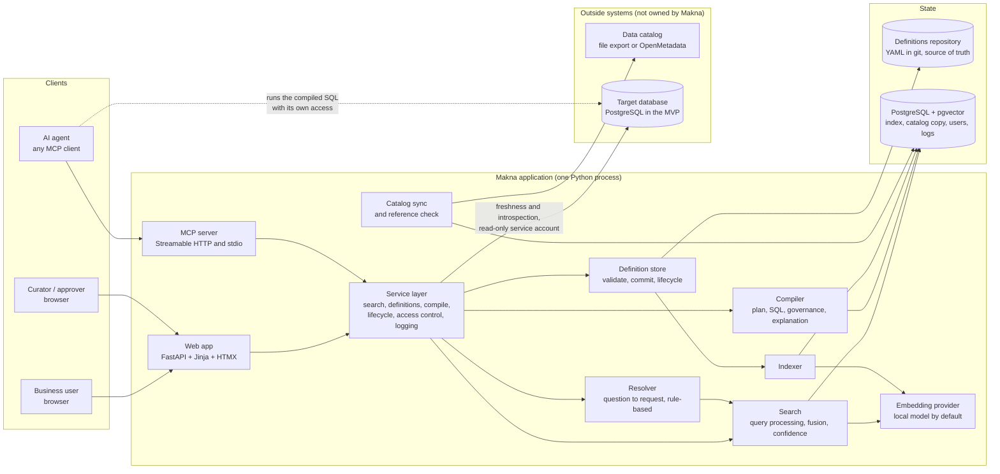

# Architecture

Status: design output (2026-11-11). Written in the design session for the build team. Decisions and their reasons are in `docs/DECISIONS.md` (records DR-1 to DR-13); this document describes the result. Work packages are in `docs/PLAN.md`.

If you find that this document contradicts another source of truth, say so in your report (see `CLAUDE.md`).

## 1. The design in one page

Makna is **one Python application and one PostgreSQL database**, placed between a data catalog and a query engine on one side and people and agents on the other.

- **Meaning lives in YAML files in a git repository** (the "definitions repository"). One file holds one object: a domain, an entity, a metric, or a glossary term. PostgreSQL holds an index built from those files. The index can always be rebuilt from the files.
- **Physical metadata comes from the catalog** through a connector and is copied into PostgreSQL at each sync. Makna never edits it.
- **Search** is one SQL statement that fuses full-text search and vector search over the index.
- **The compiler** turns a structured request (metric, dimensions, filters, time range, grain) into SQL for the target engine (PostgreSQL in the MVP, DuckDB in tests; D-22) by building a syntax tree with sqlglot. It joins only along relationships declared in approved entity files, aggregates each input of a metric separately, and enforces masking.
- **Makna compiles; it never runs a caller's query** (D-21). Agents and people run the compiled SQL with their own tools and their own access to the engine.
- **No language model runs inside Makna in the MVP.** The calling agent is the language model. Makna gives it search results, definitions, and a compiler, and tells it honestly when nothing matches.
- **Three ways in, one service layer.** The web app (server-rendered HTML), the MCP server, and the command line all call the same Python functions in `makna.services`. Rules such as "agents see approved definitions only" live in that layer, not in the interfaces.

Terms used in this document:

- **Official file**: `<name>.yaml`, the approved (or deprecated) version of an object.
- **Proposal file**: `<name>.draft.yaml`, a draft or in-review change to an object, next to its official file if one exists.
- **Simple metric**: a metric built from exactly one measure. Ratio and derived metrics are built from other metrics. The simple metrics that a metric finally depends on are its **inputs**.
- **Balance measure**: a measure taken at snapshot dates that must not be added up over time, such as outstanding principal (`semi_additive: last` in the schema).
- **Pin**: an entry in a metric's `join_paths` that says which join path to use when there is more than one.

## 2. Components



| Component | Python package | What it does | Does not do |
|---|---|---|---|
| Models | `makna.model` | Pydantic models for definitions, catalog metadata, requests, and responses. The shared vocabulary of all other packages. | No I/O. |
| Definition store | `makna.definitions` | Loads YAML, validates it (JSON Schema, then cross-file rules), writes files, commits to git, runs lifecycle transitions. | Does not query PostgreSQL except through the indexer hook. |
| Catalog connectors | `makna.catalog` | The connector interface, the file connector, the OpenMetadata connector, the sync job, and the reference check. | Never writes to a catalog. |
| Engine connectors | `makna.engine` | The engine interface and the PostgreSQL connector: list tables and columns, and the freshness query, with a read-only service account. | Never runs a caller's query or SQL (D-21). |
| Index | `makna.index` | Database tables (SQLAlchemy Core), migrations (Alembic), and the indexer that turns definitions and catalog metadata into index rows and search documents. | |
| Search | `makna.search` | Embedding providers, query processing, the hybrid search statement, and the confidence band. | |
| Compiler | `makna.compiler` | Join graph, request planning, SQL generation with sqlglot, governance checks, explanation. Pure functions over models: no database, no network. | Does not execute SQL. |
| Resolver | `makna.resolve` | Turns a question in words into a request, using search results and rules. Used by the test bench and by one eval. | No language model in the MVP. |
| Services | `makna.services` | The use cases: `search`, `get_definition`, `list_related`, `compile_query`, proposal and approval actions, user and token management, audit and tool-call logging. Applies access rules. | |
| MCP server | `makna.mcp` | Four read-only tools over `makna.services`. | No logic of its own. |
| Web app | `makna.web` | Routes, templates, static files. | No logic of its own beyond form handling. |
| Application | `makna.app` | The composition root: `create_app()` builds the one FastAPI application that `makna serve` runs, and mounts the web routes and the MCP server. | No logic of its own. |
| CLI | `makna.cli` | `makna` command: validate, sync, index, serve, user and token management, freshness. | |

**Dependency rule.** `model` depends on nothing. `compiler`, `definitions`, `catalog`, `engine`, `search`, and `index` depend on `model` (and `index`/`search` on the database). `resolve` depends on `search`. `services` depends on all of them. `mcp` and `web` depend on `services` only (plus `model` and `config`). `app` is the composition root and the only module that imports `web` and `mcp` (and `services`, `model`, `config`). `cli` may also import `definitions`, `catalog`, `index`, `search`, `engine`, and `app` (so that `serve` starts the application without importing `web` or `mcp`), because operator commands (`validate`, `catalog sync`, `index build`, `search`, `catalog compare`) are built before the service layer exists; commands that act for a user or an agent (user and token management, `resolve`) go through `services`; `makna validate` also runs V19 through `makna.services.examples`, a module of the service layer because it needs both `definitions` and `compiler`, which may not import each; and `makna mcp` is only an HTTP bridge (section 12). A test in WP-01 enforces this with an import check.

## 3. Repository layout

```
pyproject.toml              one project, distribution name makna-sl, import package makna (D-9, P-8)
src/makna/                  the packages in the table above
semantic/schema/            makna.schema.json and small validated examples
semantic/definitions/       the sample definitions (lending/...), seed for the dev stack
data/generator/             the seeded synthetic data generator
data/catalog/               lending.catalog.yaml, the file-based catalog export
data/generated/             generator output (not committed)
evals/                      golden set, reference SQL, runners
deploy/                     docker-compose.yml, container files, the init runner (deploy/init.py), PostgreSQL role setup
alembic.ini                 points Alembic at the migrations in src/makna/index/migrations
tests/                      unit/ (DuckDB in-process), integration/ (needs PostgreSQL), engine/ (needs the sample data in PostgreSQL)
spikes/                     design-session experiments, not product code
docs/                       this pack, plus docs/notes/
```

## 4. Data flows

### 4.1 A search (web or MCP)

1. The caller sends a query string, optional `kinds`, and optional `domain`. The service layer adds what the caller may see: agents and viewers get approved objects only; curators also get drafts.
2. **Query processing** (`makna.search.query`): lower-case, split into words, drop English and Indonesian stop words. Build a full-text query that ORs the remaining words (prefix match for words of four or more letters). Compute the query embedding with the configured provider.
3. **One SQL statement** (section 8.2) ranks documents by full-text score and by vector distance, fuses the two rankings, applies the status and kind weights, and returns the top results with both raw scores.
4. **Confidence** (section 8.3): the service computes how much of the query's informative vocabulary appears in the names and synonyms of the top results, and labels the result set `high`, `medium`, or `low`.
5. The service loads the brief form of each hit from `semantic_object` and returns hits plus the confidence band and guidance text.
6. The call is written to `tool_call_log` (section 14).

### 4.2 A compiled query (web test bench or MCP)

1. The caller sends a request: `metric`, `dimensions`, `filters`, `grain`, `time_start`, `time_end`, `limit`.
2. The service loads the approved model snapshot (all approved entities and metrics, from `semantic_object`, cached in memory and refreshed when `index_state.definitions_version` changes).
3. **Plan** (`makna.compiler.plan`): check the metric is approved and has no open reference issue; expand it to its inputs; for every input resolve the join path to every entity named in a dimension or filter; check grain and filter values; apply sensitivity rules. Any failure is a structured error with a code (section 7.7), and nothing is generated.
4. **Generate** (`makna.compiler.sqlgen`): build one aggregate subquery per input, combine the inputs, compute the metric, order, and limit (section 7.5).
5. **Verify** (`makna.compiler.governance`): walk the finished syntax tree and fail if a personal column appears outside a mask or an aggregate.
6. Return the SQL text, the result columns, the explanation steps, and warnings.
7. The call is written to `tool_call_log`.

Makna stops there (D-21). The caller runs the SQL with its own tool and its own access to the engine, for example an agent's database tool. Makna never sees the rows.

## 5. The semantic model

The schema is `semantic/schema/makna.schema.json` (JSON Schema 2020-12). Validated examples are in `semantic/schema/examples/`. Decision record DR-1 explains why this is Makna's own format and how it relates to Apache Ossie and MetricFlow.

### 5.1 Objects

| Kind | What it is | Key fields |
|---|---|---|
| `domain` | A business area used for browsing. | name, label, description |
| `entity` | A business object backed by one physical table. | `source.table`, `primary_key`, `dimensions`, `measures`, `relationships`, `rules` |
| `metric` | A number people ask for. | `type` (`simple`, `ratio`, `derived`), `measure` or `numerator`/`denominator` or `expr`/`inputs`, `filters`, `join_paths`, `format`, `time_grains`, `example_questions`, `example_requests`, `caveats` |
| `glossary_term` | A business word and its meaning. | `related` (objects it explains), `catalog_term` |

Every object carries `name`, `label`, `description`, `owner`, `status`, `sensitivity`, and `synonyms` by language (SEM-2). Metrics, entities, and glossary terms must have at least one English (`en`) and one Indonesian (`id`) synonym (D-19); for domains, dimensions, and rules synonyms are optional. **Dimensions, measures, and relationships are parts of an entity**, not separate files: each has its own description and (for dimensions) synonyms, sensitivity, and masking, and inherits owner and status from its entity.

Inside an entity:

- A **dimension** is a scalar SQL expression over the entity's own columns, with a type (`categorical`, `time`, `boolean`, `numeric`). Categorical dimensions may list their `values` so that people and agents can write filters without querying.
- A **measure** is an aggregation (`sum`, `count`, `count_distinct`, `avg`, `min`, `max`) of an expression over the entity's own columns, with an optional row filter and exactly one `time_dimension`: the official date for that measure. `semi_additive: last` marks a balance measure.
- A **rule** is a named boolean condition over the entity's own columns, written once and reused (D-17), for example `non_performing: days_past_due > 90`. A measure uses one with `rule:`; a metric uses one in `filters` as `{rule: entity.rule}`, on its measure's entity or an entity reachable from it. When a rule changes, review lists every measure and metric that uses it.
- A **relationship** is an approved join from this entity (the "many" side) to another entity (the "one" side), by key columns. These are the only joins the compiler will ever write.

A **metric** is one of:

- `simple`: one measure (`entity.measure`), optional `filters` that are part of the definition (structured filters or rule references; they may use dimensions and rules of joined entities), and optional `join_paths` pins.
- `ratio`: `numerator` and `denominator`, each the name of another metric. A zero denominator gives NULL.
- `derived`: an arithmetic `expr` over the metrics listed in `inputs`.

Every approved metric also has at least one **example request** (D-18): a business question and the structured request (section 7.1, without `metric`) that answers it. It is a verified example an agent can copy, and it must compile (V19), so it cannot drift from the definition.

Expressions (`expr` and `filter` on dimensions, measures, and rules) are plain SQL that sqlglot parses and prints for the target dialect (D-22). They may not contain subqueries, aggregates, or window functions. Metric `filters` and request filters are structured (`dimension`, `op`, `value`), never SQL text.

### 5.2 File layout and lifecycle states

```
<domain>/domain.yaml
<domain>/entities/<name>.yaml
<domain>/metrics/<name>.yaml
<domain>/glossary/<name>.yaml
<domain>/<kinds>/<name>.draft.yaml      a proposal: a new object, or a change to <name>.yaml
```

| State | Where it lives | Meaning |
|---|---|---|
| `draft` | proposal file | Being written. Visible to curators. Never served to agents by default; never compiled. |
| `in_review` | proposal file | Submitted. Waiting for an approver. |
| `approved` | official file | The official version. `version` counts approvals. |
| `deprecated` | official file | Hidden from search by default. Refused by the compiler. Carries a reason and an optional replacement. |

An approved object with a pending change has both files: the official file keeps being served while the proposal is edited and reviewed. Approval replaces the official file with the proposal's content and deletes the proposal file, in one commit (section 10).

### 5.3 Validation rules

Validation has two levels. **Definition errors** block saving a proposal as `in_review` and block approval. **Reference issues** (SEM-4) are found by comparing definitions with the synced catalog; they are reported after every sync and every index run, they block approval, and they make the compiler refuse the affected objects.

Definition errors (`makna.definitions.validate`; each rule has a code used in tests and error messages):

| Code | Rule |
|---|---|
| V01 | The file validates against `makna.schema.json`. |
| V02 | The path matches the content: domain folder, kind folder, file name equals `name`. A proposal file has status `draft` or `in_review`; an official file has `approved` or `deprecated`. |
| V03 | Names are unique per kind across the repository. Inside an entity, dimension, measure, and relationship names are unique. |
| V04 | `domain` names an existing domain. |
| V05 | Every `expr` and `filter` parses with sqlglot and prints for both the `postgres` and `duckdb` dialects, and contains no subquery, aggregate, or window function. |
| V06 | A measure's `time_dimension` names a dimension of type `time` on the same entity. |
| V07 | A relationship's `to` names an existing entity. |
| V08 | A simple metric's `measure` resolves. Ratio and derived metrics resolve to existing metrics, with no cycle. A derived `expr` uses only names in `inputs` and only `+ - * /`, parentheses, numbers, `NULLIF`, and `COALESCE`. |
| V09 | Each `join_paths` entry is a connected chain of relationships that starts at the measure's entity and ends at the keyed entity. |
| V10 | Metric `filters` use dimensions reachable from the measure's entity, never a personal dimension; the value type fits the dimension type; for a categorical dimension with `values`, the value is one of them. |
| V11 | A masking method fits the dimension type: `truncate_date` for `time`; `bucket` for `numeric`; `redact` for `categorical`. |
| V12 | A measure whose expression reads a column of a personal dimension uses `count` or `count_distinct` only. |
| V13 | An approved or in-review metric depends only on approved entities and approved metrics. |
| V14 | A deprecated object has a `deprecation.reason`; `replaced_by`, if present, resolves. |
| V15 | `default_grain` is one of `time_grains`. A metric with a balance measure among its inputs does not offer `day` or `week`. |
| V16 | A measure's `time_dimension` is not a personal dimension (a time range would filter on raw personal dates, and freshness would show one). |
| V17 | A personal dimension has no `values` (they would be returned by `get_definition` and indexed for search). |
| V18 | A measure's `rule` names a rule on the same entity; a metric's `{rule: entity.rule}` names a rule on an entity reachable from its measure; a rule's `expr` reads no column of a personal dimension. |
| V19 | Every example request plans and compiles with no error (checked with the compiler by `makna.services.examples`, which `makna validate` runs, and at submit and approve). Until SQL generation exists (WP-09) the check is that the request plans; it does not need the metric to be approved yet. |
| V20 | A dimension that is not personal reads no column of a personal dimension on the same entity (a copy would bypass masking and refusals). |

Reference issues (`makna.catalog.references`):

| Code | Issue |
|---|---|
| R01 | `source.table` is not in the synced catalog. |
| R02 | A column used in a `primary_key`, relationship key, `expr`, or `filter` is not in the table. Columns are extracted from expressions with sqlglot. |
| R03 | A dimension reads a column whose catalog tags map to a stricter sensitivity than the dimension declares (section 7.6). The dimension is treated at the stricter level until a curator fixes the file. |
| R04 | `catalog_term` on a glossary term does not exist in the catalog. |

### 5.4 Derived facts computed at index time

The indexer computes and stores, for each metric: its inputs; the set of **available dimensions** (section 7.4), each with its entity, description, type, effective sensitivity, and the join path that reaches it; the rules it uses (through its measures and filters); the allowed grains; and a plain-language formula line (for example "NPF Outstanding Principal divided by Outstanding Principal"). Search results, metric pages, `get_definition`, and the compiler's error messages all read these stored facts, so they always agree.

## 6. Internal metadata model

### 6.1 The common catalog model (CON-1)

Every catalog connector returns these models (`makna.model.catalog`). They are the smallest set that OpenMetadata, DataHub, and a hand-written export can all fill (DR-2).

| Model | Fields |
|---|---|
| `CatalogDataset` | `engine_fqn` (the name the query engine uses, `catalog.schema.table`; the key Makna joins on), `catalog_id` (the catalog's own identifier), `name`, `description`, `owners: list[CatalogOwner]`, `tags: list[str]`, `columns: list[CatalogColumn]`, `updated_at` |
| `CatalogColumn` | `name`, `data_type` (normalized: `string`, `integer`, `decimal`, `float`, `boolean`, `date`, `timestamp`, `other`), `native_type`, `description`, `tags: list[str]`, `nullable`, `is_primary_key`, `ordinal` |
| `CatalogOwner` | `name`, `type` (`user` or `team`), `email` |
| `CatalogGlossaryTerm` | `catalog_id`, `name`, `definition`, `synonyms: list[str]`, `related_terms: list[str]`, `tags: list[str]` |

The connector interface (`makna.catalog.base.CatalogConnector`, a `typing.Protocol`):

```python
class CatalogConnector(Protocol):
    name: str
    def list_datasets(self) -> Iterator[CatalogDataset]: ...
    def list_glossary_terms(self) -> Iterator[CatalogGlossaryTerm]: ...
    def check(self) -> None: ...        # raises ConnectorError with a clear message if misconfigured
```

Each connector maps its catalog's table identifiers to `engine_fqn` through its own configuration (for OpenMetadata: a mapping from service name to the engine's database name). Lineage (CON-6) will add an optional method in phase 3; do not add it now.

### 6.2 The file-based catalog format (CON-3)

One YAML or JSON file, validated by a Pydantic model. Any in-house catalog can integrate by exporting this file.

```yaml
format: makna-catalog/v1
source: {name: lending-sample, exported_at: "2026-06-30T00:00:00Z"}
datasets:
  - engine_fqn: lending.core.customers
    catalog_id: lending.core.customers
    name: customers
    description: One row per customer.
    owners: [{name: data-governance, type: team}]
    tags: [Tier.Gold]
    columns:
      - {name: customer_id, native_type: integer, data_type: integer, nullable: false, is_primary_key: true, description: Primary key.}
      - {name: national_id, native_type: varchar, data_type: string, description: National identity number., tags: [PII.Sensitive]}
glossary_terms:
  - {catalog_id: glossary.npf, name: NPF, definition: Financing more than 90 days past due., synonyms: [non-performing financing]}
```

### 6.3 The engine interface (CON-4)

Makna never runs a caller's query (D-21). It talks to the target engine only for its own needs: listing tables and columns (`makna catalog compare`) and the freshness check (section 13), both with one read-only service account from `MAKNA_ENGINE_URL`.

```python
class EngineConnector(Protocol):
    dialect: str                    # sqlglot dialect name: "postgres" (MVP) or "duckdb" (tests)
    def list_tables(self, schema: str) -> list[EngineTable]: ...                    # name, columns(name, native_type)
    def latest_value(self, table: str, expr: exp.Expression) -> date | None: ...    # SELECT MAX(expr): the freshness check
```

The PostgreSQL connector uses `psycopg`. The freshness query is built as a sqlglot tree like every other query. Engine introspection is used by `makna catalog compare`, which reports tables and columns that the catalog and the engine disagree on; it is not a second source of metadata. A Trino connector can be added behind the same interface later (CON-7, D-22).

### 6.4 Database tables

All tables are in the `makna` database. Everything in the first two groups can be dropped and rebuilt from the catalog and the definitions repository.

**Catalog copy** (written only by the sync job)

| Table | Columns |
|---|---|
| `catalog_source` | `id`, `name` unique, `connector`, `last_sync_at` |
| `catalog_dataset` | `id`, `source_id`, `engine_fqn` unique, `catalog_id`, `name`, `description`, `owners` jsonb, `tags` jsonb, `content_hash`, `synced_at`, `removed_at` |
| `catalog_column` | `id`, `dataset_id`, `name`, `data_type`, `native_type`, `description`, `tags` jsonb, `nullable`, `is_primary_key`, `ordinal`, `derived_sensitivity` |
| `catalog_glossary_term` | `id`, `source_id`, `catalog_id`, `name`, `definition`, `synonyms` jsonb |
| `sync_run` | `id`, `source_id`, `started_at`, `finished_at`, `status`, `summary` jsonb (datasets and columns added, changed, removed; reference issues opened and closed) |

**Semantic index** (written only by the indexer)

| Table | Columns |
|---|---|
| `semantic_object` | `id` (`kind:name`), `kind`, `name`, `domain`, `label`, `status` (state of the version being served: `approved`, `deprecated`, or, for an object with no official file, `draft`/`in_review`), `has_proposal`, `proposal_status`, `official` jsonb (the official file's content), `proposal` jsonb, `official_path`, `official_commit`, `proposal_commit`, `version`, `owner_team`, `sensitivity`, `derived` jsonb (section 5.4), `updated_at` |
| `object_edge` | `src_id`, `dst_id`, `type` (`input_of`, `measured_on`, `joins_to`, `uses_rule`, `explains`, `replaced_by`, `same_entity`) |
| `reference_issue` | `id`, `object_id`, `part` (for example `dimension:phone_number`), `code` (R01 to R04), `message`, `opened_at`, `closed_at` |
| `search_document` | `id`, `object_id`, `kind` (`metric`, `entity`, `dimension`, `rule`, `glossary_term`, `domain`, `column`), `status`, `domain`, `names` text, `description` text, `extra` text, `tsv` tsvector (generated), `embedding` vector, `text_hash` |
| `index_state` | `key`, `value` (`last_indexed_commit`, `definitions_version`, `embedding_model`) |
| `data_freshness` | `object_id`, `latest_value` (the newest value of the measure's time dimension), `checked_at` |

**Operational** (not rebuildable; back these up)

| Table | Columns |
|---|---|
| `app_user` | `id`, `email` unique, `display_name`, `password_hash`, `role`, `teams` text[], `is_active`, `created_at` |
| `api_token` | `id`, `user_id`, `name`, `token_hash`, `created_at`, `last_used_at`, `revoked_at` |
| `audit_event` | `id`, `at`, `actor_user_id`, `actor_label`, `action`, `object_id`, `from_status`, `to_status`, `reason`, `commit_sha`; unique on (`commit_sha`, `object_id`, `action`) |
| `tool_call_log` | `id`, `at`, `channel` (`mcp`, `web`, `cli`), `user_id`, `token_id`, `tool`, `request` jsonb (redacted), `result` jsonb (object ids returned, confidence, row count; never row values), `status` (`ok`, `error`, `refused`), `error_code`, `duration_ms` |

**Implementation choices (WP-05).** The semantic index tables have no foreign keys: `object_id` in `search_document` also names catalog columns and glossary terms, which are not `semantic_object` rows, and the sync job writes `reference_issue` before the indexer writes objects. The catalog copy and the operational tables have foreign keys. `data_freshness.latest_value` is a `date`, matching `latest_value` in section 6.3.

**What becomes a search document.** One per approved or deprecated object; one per object that exists only as a proposal (with its proposal status); one per dimension and one per rule of each indexed entity (`dimension:<entity>.<name>`, `rule:<entity>.<name>`); one per catalog column (`column:<engine_fqn>.<name>`, status `approved`; a column whose derived sensitivity is `personal` is returned only to curators and above, never to agents or viewers, so search is not a map of where raw personal data lives); one per catalog glossary term that no Makna glossary term claims through `catalog_term`. `names` holds the name with underscores as spaces, the label, and all synonyms. `extra` holds example questions (including those of example requests), the formula line, value descriptions, and caveats.

## 7. The query compiler

The design was proven in `spikes/compiler/` (see its README for what was and was not proven). The product compiler is written fresh; the spike is a reference for the approach, not code to copy.

### 7.1 The request

```json
{
  "metric": "collection_rate",
  "dimensions": ["branch.region_name", "product.financing_scheme"],
  "filters": [{"dimension": "product.product_category", "op": "in", "value": ["car_backed"]}],
  "grain": "month",
  "time_start": "2026-01-01",
  "time_end": "2026-07-01",
  "limit": 1000
}
```

- One metric per request.
- `dimensions` and filter dimensions are `entity.dimension`.
- `time_start` is inclusive and `time_end` is exclusive; both are ISO dates and both are optional. **Requests never contain relative time** ("last month"). The caller resolves relative time to dates (section 8.4 does this for the test bench, with an explicit "today").
- `grain` is optional. With a grain, the result has a `metric_time` column holding the first day of each period.
- `limit` defaults to 1000 and may not exceed 10000.

### 7.2 Result columns

In this order: `metric_time` (if a grain was requested); one column per dimension named `<entity>__<dimension>`; for ratio and derived metrics, one column per input, named after the input metric; the metric, named after the metric. Rows are ordered by the key columns.

### 7.3 Join paths (QRY-1 "only approved join paths")

Relationships form a directed graph from "many" to "one". To reach entity B from a measure's entity A, the compiler may only walk relationships forward. Walking forward can never multiply rows of A, so no join can inflate a measure.

Rule for choosing the path from A to B:

1. If the metric pins a path for B in `join_paths`, use it.
2. Otherwise find all paths from A to B of up to 4 steps that visit no entity twice. If there is none: error `NO_JOIN_PATH`.
3. If exactly one path is shortest, use it.
4. If several are equally short: error `AMBIGUOUS_JOIN_PATH` at compile time, and at index time the dimensions of B are left out of the metric's available dimensions and a warning is recorded for curators.

In the sample domain, `contract` reaches `branch` by `contract.booking_branch` and by `contract.servicing_branch` (both one step), so every metric that offers branch dimensions pins one. `contract` reaches `customer` directly (one step) and through `application` (two steps); the direct path wins without a pin.

### 7.4 Available dimensions

- For a **simple metric**: every dimension of the measure's entity and of every entity reachable by rule 7.3.
- For a **ratio or derived metric**: a dimension `E.d` is available only if every input can reach `E` **and every input's path enters `E` through the same final relationship**. This prevents dividing a number by booking branch by a number by servicing branch.
- A personal dimension without a masking rule is listed as unavailable with the reason, so agents do not try it.
- "The same final relationship" compares relationship names: two inputs from different tables (for example `payment.contract` and `installment.contract`) enter `contract` through different relationships, so a ratio of them does not offer `contract` dimensions until one input pins a chain that ends in the same relationship (for example `join_paths: {contract: [payment.installment, installment.contract]}` on the payment input). An entity that one input reads itself (`installment` for a ratio with a metric measured on installments) cannot be aligned by a pin. Entities left out because of an ambiguous path or inconsistent inputs are recorded with the reason, and the reason is the warning for curators.

### 7.5 SQL generation

For each input (simple metric), one subquery:

```
SELECT [date_trunc(grain, <time dimension>) AS metric_time,] <dimension exprs>, <agg>(<measure expr>) AS <input name>
FROM <measure entity table> AS t0
LEFT JOIN <next entity on the path> AS t1 ON <relationship keys> ...
WHERE (<measure filter>) AND <metric filters> AND <request filters>
  AND <time dimension> >= DATE time_start AND <time dimension> < DATE time_end
  [AND <time dimension> IN (<last snapshot date per period>)]      -- balance measures only
GROUP BY <the same key expressions>
```

- The time range and grain apply to **each input's own time dimension**. For `collection_rate`, payments are placed by posting date and installments by due date.
- **Balance measures.** The extra condition keeps only rows whose snapshot date is the latest snapshot date in each requested period within the time range (one subquery: `SELECT MAX(date) FROM table WHERE <range> GROUP BY date_trunc(grain, date)`; without a grain, a single `MAX`). So outstanding principal for a quarter is the balance at the quarter's last month end, and without a grain it is the latest balance in the range.
- Joins are `LEFT JOIN`, so rows with a missing dimension key are kept under a NULL dimension value instead of silently dropped.

Then:

- **Simple metric**: the input subquery is the query.
- **Ratio or derived metric**: put each input in a CTE; `UNION ALL` the CTEs, each selecting the key columns, its own value, and NULL for the other inputs; `GROUP BY` the key columns taking `MAX` of each input (wrapped in `COALESCE(..., 0)` for `sum` and `count` inputs); then compute the metric in the outer query. A ratio is `CAST(numerator AS DOUBLE) / NULLIF(denominator, 0)`.

This "aggregate separately, then combine" shape is the core correctness rule. Inputs are never joined row to row. The spike shows the naive join giving a collection rate of 1.0006 where the correct value is 0.9411. `UNION ALL` plus `GROUP BY` is used instead of `FULL OUTER JOIN` because grouping treats NULL keys as equal, needs no null-safe join syntax, and extends to any number of inputs.

All SQL is built as a sqlglot syntax tree and printed for the configured dialect (`postgres` in the MVP; D-22). Expressions from YAML are parsed and their columns bound to a table alias. Filter values become literal nodes. **No SQL text is ever built by string concatenation or formatting.** Because the tree is dialect-neutral, unit tests print the same tree for DuckDB and run it in-process, and the engine tier runs it on PostgreSQL (section 15). `spikes/compiler/run_on_postgres.py` showed both on the spike cases.

### 7.6 Sensitivity and masking (QRY-2, Q-5, DR-5)

Levels, from least to most strict: `public`, `internal`, `confidential`, `personal`.

- **Effective sensitivity of a dimension** = the stricter of (a) the level in the YAML (or the entity's level if the dimension has none) and (b) the level derived from catalog tags on the columns its expression reads. The tag mapping is configuration (`[sensitivity.tag_map]` in `config/makna.toml`; default: `PII.Sensitive` and `PersonalData.Personal` map to `personal`; `PII.NonSensitive` maps to `confidential`). If the catalog starts tagging a column as personal, Makna tightens at the next sync without any YAML change, and opens reference issue R03.
- **Rules for a `personal` dimension:**
  - It can be selected as a dimension only if it has a `masking` rule, and the masked expression is what goes into the SQL: `redact` gives the constant `'***'`; `truncate_date` gives the date truncated to the grain; `bucket` gives the lower bound of a fixed-width band. There is no partial masking such as "last four digits": used as a grouping key, a partly masked identifier still returns one row per person (review R-4).
  - **Minimum group size.** When a request selects a personal dimension, every input's aggregate also counts the distinct primary keys of the entity that holds that dimension. A result group is dropped if any input has rows for it from fewer than `min_group_size` such records (`[governance]` in `config/makna.toml`, default 10). The counts are not returned. The explanation says that groups smaller than the minimum were left out, and how many. This stops a combination of masked and ordinary dimensions (for example birth year, city, and segment) from singling out a customer. Requests without a personal dimension are not affected.
  - Without a masking rule it cannot be selected: error `PERSONAL_DATA_REFUSED`.
  - It can never be used in a filter, masked or not (filtering on an identity number singles out a person): error `PERSONAL_DATA_REFUSED`.
  - A measure may count rows or distinct values of a personal column (V12), because the result is an aggregate. A personal dimension cannot be a measure's official date (V16) and cannot list `values` (V17).
- **No one can unmask through Makna in the MVP.** There is no role that sees raw personal data. Row-level policies (QRY-5) and privileged unmasking are phase 2.
- **Makna accepts no SQL text and runs no caller queries** (D-21). Its join rules and masking hold for the SQL it produces. A caller that also has direct access to the engine can run other SQL; engine access control is the protection there (below).
- **Final check.** After generation, the governance pass walks the tree: every reference to a column read by any personal dimension (whether or not the request selected it) must sit inside a masking expression or inside `COUNT` or `COUNT(DISTINCT ...)`, or compilation fails. `MIN`, `MAX`, and other aggregates do not count, because they return one person's value. This catches mistakes in the generator itself.
- `confidential` and below are not masked in the MVP; the level is shown to people and agents and recorded in logs.

Makna's masking is a property of the SQL it generates. It does not replace access control in the engine: the engine still decides what each user's credentials may read. Because agents run SQL with their own engine access (D-21), an adopter that exposes personal data must also restrict or mask it in the engine.

### 7.7 Errors

Compilation fails with one structured error. Each error has a code, a message that says what to do, and details an agent can act on.

| Code | When | Details returned |
|---|---|---|
| `UNKNOWN_METRIC` | No such metric. | up to 3 close names |
| `NOT_APPROVED` | The metric (or an input) is a draft or in review. | status |
| `DEPRECATED` | The metric is deprecated. | reason, `replaced_by` (as stored, for example `metric:npf_ratio`) |
| `BROKEN_REFERENCE` | An open reference issue affects the metric. | the issues |
| `UNKNOWN_DIMENSION` | The dimension does not exist. | available dimensions |
| `DIMENSION_NOT_AVAILABLE` | It exists but this metric cannot be grouped or filtered by it. | reason, available dimensions |
| `NO_JOIN_PATH`, `AMBIGUOUS_JOIN_PATH` | Section 7.3. Normally caught earlier as `DIMENSION_NOT_AVAILABLE`. | candidate paths |
| `INVALID_GRAIN` | Grain not offered by the metric. | allowed grains |
| `INVALID_FILTER` | Operator or value does not fit the dimension. | expected type, allowed values |
| `INVALID_TIME_RANGE` | Not ISO dates, or start is not before end. | |
| `PERSONAL_DATA_REFUSED` | Section 7.6. | the dimension, and whether a masked form exists |
| `LIMIT_EXCEEDED` | Limit above 10000 (or below 1). | the limit and the maximum |


### 7.8 Explanation (QRY-3)

The compiler returns an ordered list of plain sentences, built while planning, for example:

1. "Collection Rate = Amount Collected divided by Amount Due. Each side is calculated separately and then combined by month and region."
2. "Amount Collected: payments placed by posting date, from 2026-01-01 up to but not including 2026-07-01; reversed payments are excluded (part of the definition)."
3. "Region comes from the servicing branch of the contract (payment, then contract, then servicing branch)."

It also returns `warnings`, for example "Outstanding Principal is a balance: the value for each quarter is the balance at its last month end.", or "3 groups with fewer than 10 customers were left out to protect personal data."

## 8. Search and question resolution

The mechanics were proven in `spikes/search/`. Read its README: two of its findings shaped this section.

### 8.1 Embeddings (SRC-4)

```python
class EmbeddingProvider(Protocol):
    model_id: str
    dimension: int
    def embed_documents(self, texts: list[str]) -> list[list[float]]: ...
    def embed_query(self, text: str) -> list[float]: ...
```

| Provider | Use |
|---|---|
| `fastembed` (default) | Runs `sentence-transformers/paraphrase-multilingual-MiniLM-L12-v2` (384 dimensions, Apache-2.0) inside the Makna process with ONNX on CPU. No data leaves the deployment and no extra service runs (DR-9). |
| `ollama` | Calls a local Ollama server. |
| `openai_compatible` | Calls a hosted or self-hosted endpoint with the OpenAI embeddings API shape. |
| `hash` | A deterministic stand-in (hashed character trigrams) for unit tests and CI. Not for real use. |

The text embedded for a document is its names (twice, so synonyms weigh more) followed by its description. The `embedding` column is `vector` without a fixed size, and the MVP uses exact search with no vector index: at thousands of documents an exact scan takes a few milliseconds and avoids approximate-search recall loss. `index_state.embedding_model` records the model; if the configured model differs, `makna index build` re-embeds everything.

### 8.2 The search statement (SRC-1, SRC-2, SRC-3)

One statement with two ranked lists and a fusion step:

- **Keyword list**: `tsv @@ query`, ordered by `ts_rank_cd`. `tsv` uses the `simple` text search configuration (no stemming, which suits mixed Indonesian and English) with weight A for `names`, B for `description`, C for `extra`. Top 30.
- **Vector list**: ordered by cosine distance to the query embedding. Top 30.
- **Fusion**: `score = (w_keyword / (60 + keyword_rank) + w_vector / (60 + vector_rank)) * status_weight * kind_weight`.

Starting weights, all in `config/makna.toml` under `[search]` and tuned on the golden set in WP-15: `w_keyword = 1.0`, `w_vector = 1.0`; status: approved 1.0, draft and in review 0.5; kind: metric 1.0, glossary term 0.9, entity 0.8, dimension 0.8, rule 0.8, domain 0.7, column 0.6.

Status rules (SRC-3): deprecated documents are excluded unless `include_deprecated` is set. Agents (MCP) and viewers search approved documents only. Curators, approvers, and admins also see drafts, at half weight. Synonyms in both languages are in `names`, the highest-weight field (SRC-2).

The spike found that fusing a weak list with a strong one can lower the first result's accuracy. That is why the weights are configuration and why WP-15 reports keyword-only, vector-only, and fused scores side by side.

### 8.3 Confidence and "nothing matches"

Search always returns its best guesses; rank scores cannot say "none of these is right". The spike showed that raw scores do not separate a valid weak match from no match. So search returns evidence, and three parties share the judgement:

- **Makna computes a confidence band** for the result set. First the query's non-stop words are split into **qualifier words** and **content words**. Qualifier words describe a cut or a period rather than name a metric: time and grain words (the vocabulary of section 8.4, kept in one module, `makna.search.terms`, that the resolver also uses), and words that appear in the names, synonyms, or declared values of an indexed dimension but in no metric or glossary term name. The rest are content words. `coverage` = the share (weighted by inverse document frequency over the `names` field) of the content words that appear in the `names` of any of the top 3 hits. If a query has no content words, the band is `low`. Without this split, valid questions such as "total pencairan per wilayah tahun ini" came out `low` on the spike data, because "wilayah" and "tahun" never occur in metric names (review R-5). `high` if coverage is at least 0.6; `low` if coverage is below 0.3 and the top cosine similarity is below `low_cosine`; otherwise `medium`. `low_cosine` is set in WP-15 from the real model's score distribution; until then only coverage is used. Each hit also lists `matched_terms`.
- **The response says what to do.** With `low` confidence the response carries the guidance "No governed definition clearly matches. Tell the user that no approved metric exists for this; do not approximate it with a different metric."
- **The agent reads the descriptions** of the hits and decides. The tool description tells it to do so (section 12).

The evals measure how often this works (EVL-2 abstention score, and the no-answer questions in EVL-4). Low-confidence searches are the raw material of the phase 2 gaps report (GOV-3); the MVP already logs them.

### 8.4 From a question to a request (Q-3, DR-3)

In the main flow the **agent** does this: it calls `makna_search`, reads the candidates, calls `makna_get_definition` for the one it picks, builds a request, and calls `makna_compile_query`. The compiler validates everything, so a wrong request fails with an actionable error instead of producing wrong SQL.

For the test bench (WEB-4) and as a baseline in the evals, Makna has a **rule-based resolver** (`makna.resolve`). It never calls a language model.

`resolve(question, today, user) -> Resolution` where `Resolution` has `status` (`resolved`, `ambiguous`, `no_match`), `request`, `candidates` (the metric hits with scores), `unresolved_terms`, and `notes`.

1. Search metrics and glossary terms (approved only). A glossary hit contributes its `related` metrics as candidates.
2. `no_match` if confidence is `low`.
3. `ambiguous` if the second candidate metric's score is at least 0.85 of the first **and** their coverage differs by less than 0.15. Return the candidates with their one-line meanings; do not choose. (Example: "What is our NPF?" returns the ratio and the amount.)
4. Otherwise take the first metric, then find:
   - **Dimensions**: match the question's word sequences against the names, labels, and synonyms of the metric's available dimensions.
   - **Filters**: match word sequences against the declared `values` (and their descriptions) of the metric's available categorical dimensions. A matched value becomes an `=` filter. Values that are not declared in YAML cannot be matched; the words are returned in `unresolved_terms`.
   - **Time**: a small bilingual grammar evaluated against `today`: month and year ("June 2026", "Juni 2026"), quarter ("Q1 2026", "kuartal 1 2026", "triwulan I 2026"), half year ("H1 2026", "semester 1 2026"), year, "last month"/"bulan lalu", "this month"/"bulan ini", "last quarter"/"kuartal lalu", "this year"/"tahun ini", "last year"/"tahun lalu", "year to date"/"YTD". No time phrase means no time range, which for a balance metric gives the latest month end.
   - **Grain**: "daily/harian", "weekly/mingguan", "monthly/bulanan/per bulan", "quarterly/kuartalan/per kuartal", "yearly/tahunan/per tahun"; "trend" or "tren" means the metric's `default_grain`.
5. Words that matched nothing and are not stop words go to `unresolved_terms`, shown in the test bench so a curator can see which synonym is missing.

When a question is ambiguous, Makna **returns the options** and never picks silently. The one exception is by design: where governance has already chosen (for example which branch link a metric uses), Makna applies that choice and states it in the explanation.

## 9. Development stack and deployment

`docker compose -f deploy/docker-compose.yml up` starts everything (NFR-1):

| Service | Image | Role |
|---|---|---|
| `postgres` | `pgvector/pgvector` for PostgreSQL 17 | Two databases with separate roles: `makna` (the application, role `makna`) and `lending` (the sample data and the target engine, owned by a loader role). The `makna` role cannot connect to `lending`. A read-only role reads `lending`: Makna's freshness check and catalog comparison use it through `MAKNA_ENGINE_URL`, and so do the engine tests and evals. Its port is published on `127.0.0.1` only. |
| `init` | the Makna image | Runs once (`python -m deploy.init`, an ordered list of idempotent steps kept outside the installed package because it uses the sample-data code in `data/`; a second run changes nothing): generate data if missing, load it into `lending`, run migrations, copy `semantic/definitions/` into a new git repository in a volume, sync the catalog from `data/catalog/lending.catalog.yaml`, build the index, create four demo users (one per role). Each step is added by the work package that builds the feature (see `docs/PLAN.md`). |
| `app` | the Makna image | `makna serve`: web app on `/`, MCP on `/mcp`, health on `/healthz`, one port (8000). |

The requirement lists "API, MCP server, web app" separately; in the MVP they are three interfaces of one process. They can be split into separate processes later without code changes because they share only the service layer.

Why the sample data sits in PostgreSQL and is queried there directly (D-22): it is already in the stack, holds the data durably, loads quickly, and needs no second engine. The semantic layer addresses tables as `lending.core.<table>`. PostgreSQL resolves these three-part names in the current database (`lending`), and DuckDB through an attached database named `lending`; `spikes/compiler/run_on_postgres.py` showed both.

An OpenMetadata server is **not** in the default stack (it needs its own database and a search engine). `deploy/docker-compose.openmetadata.yml` adds it for the connector's integration test (WP-21).

Configuration: secrets and connection settings from environment variables (NFR-4): `MAKNA_DATABASE_URL`, `MAKNA_SECRET_KEY`, `MAKNA_DEFINITIONS_REPO`, `MAKNA_ENGINE_URL` (optional; the target database with a read-only service account, used only by the freshness check and `makna catalog compare`), `MAKNA_EMBEDDING_PROVIDER`, connector secrets such as `MAKNA_OPENMETADATA_TOKEN`. Non-secret settings (search weights, tag map, catalog sources, the SQL dialect, the governance team, the minimum group size) are in `config/makna.toml`. `deploy/.env.example` lists every variable with no values.

Self-hosting (NFR-3): nothing in the running system calls an outside service. The embedding model is downloaded once when the image is built and stored in the image; a build argument points to an internal mirror for sites without internet access.

## 10. The definition store and lifecycle (Q-4, DR-4)

The definitions repository is an ordinary git repository on a path the application can write (`MAKNA_DEFINITIONS_REPO`), with a single branch. Reading needs only the files: until WP-18 adds the write path, the indexer and services read a plain directory and leave the commit columns empty. **The application writes to it by making commits.** It calls the `git` command line through one small wrapper class (`makna.definitions.repo.GitRepo`: `add`, `rm`, `commit`, `log`, `show`, `rev_parse`, `diff_names`). Only commits the application makes can make a definition official; commits made any other way are indexed as proposals (below).

Every lifecycle action is one commit:

| Action | Who | Effect on files | Commit message |
|---|---|---|---|
| `create_proposal` | curator and above | Write `<name>.draft.yaml` with status `draft`. | `propose(metric:x): <reason>` |
| `update_proposal` | the proposal's author, or approver and above | Rewrite the proposal file. If it was `in_review` it returns to `draft`. | `edit(metric:x): <reason>` |
| `submit` | the proposal's author, or approver and above | Status `in_review`. Requires zero definition errors. | `submit(metric:x): <reason>` |
| `approve` | section 11 | Write the proposal's content to `<name>.yaml` with status `approved` and `version` + 1; delete the proposal file. Requires zero definition errors and zero open reference issues for the object. | `approve(metric:x): <reason>` |
| `reject` | approver and above | Status back to `draft`. | `reject(metric:x): <reason>` |
| `withdraw` | author, or approver and above | Delete the proposal file. | `withdraw(metric:x): <reason>` |
| `deprecate` | section 11 | Set the official file to `deprecated` with the reason and optional replacement. | `deprecate(metric:x): <reason>` |

A reason is required for every action (WEB-3). The commit author is the user (`Display Name <email>`), the committer is `Makna`, and the message ends with trailers `Makna-Action`, `Makna-Object`, `Makna-Actor` (user id), and `Makna-Version`.

Order of work inside one action, under a PostgreSQL advisory lock so that one write runs at a time:

1. Check permission. Validate the new content.
2. Insert the `audit_event` row as an intent: action, object, actor, reason, and the SHA-256 of each file the action writes or deletes; `commit_sha` is still empty.
3. Write the files and commit.
4. In one database transaction: re-index the object (and objects whose derived facts depend on it), set `commit_sha` on the intent row, bump `index_state.definitions_version`, set `last_indexed_commit`.

If step 4 fails, git is ahead of the index. `makna index sync` (also run at startup) repairs this: it lists commits after `last_indexed_commit`, and for each one that matches an intent row with an empty `commit_sha` (same object and action, same file hashes) it completes step 4.

**Commits made outside the application are not trusted.** A commit is an application commit only if its sha is in `audit_event`, or it matches an open intent row as above. Commit trailers are not proof, because anyone can write them. Any other commit is an **external change**: a merged pull request, a hand edit, or a coding agent's commit. For each object such a commit touches, `index sync`:

- logs `external_change` with the commit's author;
- indexes the new content as a proposal with status `in_review` and `drafted_by: external:<author email>`, with its validation errors if any (V01 to V20);
- keeps serving the official content of the last application commit for that file (`git show <official_commit>:<path>`).

An external change is therefore never served to agents or viewers as approved, and never skips the rules of section 11. It appears in `/review` like any proposal. Approving it is a normal `approve` by a user who may approve (section 11). That writes a new application commit with `version` + 1. Rejecting it moves the external content to `<name>.draft.yaml` with status `draft` and restores the official file to its last approved content, in one application commit. An organization that reviews definitions as pull requests in a git host can keep doing so, but the merged result still needs one approval in Makna, and that is the approval that counts.

`makna index build` rebuilds the index from `HEAD` and `audit_event`. For each official file it serves the newest version written by an application commit, found with `git log` on the file and matched against `audit_event`. Later external commits on that file become a proposal as above. `init` seeds the repository from `semantic/definitions/` as an application action (`seed`, recorded in `audit_event`), so the sample definitions are approved on a fresh install. In this source repository, those sample definitions are reviewed through the project's own pull requests.

Agents see a change as soon as step 3 commits: every service call reads the index, and the in-memory model snapshot is refreshed when `definitions_version` changes. No restart or redeploy is involved.

The audit log (GOV-1) is therefore stored twice on purpose: in git history (cannot be changed quietly, survives the database) and in `audit_event` (easy to query and show).

## 11. Access control (Q-6, DR-6)

Sign-in is by email and password (Argon2 hash) with a server-side signed session cookie. Agents and scripts use API tokens (random 32 bytes, shown once, stored as a SHA-256 hash), sent as `Authorization: Bearer`. A token belongs to a user and acts with at most the `viewer` permissions of that user. Single sign-on is phase 2 (WEB-5).

| Permission | viewer | curator | approver | admin | agent token |
|---|---|---|---|---|---|
| Search and read approved definitions | yes | yes | yes | yes | yes |
| See drafts and proposals | no | yes | yes | yes | no |
| Compile a query | yes | yes | yes | yes | yes |
| Use the test bench | yes | yes | yes | yes | n/a |
| Create, edit, submit, withdraw proposals | no | yes | yes | yes | no |
| Approve, reject, deprecate | no | owner team only | yes | yes | no |
| See audit log | no | yes | yes | yes | no |
| See tool-call log (query text may still hold a name a user typed) | no | no | yes | yes | no |
| Manage users, tokens of others, catalog sync, index | no | no | no | yes | no |

**Who can approve** (WEB-3 "only owners or approvers"): a user may approve or deprecate an object if they are an approver or admin, **or** they are a curator and the object's `owner.team` is in their `teams`. Three more rules close the gaps around this (D-11, review R-6):

- **Two-person rule.** No user who authored any commit on the proposal may approve it. That covers every commit since the object was last approved, or since it was created for a new object, and includes the authors of external changes, matched by email. `MAKNA_ALLOW_SELF_APPROVAL=true` turns this rule off for single-user installs. The default is `false`, and the dev stack keeps the default (D-11).
- **Which owner team counts.** Approval rights come from the `owner.team` of the official file. For a new object they come from the proposal's `owner.team`, which must be one of the proposer's teams unless the proposer is an approver or admin (checked at `create_proposal`).
- **Changing the owner.** A proposal that changes `owner.team` of an existing object can be approved only by an approver or admin.
- **Loosening sensitivity (D-20).** The approver must also be a member of the governance team (`[governance] team` in `config/makna.toml`, default `data-governance`) when the proposal: declares an object, dimension, or rule at a less strict level than its official version; removes a masking rule or replaces it with a finer one (for example year to month); or creates an object with a `personal` dimension. Being an approver or admin is not enough. Business meaning stays with the owner team; sensitivity is the governance team's call.

API tokens cannot perform any write action, whatever the user's role (D-4).

## 12. The MCP server (MCP-1, MCP-2, MCP-3, Q-7, DR-7)

Built with the official Python SDK (`mcp` 2.x, class `MCPServer`; see `docs/notes/mcp-sdk-2-renamed-fastmcp.md`). Transports: Streamable HTTP mounted in the application at `/mcp` (the main one, with bearer token), and stdio through `makna mcp`. The stdio command is a thin bridge for MCP clients that can only start a local process. It holds only `MAKNA_URL` and `MAKNA_TOKEN`, forwards every message to `/mcp` over HTTP, and has no database settings and no service code. It refuses to start without a token. Every channel therefore has a token-based caller, and no agent process ever holds Makna's database URL. Every tool is read-only and marked with `readOnlyHint`.

**Makna does not run queries** (D-21). `makna_compile_query` returns SQL; the agent runs it with its own database tool and its own engine access, so Makna holds no engine credentials for callers and no tool input or header accepts any. Makna's guarantees (approved joins, masking, refusals) cover the SQL it returns. The server instructions tell the agent to run that SQL unchanged; whether the agent can also run other SQL is decided by the engine's access control, not by Makna.

Server instructions (sent at initialization):

> Makna holds the approved business definitions for this organization's data. To answer a question about a business number: 1) call makna_search with the user's words; 2) call makna_get_definition for the best candidate and check that its description really matches what the user asked; 3) call makna_compile_query with a structured request (the definition's example requests show the format), then run the SQL it returns, unchanged, with your own database tool. Never write SQL yourself for a number that Makna defines. If search confidence is low or no description matches, tell the user that no approved definition exists; do not substitute a different metric. If search reports several candidates, ask the user which one they mean.

Design rules for responses: JSON with short keys that are full words; no nulls or empty lists; descriptions cut to 200 characters in lists; identifiers the agent can pass straight back. Size budgets are tested (WP-13).

### `makna_search`

Description given to the agent:

> Find approved metrics, business terms, entities, and dimensions by meaning. Use this first for any question about a business number or term, in English or Indonesian. Returns up to `limit` ranked hits and a `confidence` of high, medium, or low. If confidence is low, or no hit's description matches the question, no approved definition exists: say so, and do not use a different metric instead. If `ambiguous_between` is present, ask the user to choose.

Input: `query` (string), `kinds` (optional list of `metric`, `glossary_term`, `entity`, `dimension`, `column`; default all but `column`), `domain` (optional), `limit` (default 5, maximum 10).

Output (budget: 2,500 characters at the default limit):

```json
{
  "confidence": "high",
  "ambiguous_between": ["metric:npf_ratio", "metric:npf_outstanding_principal"],
  "guidance": "Two metrics match. Ask the user whether they want the ratio or the amount.",
  "hits": [
    {"id": "metric:npf_ratio", "label": "NPF Ratio", "kind": "metric",
     "description": "Share of outstanding principal that is non-performing at a month end: ...",
     "matched_terms": ["npf"], "type": "ratio", "unit": "percent"}
  ]
}
```

### `makna_get_definition`

> Get the full approved definition of one object by id (from makna_search). For a metric this returns its meaning, formula in words, official date, caveats, the dimensions you may group or filter by, their allowed values, and the allowed time grains. Read this before compiling a query, and use only the dimensions it lists. If the id is unknown, the error lists close ids; if none fits, search again with different words.

Input: `id` (for example `metric:npf_ratio`), `detail` (`brief` or `full`, default `full`).

Output for a metric (budget: 6,000 characters in `full`; `brief` omits dimension descriptions and values):

```json
{
  "id": "metric:npf_ratio", "label": "NPF Ratio", "status": "approved", "version": 3,
  "description": "...", "formula": "NPF Outstanding Principal divided by Outstanding Principal",
  "type": "ratio", "inputs": ["metric:npf_outstanding_principal", "metric:outstanding_principal"],
  "unit": "percent", "owner": "credit-risk", "sensitivity": "internal",
  "time": {"dimension": "contract_snapshot.snapshot_date", "grains": ["month", "quarter", "year"], "default_grain": "month",
           "note": "Balance metric: a period longer than a month reports its last month end."},
  "dimensions": [
    {"ref": "branch.region_name", "description": "Region the branch belongs to.", "type": "categorical",
     "values": ["Jawa Barat", "Jawa Tengah"], "via": "servicing branch"},
    {"ref": "customer.birth_year", "type": "time", "masked": "year only", "filterable": false,
     "note": "groups of fewer than 10 customers are left out"}
  ],
  "unavailable_dimensions": [{"ref": "customer.full_name", "reason": "personal data"}, {"ref": "customer.phone_number", "reason": "personal data"}],
  "rules": [{"ref": "contract_snapshot.non_performing", "description": "A position more than 90 days past due."}],
  "example_requests": [{"question": "NPF ratio by region each quarter from Q4 2025 to Q2 2026",
                        "request": {"dimensions": ["branch.region_name"], "grain": "quarter", "time_start": "2025-10-01", "time_end": "2026-07-01"}}],
  "caveats": "...", "example_questions": ["What is our NPF?"]
}
```

Entities return their description, dimensions, rules, and relationships. Glossary terms return the definition and related objects. Unknown id: error `NOT_FOUND` with up to 3 close ids.

### `makna_list_related`

> List objects related to one object: the inputs of a metric, metrics built from it, metrics on the same entity, the rules it uses (or, for a rule, the metrics that use it), the business terms that explain it, and its replacement if deprecated. Use it to find a nearby metric when the first one is not quite what the user asked for. Returns up to 20 related objects with one-line descriptions. An empty list means nothing is related: go back to makna_search.

Input: `id`, `relation` (optional filter). Output: `{"related": [{"id", "label", "kind", "relation", "description"}]}`, at most 20.

### `makna_compile_query`

> Turn a structured request into SQL for the query engine, using only approved joins and definitions. Use the metric name and the dimension refs exactly as given by makna_get_definition. Dates are ISO dates; time_end is exclusive; resolve words like "last month" to dates before calling. Returns the SQL, the result columns, and an explanation of how the number is built that you can show to the user. On an error, read the code and the details (they list what is allowed), fix the request, and call again.

Input: the request of section 7.1. Output:

```json
{"sql": "...", "dialect": "postgres",
 "columns": [{"name": "metric_time", "role": "time"}, {"name": "branch__region_name", "role": "dimension"},
             {"name": "npf_ratio", "role": "metric", "unit": "percent"}],
 "explanation": ["..."], "warnings": ["..."], "metric": {"id": "metric:npf_ratio", "version": 3}}
```

Errors: `{"error": {"code": "DIMENSION_NOT_AVAILABLE", "message": "...", "details": {...}}}` (section 7.7), returned as a tool error.

**Client compatibility (MCP-3)** is tested in WP-22C with two different clients: the official SDK's client over stdio, and LangChain's MCP adapters over Streamable HTTP. Both list the tools and complete a search, a definition read, and a compile.

## 13. The web app (P-4, D-8)

FastAPI serves HTML rendered with Jinja templates. HTMX (one vendored script) gives partial page updates. The only other JavaScript is the Ace editor (vendored prebuilt files) for YAML editing, chosen over CodeMirror 6 because Ace ships ready-to-use files and CodeMirror 6 needs a bundler (DR-8). Styling is one vendored classless stylesheet (Pico CSS) plus one small project stylesheet. There is no Node.js toolchain and no build step. All forms carry a CSRF token.

| Route | Page | Requirement |
|---|---|---|
| `/` | Search box, domains, recently approved metrics. | WEB-1 |
| `/search?q=` | Results with kind, status badge, one-line meaning. Results update as you type (HTMX). | WEB-1, SRC-3 |
| `/domains/<name>` | Objects of a domain, grouped by kind. | WEB-1 |
| `/metrics/<name>` | Plain-language meaning first; then formula in words, owner, status and version, freshness ("data up to 2026-06-30, checked 2 hours ago"), caveats, example questions (each opens the test bench), dimensions and grains, related objects; for curators: the YAML, history, and reference issues. | WEB-1 |
| `/entities/<name>`, `/glossary/<name>` | The same pattern. | WEB-1 |
| `/edit/<kind>/<name>`, `/new/<kind>` | Ace editor with the YAML. "Check" posts the text and shows errors with line numbers (V01 to V20) without saving. "Save draft" and "Submit for review" ask for a reason. A side-by-side difference with the official version. New objects start from a template per kind. | WEB-2 |
| `/review` | Queue of proposals in review: object, author, reason, difference, validation result, reference issues. Approve and Reject ask for a reason. Buttons are shown only to users who may approve that object. | WEB-3 |
| `/bench` | Type a question. Shows, in order: search hits with scores and matched terms; the resolution (status, chosen metric or the candidates, dimensions, filters, time, unresolved words); the request as JSON, editable; and the SQL and explanation (with a copy button). The bench does not run the SQL (D-21). | WEB-4 |
| `/audit`, `/logs/tool-calls` | Filterable tables (built in WP-19B and WP-19C). | GOV-1, GOV-2 |
| `/admin/users`, `/admin/tokens`, `/admin/catalog` | Users and roles; tokens (both built in WP-16); sync runs and the reference-issue report, with buttons to run a sync and an index sync (built in WP-19C). | WEB-5, SEM-4 |
| `/login`, `/logout`, `/account` | Sign-in; own tokens. | WEB-5 |


**Freshness** (WEB-1): `makna freshness refresh` runs, for each measure, `SELECT MAX(<time dimension>)` on the target database with the read-only service account (`MAKNA_ENGINE_URL`), and stores the result in `data_freshness`. The dev stack runs it in `init`. Without `MAKNA_ENGINE_URL` the page shows "freshness not available". The page also shows the date of the last approval.

## 14. Audit and logs (GOV-1, GOV-2)

- **`audit_event`**: one row per lifecycle action (section 10), with actor, object, states, reason, and commit.
- **`tool_call_log`**: one row per call to `search`, `get_definition`, `list_related`, `compile_query`, and `resolve`, from any channel. `request` holds the query text and request after **redaction**: sequences of 9 or more digits, email addresses, and phone-like numbers are replaced with `[REDACTED]`; the value of any filter on a personal dimension is replaced with `[REDACTED]` whatever the call's outcome; for a call refused with `PERSONAL_DATA_REFUSED`, no free text is stored at all (only the tool, the dimension refs, and the error code). Names and other free-text personal data cannot be detected reliably, so query text kept after redaction may still contain a name someone typed. That is why the tool-call log is visible to approvers and admins only (section 11). GOV-2 reads "with personal data removed where it can be detected" (D-24). `result` holds the ids returned, the confidence band, and the error code. Makna never sees result rows, so none can be logged. Failures and refusals are logged like successes, with `status` and `error_code`.
- Application logs are JSON lines on standard output with a request id. OpenTelemetry traces (GOV-4) are phase 2; the service layer functions are the natural span boundaries.

## 15. Testing strategy (NFR-5)

| Tier | Needs | Covers |
|---|---|---|
| `tests/unit` | Nothing but Python. | Models, validation rules, compiler (SQL compared as syntax trees, and executed on DuckDB by printing the same tree for DuckDB against a small fixture dataset), resolver, redaction, permission matrix. |
| `tests/integration` | PostgreSQL with pgvector (`MAKNA_TEST_DATABASE_URL`). | Indexer, search, definition store with a temporary git repository, lifecycle, services, MCP tools in process, web routes with the FastAPI test client. Uses the `hash` embedding provider. |
| `tests/engine` | PostgreSQL holding the generated sample data (a service container in CI, or a local PostgreSQL). | PostgreSQL connector (introspection, freshness); every approved sample metric compiles and runs on PostgreSQL; compile-correctness evals. |
| `evals/` | Retrieval and compile evals need the dev stack. The agent eval also needs a language model key. | Section 8 of the requirements; see `docs/EVALS.md`. |

DuckDB appears only in tests, as a fast stand-in for the engine. It is not an engine connector and is not shipped.

Coding sessions may have no Docker (D-15). There, the unit tier (including DuckDB) is what runs locally, and results on PostgreSQL count as proven only when CI passes, unless a PostgreSQL is available in the session. The rules are in `docs/PLAN.md`, "How to use this plan".

CI (GitHub Actions): lint (ruff), types (mypy), unit; integration with a PostgreSQL service container; then a job that starts the dev stack and runs `tests/engine` and the retrieval and compile evals with thresholds. The agent eval runs on manual trigger only, in quick mode, when the owner has configured the model key as a CI secret; the full run is started by hand (`docs/EVALS.md` section 5.5).

## 16. Where each requirement is met

| ID | Where in the design | Work package |
|---|---|---|
| CON-1 | 6.1 common catalog model and connector interface | WP-06 |
| CON-2 | 6.1, DR-2 (OpenMetadata, REST) | WP-21 |
| CON-3 | 6.2 file format | WP-06 |
| CON-4 | 6.3 engine interface, 13 freshness | WP-11 |
| CON-5, CON-6, CON-7 | Not in MVP. 6.4 `content_hash` and `sync_run.summary` prepare CON-5. | — |
| SEM-1 | 5.1 (including rules and example requests), `semantic/schema/` | WP-03, WP-08 (V19) |
| SEM-2 | 5.1 common fields | WP-03, WP-04 |
| SEM-3 | 5.2, 10 | WP-03, WP-18 |
| SEM-4 | 5.3 reference issues R01 to R04, 6.4 `reference_issue`, 13 `/admin/catalog` | WP-06, WP-19C |
| SEM-5 | Not in MVP. DR-1 names Apache Ossie as the target. | — |
| SRC-1 | 8.2 | WP-07 |
| SRC-2 | 8.2 (`simple` configuration, synonyms in `names`), 8.1 (multilingual model) | WP-07 |
| SRC-3 | 8.2 status rules | WP-07 |
| SRC-4 | 8.1 | WP-07 |
| SRC-5 | Not in MVP. | — |
| QRY-1 | 7.1 to 7.5 | WP-08, WP-09 |
| QRY-2 | 7.6 | WP-10 |
| QRY-3 | 7.8 | WP-09 |
| QRY-4 | Dropped (D-21): Makna compiles only. | — |
| QRY-5 | Not in MVP. | — |
| MCP-1, MCP-2 | 12 | WP-13 |
| MCP-3 | 12 client compatibility | WP-22C |
| MCP-4, MCP-5 | Not in MVP. The service layer (2) is what an HTTP API will expose. | — |
| WEB-1 | 13 discovery pages, freshness | WP-17 |
| WEB-2 | 13 editor | WP-19 |
| WEB-3 | 10, 11, 13 review queue | WP-18, WP-19B |
| WEB-4 | 8.4, 13 `/bench` | WP-20 |
| WEB-5 (basic) | 11 | WP-12B, WP-16 |
| WEB-6, WEB-7 | Not in MVP. | — |
| GOV-1 | 10, 14, 13 `/audit` | WP-18, WP-19B |
| GOV-2 | 14, 13 `/logs/tool-calls` | WP-12, WP-19C |
| GOV-3, GOV-4 | Not in MVP. 8.3 and 14 record the data GOV-3 needs. | — |
| EVL-1 | `docs/EVALS.md` 2 | WP-14 |
| EVL-2 | `docs/EVALS.md` 3 | WP-15 |
| EVL-3 | `docs/EVALS.md` 4 | WP-15 |
| EVL-4 | `docs/EVALS.md` 5 | WP-22, WP-22B, WP-23 (release gate) |
| EVL-5 | `docs/EVALS.md` 6, 15 | WP-15, WP-22B |
| DAT-1, DAT-2 | `docs/SAMPLE_DOMAIN.md` 3 and 4 | WP-02 |
| DAT-3 | `docs/SAMPLE_DOMAIN.md` 5 | WP-04 |
| NFR-1 | 9 | WP-05, WP-23 |
| NFR-2 | 8.1, 8.2; measured in `docs/EVALS.md` 3 | WP-07, WP-15, WP-23 |
| NFR-3 | 9 self-hosting | WP-07, WP-23 |
| NFR-4 | 9 configuration | WP-01 |
| NFR-5 | 15 | WP-01, WP-23, and the tests of every package |

## 17. Deliberately left out of the MVP

- A language model inside Makna (for resolving questions or drafting definitions).
- An index of actual data values for filters; only values declared in YAML are known to the resolver.
- Unmasking personal data for privileged users; row-level policies (QRY-5).
- Pushing to or pulling from a git remote from inside the application (operators can do it with git and `makna index sync`).
- Publishing approved metrics back into the catalog (D-10, D-16: after the MVP; git stays the source of truth).
- Running callers' queries (D-21): Makna compiles; callers run the SQL with their own tools.
- Trino and other engines (D-22, CON-7): the MVP targets PostgreSQL, with DuckDB in tests.
- A materialization registry of pre-computed metric columns (D-25).
- A built-in chat assistant, an LLM gateway, and any agent write or feedback tool (D-26).
- Linking rules to the pipeline columns that materialize them (lineage, CON-6).
- A public REST API (MCP-4), reranking (SRC-5), incremental sync (CON-5), single sign-on, Indonesian interface text (WEB-6).
